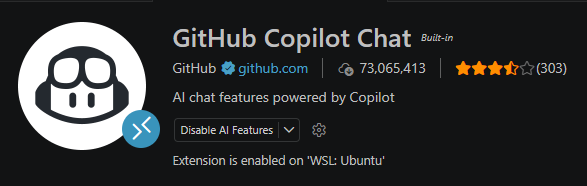
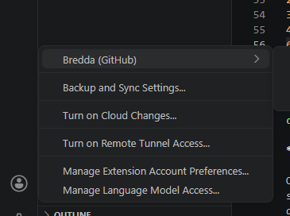
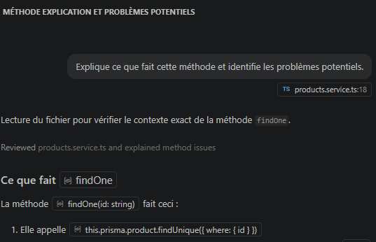
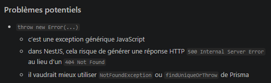
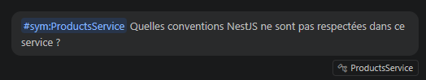
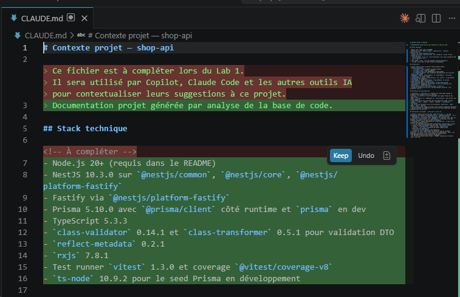
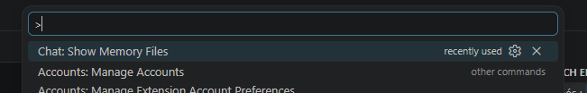
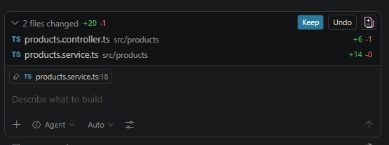
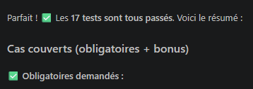

# Module Pratique — GitHub Copilot Javascript

---

## Avant de commencer

### Ce dont vous avez besoin

- Un compte GitHub (gratuit)
- VS Code
- Node.js 20+ installé
- La codebase `shop-api`, disponible sur https://github.com/Younup/shop-api-ia-pratique

### Copilot Free — ce que ça couvre

Le plan gratuit de GitHub Copilot inclut :
- 2 000 complétions de code par mois
- 50 messages Copilot Chat par mois
- Agent mode disponibles

---

## Installation et premiers réflexes

### Objectifs

- Activer Copilot Free et l'installer dans son IDE
- Comprendre les modes disponibles (complétion, chat, edit)
- Écrire un premier fichier de contexte projet (`CLAUDE.md` / `copilot-instructions.md`)

---

### 1.1 Activation de Copilot Free

**Sur GitHub :**

1. Aller sur [github.com/features/copilot](https://github.com/features/copilot)
2. Cliquer sur "Start for free"
3. Se connecter avec son compte GitHub
4. Sélectionner le plan "Free" (pas de carte de crédit requise)

---

### 1.2 Installation de l'extension

**VS Code :**

1. Ouvrir VS Code
2. Aller dans Extensions (`Ctrl+Shift+X` / `Cmd+Shift+X`)
3. Rechercher "GitHub Copilot" (éditeur : GitHub)



4. Vérifier que l'extension officielle est bien activée 
6. Se connecter à son compte GitHub via le menu "Accounts" de VsCode dans la barre latérale gauche




**Vérifier que l'installation fonctionne :**

Ouvrir un fichier TypeScript dans la codebase `shop-api`. Après quelques secondes, une icône Copilot doit apparaître dans la barre de statut en bas de l'éditeur. Si elle est grisée, vérifier la connexion au compte GitHub.

---

### 1.3 Découverte des modes

Ouvrir `src/products/products.service.ts` dans la codebase.

**Mode complétion inline**

Commencer à taper une nouvelle méthode :

```typescript
async findByPriceRange(min: number, max: nu
```

Copilot propose une complétion. Observer la suggestion en gris. `Tab` pour accepter, `Escape` pour ignorer. Taper quelques caractères supplémentaires pour voir la suggestion évoluer.

> **Note :** la suggestion change selon ce qui est déjà dans le fichier. Copilot utilise le fichier ouvert comme contexte principal.

**Copilot Chat**

Ouvrir le panel Copilot Chat de VS Code : icône Copilot dans la barre latérale gauche, ou `Ctrl+Alt+I` / `Cmd+Alt+I`


Sélectionner la méthode `findOne()` dans `products.service.ts`, puis dans le chat :

```
Explique ce que fait cette méthode et identifie les problèmes potentiels.
```



Observer la réponse. Copilot doit mentionner que `Error` générique n'est pas la bonne pratique dans NestJS, `NotFoundException` serait plus approprié.



**Edit mode (modifications multi-fichiers)**

Dans Copilot Chat, taper `#` pour ouvrir l'autocomplete des références disponibles.
Il y a deux types de références.

**Références de symboles** — ce que vous avez découvert : taper `#` suivi du nom
d'une classe, méthode ou fonction ouvre l'autocomplete sur les symboles des fichiers actuels ouverts dans l'éditeur.
Garder `product.service.ts ` ouvert et sélectionner `ProductsService` ajoute `#sym:ProductsService` dans le prompt, avec
la petite icône de fichier dans la liste des références utilisées. C'est le moyen
le plus précis de cibler un contexte spécifique sans envoyer un fichier entier.

**Références de contexte** — quelques-unes particulièrement utiles :

| Référence | Ce qu'elle apporte |
|-----------|-------------------|
| `#codebase` | L'ensemble du workspace, Copilot indexe et sélectionne les fichiers pertinents |
| `#file` | Un fichier spécifique à choisir dans le picker |
| `#selection` | La sélection courante dans l'éditeur |
| `#terminalLastCommand` | La dernière commande exécutée dans le terminal et son output |
| `#changes` | Les modifications non commitées (diff courant) |

La liste complète évolue avec les versions de l'extension.
Référence officielle : [docs.github.com/en/copilot/reference/chat-cheat-sheet](https://docs.github.com/en/copilot/reference/chat-cheat-sheet)

Testez avec la question uivante:

```
#sym:ProductsService Quelles conventions NestJS ne sont pas respectées dans ce service ?
```
Seule la classe `ProductService` sera ajoutée au contexte, et non pas le fichier entier.




---

### 1.4 Écrire le fichier de contexte projet

Le `CLAUDE.md` fourni dans la codebase est un squelette vide. Le compléter est la première vraie tâche du lab.

**Ouvrir `CLAUDE.md`** à la racine de `shop-api`.

**Méthode :** plutôt que de tout écrire manuellement, utiliser Copilot Chat pour explorer la codebase et générer un premier draft :

```
#codebase
Analyse l'ensemble de ce projet NestJS et génère un fichier CLAUDE.md
qui documente :
- La stack technique précise (versions incluses dans package.json)
- L'architecture (pattern utilisé, organisation des modules)
- Les conventions de code observées
- Les contraintes spécifiques à noter pour un outil IA

Sois précis sur les patterns propres au projet, pas sur les généralités TypeScript.
```

**Valider et compléter le draft généré.** Copilot va probablement manquer certaines choses, notamment la dette technique intentionnelle. 

Ouvrez le fichier `CLAUDE.md` et observer les diffs apportées par l'IA. Vous pouvez maintenant les reivewer, valider, rejeter ou amender.



**Copier le contenu dans `.github/copilot-instructions.md`** pour que Copilot l'utilise automatiquement :

```bash
mkdir -p .github
cp CLAUDE.md .github/copilot-instructions.md
```

> **Pourquoi deux fichiers ?** `CLAUDE.md` est la convention de Claude Code. `.github/copilot-instructions.md` est la convention de Copilot. Les deux ont le même contenu, c'est un seul effort, deux outils en bénéficient.

---

## Workflow agentic sur la codebase

### Objectifs

- Appliquer le workflow Specify → Plan → Implement → Validate sur une feature réelle
- Utiliser agent mode de Copilot sur une tâche multi-fichiers
- Écrire un fichier `copilot-instructions.md` qui améliore la cohérence des générations

---

### 2.1 La feature à implémenter

**Contexte :** `shop-api` ne permet pas aujourd'hui de rechercher des produits par nom. On veut ajouter un endpoint `GET /products/search?q=laptop` qui retourne les produits dont le nom contient la chaîne de recherche (insensible à la casse).

C'est une feature volontairement simple, l'objectif est de pratiquer le workflow, pas de résoudre un problème complexe.

---

### 2.2 SPECIFY — Rédiger la spécification

Avant d'ouvrir Copilot, rédigeons la spécification pour être clair de notre côté :

```
Feature : recherche de produits par nom
Endpoint : GET /products/search?q={terme}
Comportement :
  - Recherche insensible à la casse
  - Recherche partielle (contient la chaîne, pas égalité exacte)
  - Si q est vide ou absent, retourner tous les produits (comportement de GET /products)
  - Si aucun résultat, retourner un tableau vide (pas une 404)
Fichiers concernés : products.service.ts, products.controller.ts
Contraintes : utiliser Prisma, respecter les conventions du projet
```

---

### 2.3 PLAN — Amender et valider le plan

Copilot propose un agent **Plan** dédié à cette étape. Deux façons de l'activer.
Dans un nouveau Copilot Chat vierge  :
- Dans le Chat view, cliquer sur le dropdown des agents et sélectionner **Plan**
- Ou taper directement `/plan` dans le chat, suivi de la description de la tâche  

```
/plan Implémenter GET /products/search?q={terme} dans shop-api.
Recherche insensible à la casse sur le nom du produit, partielle (contains),
q vide → tous les produits, aucun résultat → tableau vide.
Fichiers concernés : products.service.ts, products.controller.ts.
```

L'agent Plan analyse la codebase, peut poser des questions de clarification, et produit un plan étape par étape. Il sauvegarde automatiquement ce plan dans `/memories/session/plan.md`,  accessible via la commande `Chat: Show Memory Files` ou directement via le bouton `Open in editor`au dessus de l'input du chat.



Lire le plan et **amender avant de lancer l'implémentation** en répondant dans le chat :

```
Contraintes à intégrer au plan :

Respecter les conventions du fichier copilot-instructions.md
Ne pas modifier les méthodes existantes
Ajouter la route /search avant la route /:id dans le controller
(NestJS évalue les routes dans l'ordre — "search" serait capturé par /:id sinon)
```

Attendre que l'agent mette à jour le plan et reviewer le plan afin de s'assurer qu'il respecte l'nesemble de la spécification et des contraintes.

---

### 2.4 IMPLEMENT — Lancer l'implémentation

Une fois le plan amendé et validé, trois boutons apparaissent sous le plan :

- **Start implementation** — lance l'agent en mode interactif. Il modifie les fichiers
  étape par étape et s'arrête pour demander validation à chaque étape significative.
  Recommandé pour ce lab — permet de surveiller les modifications au fil de l'eau.

- **Start with autopilot** — l'agent exécute le plan en autonomie complète sans
  interruptions. À utiliser quand le plan est bien vérifié et la tâche bien bornée.

- **Open in editor** — ouvre le plan en markdown dans l'éditeur pour le modifier
  manuellement avant de lancer l'implémentation.

Pour ce lab, cliquer sur **Start implementation**.

Surveiller les modifications proposées par l'agent. Copilot affiche les diffs
avant de les appliquer. Ne pas accepter en bloc, lire chaque modification.


---

### 2.5 VALIDATE — Review et test

**Review des modifications dans le Chat view**

Une fois l'implémentation terminée, un accordéon apparaît au-dessus de l'input
du chat avec la liste des fichiers modifiés et le nombre de diffs par fichier.

Pour chaque fichier :
- Cliquer sur le fichier pour l'ouvrir, les blocs de diff sont affichés avec
  des boutons **Keep** et **Undo** par bloc
- **Keep** : accepter la modification du bloc
- **Undo** : rejeter ce bloc spécifiquement sans toucher au reste du fichier

En haut de l'accordéon, des boutons globaux permettent de tout accepter ou tout
rejeter en une fois. A éviter : préférer la review bloc par bloc.



**Ce que vous vérifiez dans chaque fichier :**

Dans `products.service.ts` :
- La méthode `search(query: string)` gère bien le case insensitive
- Le cas `query` vide est géré
- Aucune méthode existante n'a été modifiée

Dans `products.controller.ts` :
- La route `@Get('search')` est bien déclarée **avant** `@Get(':id')`
- Le paramètre de query est récupéré avec `@Query('q')`

**Test manuel :**

```bash
npm run start:dev

# Recherche normale
curl "http://localhost:3000/products/search?q=laptop"

# Insensible à la casse
curl "http://localhost:3000/products/search?q=LAPTOP"

# Aucun résultat → tableau vide, pas d'erreur
curl "http://localhost:3000/products/search?q=zzzzz"

# q vide → tous les produits
curl "http://localhost:3000/products/search?q="
```
---

## Cas d'usage avancés

### Objectifs

- Utiliser Copilot pour explorer du legacy et comprendre une codebase inconnue
- Générer des tests unitaires sur du code existant non testé
- Exercice de vigilance : identifier les erreurs dans du code généré

---

### 3.1 Legacy comprehension — Explorer OrdersService

`orders.service.ts` contient de la dette technique et des incohérences. L'objectif est d'utiliser Copilot pour cartographier ce fichier rapidement.

Dans un nouveau Copilot Chat vierge :

```
#file:orders.service.ts
#file:products.service.ts

Analyse OrdersService et réponds à ces questions :
1. Quelle est la responsabilité principale de ce service ?
2. Quelles dépendances externes utilise-t-il ?
3. Quels problèmes de code ou incohérences identifies-tu ?
4. Y a-t-il du dead code ? Si oui, lequel ?
5. Quels cas limites ne sont pas gérés ?
```

Lire la réponse de Copilot et vérifier :
- A-t-il identifié le bug de calcul de total dans `addItem` ?
- A-t-il mentionné la méthode `calculateDiscount` comme dead code ?
- A-t-il relevé les `Error` génériques au lieu de `NotFoundException` ?

> Si Copilot a manqué certains problèmes, noter lesquels. C'est un exemple concret des limites de la review IA.

---

### 3.2 Génération de tests — ProductsService

Le dossier `test/` est vide. Générer les tests pour `ProductsService`.

Dans un nouveau Copilot Chat vierge :

```
#file:products.service.ts
#file:prisma.service.ts

Génère les tests Vitest pour ProductsService.

Contexte :
- Framework : Vitest
- Mocker PrismaService avec vi.mock() ou en passant un mock dans le constructeur
- Utiliser @nestjs/testing pour instancier le module

Cas à couvrir obligatoirement :
- findAll() : retourne la liste des produits
- findOne() : produit trouvé → retourner le produit
- findOne() : produit non trouvé → lever une erreur
- create() : créer un produit et le retourner
- updateStock() : décrémenter le stock correctement
- updateStock() : que se passe-t-il si le stock descend en dessous de 0 ?

Après génération, liste les cas que tu n'as pas couverts.
```

La génération du premier test peut prendre plusieurs itération par l'agent, qui peut s'emmêler les pinceaux, notamment pour injecter les mocks. Valider simplement les demandes d'exécution des tests lors de ses différentes tentatives.

Au final, les tests sont générés dans `src/products/products.service.spec.ts`.



**Examiner les tests générés :**

Porter une attention particulière au test sur `updateStock` avec un stock qui descend en négatif. Copilot va très probablement générer un test qui **passe** en validant le comportement actuel (stock négatif sauvegardé sans erreur). C'est un exemple concret d'un point d'attention important lorsque l'on génère des tests de la sorte : un test généré valide le comportement tel qu'il est implémenté, pas forcément tel qu'il devrait être.

```
// Ce test va probablement passer  mais est-ce le bon comportement ?
it('should allow negative stock', async () => {
  // ...
})
```

**Lancer les tests :**

```bash
npm test
```

---

### 3.3 Review d'un diff généré

L'agent a généré le diff suivant à partir de cette demande précise :
*"Ajoute une méthode `applyDiscount(orderId, discountPercent)` dans OrdersService
qui applique une remise en pourcentage sur le total de la commande. La remise doit
être entre 0 et 100. Si la commande n'est pas en statut PENDING, lever une erreur."*

La spécification est correcte. L'agent a quand même produit des erreurs.
Passez le diff en revue avant de lire la correction.

```typescript
// orders.service.ts
async applyDiscount(orderId: string, discountPercent: number) {
  const order = await this.getOrderById(orderId)

  if (order.status !== 'PENDING') {
    throw new Error('Cannot apply discount to a non-pending order')
  }

  const discountAmount = this.calculateDiscount(order.total, discountPercent) // (1)
  const newTotal = order.total - discountAmount                               // (2)

  return this.prisma.order.update({
    where: { id: orderId },
    data: { total: newTotal },
  })
}
```

```typescript
// orders.controller.ts
@Post(':id/discount')
applyDiscount(
  @Param('id') id: string,
  @Body('discountPercent') discountPercent: number, // (3)
) {
  return this.ordersService.applyDiscount(id, discountPercent)
}
```

<details>
<summary><strong>Correction: 3 problèmes</strong></summary>

**(1) L'agent a réutilisé du dead code incorrect.**
`calculateDiscount()` existe dans `OrdersService` mais n'est jamais appelée nulle
part, c'est du dead code. Et son implémentation est fausse : elle divise par
`discountPercent / 100` au lieu de multiplier. Pour une remise de 20% sur 100€,
elle retourne 500 au lieu de 20.

L'agent a vu une méthode qui semblait correspondre au besoin et l'a utilisée sans
en vérifier la logique. C'est un cas classique : le nom est trompeur, le code
est présent, la review superficielle ne détecte rien.

**(2) `newTotal` peut devenir négatif.**
La spécification dit que la remise doit être entre 0 et 100 mais l'agent n'a
pas ajouté de validation sur `discountPercent`. Une valeur de 150 produit un total
négatif. La contrainte était dans le prompt, elle n'a pas été implémentée.

**(3) Problème subtil, spécifique à NestJS,  si vous l'avez manqué, c'est normal.**
`@Body('discountPercent')` extrait un champ du body comme string, pas comme number,
même si le type TypeScript annoté est `number`. Sans `ParseFloatPipe`, la valeur
reçue dans le service est la chaîne `"20"`, les calculs arithmétiques produisent
des résultats incorrects silencieusement.

Ce type d'erreur est fréquent sur des frameworks très connus : l'IA connaît NestJS,
génère du code syntaxiquement correct, mais rate une subtilité de comportement
runtime. Le même phénomène arrive avec les décorateurs Angular, les hooks React,
ou les middlewares Express. Des patterns que le modèle a vus des milliers de fois
mais sur lesquels il peut halluciner un comportement qui n'est pas celui de la
vraie implémentation.

</details>

---

## Évaluation pratique

---

**Question 1.** Après avoir installé l'extension Copilot et ouvert la codebase, l'icône Copilot dans la barre de statut est grisée. Quelle est la cause la plus probable ?

- A) La codebase est trop volumineuse pour Copilot Free
- B) L'extension ne supporte pas TypeScript
- C) La connexion au compte GitHub n'a pas été effectuée ou la session a expiré
- D) Le plan Free ne donne pas accès à la complétion inline

> ✅ **Réponse : C** — Une icône grisée indique généralement un problème de connexion au compte GitHub. Se déconnecter et se reconnecter depuis les paramètres de l'extension résout le problème dans la majorité des cas.

---

**Question 2.** L'agent a généré du code avec `calculateDiscount` qui s'avère être du dead code incorrect. Quelle est la meilleure façon de détecter ce type de problème lors de la review ?

- A) Vérifier que le code compile sans erreur
- B) Lancer les tests générés par l'agent, s'ils passent, le code est correct
- C) Lire la logique de chaque méthode appelée, y compris celles qui existaient déjà dans le projet
- D) Comparer le nombre de lignes générées avec ce qui était attendu

> ✅ **Réponse : C** — L'agent réutilise du code existant sans en vérifier la logique. Une review efficace ne se limite pas au code nouvellement généré, elle inspecte aussi les méthodes appelées, surtout quand leur nom semble correspondre au besoin mais que leur implémentation n'a pas été validée.
---

**Question 3.** Dans le workflow SPECIFY → PLAN → IMPLEMENT → VALIDATE, à quelle étape Copilot agent mode est-il utilisé ?

- A) SPECIFY — pour rédiger la spécification
- B) PLAN — pour proposer les étapes d'implémentation
- C) IMPLEMENT — pour exécuter les modifications en autonomie
- D) VALIDATE — pour vérifier le code généré

> ✅ **Réponse : C** — L'agent mode est activé à l'étape IMPLEMENT, après que le plan a été validé. C'est à ce moment que Copilot modifie les fichiers en autonomie selon le plan approuvé.

---

**Question 4.** Lors d'un chat, Copilot propose dans son plan de modifier `products.module.ts` pour exporter la nouvelle méthode `search`. Ce fichier n'était pas dans la spécification initiale. Que faire ?

- A) Accepter automatiquement — Copilot sait ce qui est nécessaire
- B) Évaluer si cette modification est justifiée avant d'accepter
- C) Rejeter toute modification non prévue dans la spécification
- D) Redémarrer l'agent avec une spécification plus précise

> ✅ **Réponse : B** — Une modification non prévue n'est pas forcément mauvaise — elle peut être justifiée. La bonne posture est d'évaluer : est-ce que cette modification a du sens architecturalement ? Si oui, l'accepter. Si non, la refuser et expliquer à l'agent pourquoi.

---

**Question 5.** Lors d'un exercice, Copilot a génèré un test pour `updateStock` qui passe en validant que le stock peut devenir négatif. Ce test est-il correct ?

- A) Oui, le test valide le comportement implémenté, ce qui est la définition d'un bon test
- B) Non,  le test valide un comportement incorrect. Il faudrait d'abord corriger le bug, puis écrire le test qui valide le bon comportement
- C) Oui,  tester les comportements incorrects permet de documenter la dette technique
- D) Non,  Vitest ne peut pas tester les cas de stock négatif

> ✅ **Réponse : B** — Un test qui passe en validant un bug documente le bug mais ne le résout pas. La bonne approche : corriger d'abord `updateStock` pour qu'il lève une exception quand le stock descendrait en négatif, puis écrire le test qui valide ce comportement correct.

---

**Question 6.** Dans l'exercice de vigilance, le problème (1) identifié est que l'agent a réutilisé `calculateDiscount` qui est du dead code incorrect. Quelle pratique du workflow agentic aurait permis d'éviter ce problème ?

- A) Utiliser une température plus basse pour la génération
- B) Valider le plan à l'étape PLAN — le plan aurait dû mentionner l'utilisation de cette méthode, ce qui aurait déclenché une vérification
- C) Toujours générer du code dans un nouveau fichier
- D) Utiliser un modèle plus récent

> ✅ **Réponse : B** — À l'étape PLAN, si l'agent avait mentionné "je vais utiliser `calculateDiscount` pour calculer la remise", c'était l'occasion de vérifier cette méthode et de constater qu'elle est incorrecte. C'est précisément l'utilité de valider le plan avant d'exécuter.

---

**Question 7.** Vous avez modifié le fichier `copilot-instructions.md` pour ajouter une contrainte. Cette contrainte n'est pas respectée dans la génération suivante. Quelle est la cause la plus probable ?

- A) Copilot ignore les fichiers d'instructions sur les projets volumineux
- B) La contrainte est formulée de façon trop vague ou générale pour que Copilot puisse l'appliquer
- C) Il faut redémarrer VS Code pour que les modifications du fichier d'instructions soient prises en compte
- D) Copilot Free ne supporte pas les fichiers d'instructions personnalisées

> ✅ **Réponse : B** — Les contraintes vagues ("écrire du bon code", "respecter les bonnes pratiques") ont peu d'impact. Les contraintes précises et techniques ("les transactions Prisma sont obligatoires dès qu'on modifie plusieurs tables", "utiliser NotFoundException et non Error générique") sont appliquées de façon fiable.

---

**Question 8.** A l'initialisation de votre projet, vous demandez à Copilot d'analyser la codebase pour générer le `CLAUDE.md`. La réponse contient des informations correctes mais manque des contraintes spécifiques au projet. Quelle est la bonne approche ?

- A) Régénérer avec un prompt plus long qui liste toutes les contraintes attendues
- B) Utiliser le draft comme point de départ et le compléter manuellement avec les contraintes manquantes
- C) Accepter le draft tel quel — Copilot a identifié les contraintes importantes
- D) Demander à Copilot de lister lui-même les contraintes qu'il a manquées

> ✅ **Réponse : B** — Le draft généré est un point de départ, pas un livrable final. Les contraintes non évidentes — celles que le modèle ne peut pas deviner depuis le code seul — doivent être ajoutées manuellement. C'est l'investissement qui rend le fichier réellement utile.

---

**Question 9.** Vous travaillez sur une mission et l'équipe cliente n'a pas de `copilot-instructions.md`. Vous en créez un qui reflète les conventions du projet et vous le proposez au tech lead. Il hésite car "ça va changer le comportement de Copilot pour tout le monde". Comment répondre ?

- A) C'est son choix, ne pas insister
- B) Expliquer que le fichier améliore la cohérence des générations pour toute l'équipe et qu'il peut être revu et ajusté collectivement
- C) Créer le fichier sans en parler et voir si quelqu'un remarque la différence
- D) Garder le fichier en local sous un nom différent

> ✅ **Réponse : B** — Le fichier de contexte bénéficie à toute l'équipe et sa maintenance est collective. La bonne approche est d'expliquer la valeur, de proposer une review du contenu, et de le traiter comme n'importe quel fichier de configuration versionné.

---

**Question 10.** Après avoir cliqué sur "Start implementation", l'agent a modifié `products.service.ts` et `products.controller.ts`. Vous ouvrez `products.controller.ts` depuis l'accordéon et constatez que l'agent a ajouté la route `/search` au bon endroit mais a aussi modifié le décorateur de la route `/:id` sans que ce soit demandé. Que faites-vous ?

- A) Accepter tout le fichier via le bouton global, les deux modifications sont liées
- B) Rejeter tout le fichier et relancer l'agent avec une spécification plus précise
- C) Utiliser Keep sur le bloc de la route `/search` et Undo sur le bloc du décorateur modifié
- D) Accepter manuellement en copiant uniquement la partie correcte dans l'éditeur

> ✅ **Réponse : C** — L'accordéon permet une review bloc par bloc avec Keep/Undo par modification. C'est précisément pour ça qu'il ne faut pas utiliser "tout accepter" en bloc — une modification justifiée et une non demandée peuvent coexister dans le même fichier. Keep/Undo par bloc donne le contrôle granulaire nécessaire à une bonne review.

---
