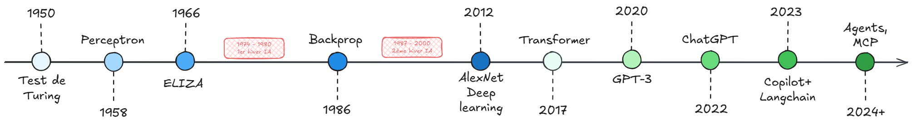
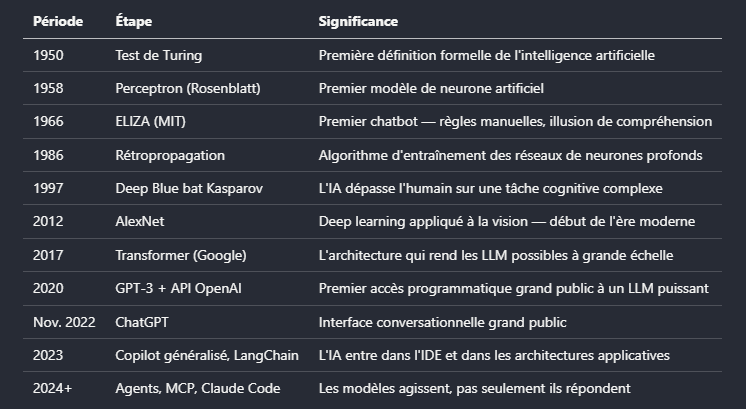
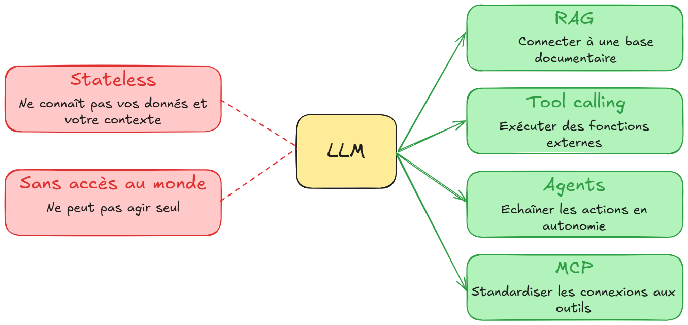
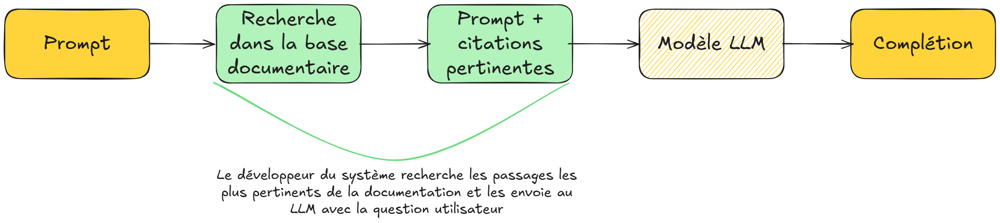
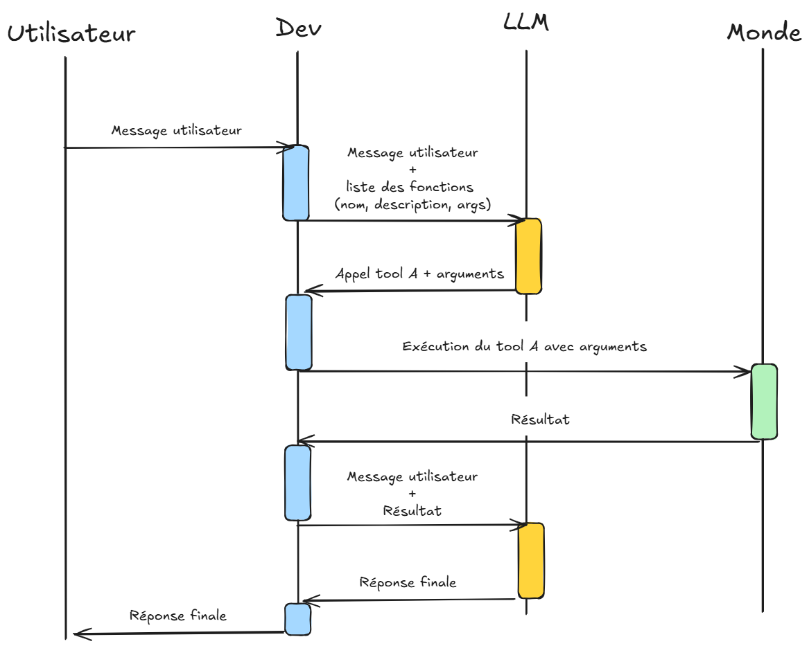
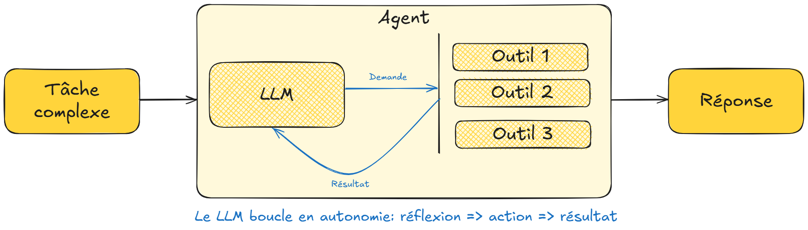
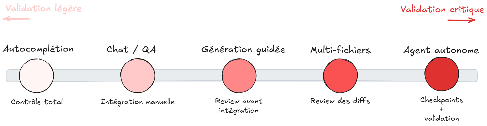
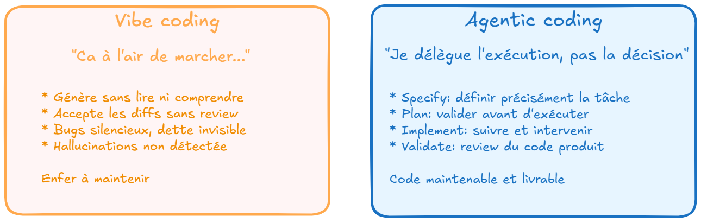

# Chapitre 1 — Ce que l'IA change pour un développeur

---

## 1.1 D'où ça vient — l'essentiel

L'IA générative repose sur 70 ans de recherche. Ce qui change depuis 2022, c'est l'accessibilité programmatique : les LLM sont devenus des API comme les autres, consommables en quelques lignes de code. Pour un développeur, ça signifie que l'IA n'est plus un domaine réservé aux équipes de recherche, c'est une brique d'intégration.





---

## 1.2 La mécanique essentielle

Comprendre comment fonctionne un LLM n'est pas optionnel pour bien l'utiliser. Les concepts suivants ont des implications directes sur la façon de concevoir son utilisation professionnelle et individuelle de l'IA générative.

### Pas de mémoire, pas d'état

Un LLM est fondamentalement **sans état**. Entre deux questions, il ne se souvient de rien. Chaque requête repart de zéro côté modèle.

Ce que ça implique dans la pratique : pour qu'une conversation soit cohérente, c'est l'application (GitHub Copilot, ChatGPT, ...) qui doit gérer l'historique complet à chaque appel. Un assistant qui "se souvient" de ce qu'on lui a dit hier ne mémorise rien lui-même : l'application stocke l'historique et le réinjecte dans chaque prompt.

C'est ce qui rend la **context window** (fenêtre contextuelle) si critique : c'est le seul vecteur d'information dont le modèle dispose à l'instant T.

### Tokens

Un LLM ne lit pas du texte, il lit des tokens. Un token correspond approximativement à ¾ d'un mot en français (les mots courants font souvent un token, les mots rares ou techniques peuvent en faire plusieurs).

Ce que ça implique concrètement :

- Le coût d'un appel API est calculé en tokens (entrée + sortie)
- Toute chose étant égale par ailleurs, le nombre de tokens en entrée et sortie impacte fortement la rapidité de la réponse
- La context window est limitée en tokens
- Un fichier de code de 500 lignes représente environ 5 000 à 8 000 tokens selon le langage


[=> Tool tokenizer visuel de OpenAI](https://platform.openai.com/tokenizer)

### Context window

C'est la quantité totale de texte (ie. tokens) que le modèle peut traiter en une seule fois : prompt système + historique de conversation + instruction courante. Tout ce qui dépasse est **invisible** au modèle.

Comme il n'y a pas de mémoire entre les appels, la context window est souvent chargée intentionnellement : historique de conversation, fichiers de code pertinents, documentation, exemples. Cette accumulation a un coût et une limite.

Quelques repères :

- GPT-5.6 : 400k tokens (~300 000 mots)
- Claude Sonnet 5 : jusqu'à 1M tokens
- gemini-3.8-flash : jusqu'à 1M tokens

Plus la context window est grande, plus le modèle peut prendre en compte de contexte. Mais une fenêtre contextuelle plus grande n'est pas obligatoirement la panacée : si elle est surchargée, elle peut dégrader la qualité de l'attention sur les éléments importants (phénomène [lost in the middle](https://www.emergentmind.com/papers/2307.03172) par exemple).


### Température

La température contrôle le degré d'aléatoire dans la génération du modèle.

Pour comprendre techniquement : à chaque étape, le modèle calcule une distribution de probabilité sur tous les tokens possibles. La température modifie cette distribution avant l'échantillonnage.

- **Température = 0** : le token le plus probable est toujours sélectionné. Comportement déterministe et reproductible.
- **Température élevée (0.7–1.0)** : les tokens moins probables ont plus de chances d'être sélectionnés. Les réponses sont plus variées, parfois plus créatives, parfois moins cohérentes.

En pratique pour un dev :

- **Température basse** pour générer du code, des tests, des données structurées
- **Température haute** pour brainstormer des solutions, générer des alternatives, rédiger de la documentation

### Ce que le modèle fait vraiment

Un LLM prédit le prochain token le plus probable étant donné tout ce qui précède. Il ne "comprend" pas le code au sens humain, il a appris des patterns statistiques sur des milliards de lignes de code.

Conséquence directe : le modèle peut produire du code syntaxiquement parfait qui ne fait pas ce qui est attendu: introduire des bugs subtils qui "ressemblent" à du bon code, ou inventer des APIs qui n'existent pas. C'est ce qu'on appelle une **hallucination**: une réponse plausible mais incorrecte.

> La validation humaine n'est pas une étape optionnelle. C'est la condition pour que l'IA soit un outil plutôt qu'une source de dette technique.

---

## 1.3 Les briques d'intégration

Un LLM seul a des limitations structurelles importantes. Comprendre ces limitations explique pourquoi l'écosystème autour des LLM s'est développé aussi rapidement.



**Limitation 1 : le modèle ne connaît que ce qu'on lui donne.**

Un LLM est entraîné sur des données publiques jusqu'à une certaine date. Il ne connaît pas la documentation interne d'un projet, les contrats d'un client, la codebase propriétaire.

Si on l'interroge sur ces sujets sans lui fournir le contexte, il va soit répondre de façon générique, soit halluciner une réponse plausible.

**Limitation 2 : le modèle ne peut rien faire par lui-même.**

Un LLM seul produit uniquement du texte. Il ne peut pas consulter une base de données, appeler une API, créer un fichier ou pousser un commit. Il est isolé de l'environnement.

**Limitation 3 : l'agent redécouvre la même procédure à chaque fois.**

Un agent qui exécute une tâche récurrente (générer des tests selon vos conventions, faire une revue de PR selon votre checklist) repart de zéro à chaque session. Soit vous retapez le contexte à chaque fois, soit vous l'intégrez dans le fichier de contexte permanent — au risque de le saturer avec des procédures qui ne servent que ponctuellement.

**Limitation 4 : l'agent reste probabiliste même sur ce qui devrait être garanti.**

Demander à un agent de toujours lancer les tests après une modification, ou de ne jamais toucher aux fichiers de migration, fonctionne la plupart du temps. Mais une instruction dans un prompt ou un fichier de contexte reste une consigne que le modèle peut interpréter, oublier en session longue, ou déprioriser face à d'autres contraintes.

Des techniques et outils répondent à ces limitations.

### RAG — Retrieval-Augmented Generation

Réponse à la limitation 1 (connaissance).

Plutôt que d'espérer que le modèle connaisse les bonnes réponses, on lui donne accès à une base de documents au moment où il en a besoin. Avant de répondre, il recherche les passages pertinents et construit sa réponse en s'appuyant dessus.



Cas d'usage typiques : chatbot sur documentation interne, search dans une codebase, assistant sur une base de connaissance métier.

### Function calling / Tool calling

Réponse à la limitation 2 (action). Ce mécanisme permet au LLM de demander l'exécution d'une fonction externe. Le modèle produit une instruction structurée ("appelle cet outil avec ces paramètres"), l'application l'exécute, et renvoie le résultat au modèle qui l'utilise pour construire sa réponse.



C'est la brique de base qui rend les agents possibles.

### Agents et systèmes agentiques

Un agent utilise le tool calling en boucle pour accomplir une tâche complexe en plusieurs étapes. Le modèle décide quels outils appeler, dans quel ordre, en fonction du résultat de chaque étape.



```
Tâche → LLM planifie → appelle outil 1 → reçoit résultat
      → LLM réévalue → appelle outil 2 → reçoit résultat
      → LLM réévalue → produit la réponse finale
```

C'est ce qui permet à Claude Code de lire le projet, d'écrire du code, d'exécuter les tests, de corriger les erreurs, et de recommencer, sans intervention humaine à chaque étape.

### MCP — Model Context Protocol

Standard ouvert (initié par Anthropic et cédé à l'Agentic AI Foundation en décembre 2025) qui standardise la façon dont les agents se connectent aux outils externes. 

Avant MCP : connecter un agent à GitHub + Jira + une BDD = trois intégrations sur mesure à développer et maintenir. Avec MCP : un agent compatible se branche sur tous les outils qui supportent le protocole.

L'écosystème MCP couvre aujourd'hui GitHub, Jira, Atlassian, Salesforce, Playwright, des dizaines de bases de données, et des centaines d'autres connecteurs.

### Skills — le savoir-faire à la demande

Réponse à la limitation 3 : une **skill** est un paquet d'instructions (et éventuellement de scripts ou de ressources) qui documente une procédure précise. L'agent la charge seulement quand la tâche en cours en a besoin, pas en permanence. Concrètement, un fichier `SKILL.md` dans un dossier `skills/`, invocable en commande explicite (`/generate-tests`) ou déclenché automatiquement quand l'agent détecte que la tâche correspond.

C'est la même logique que le fichier de contexte projet (Chapitre 3) mais appliquée à des procédures ponctuelles plutôt qu'à des règles permanentes : le fichier de contexte dit "voici comment ce projet fonctionne", une skill dit "voici comment faire cette tâche précise, quand elle se présente".

### Hooks — l'automatisation déterministe

Réponse à la limitation 4 : un **hook** est un script (commande shell, appel HTTP, appel d'outil MCP) déclenché automatiquement par l'application à un point précis du cycle de vie de l'agent — avant qu'il modifie un fichier, après qu'il termine une session, avant qu'il exécute une commande. Contrairement à une instruction dans un prompt, un hook s'exécute systématiquement : ce n'est plus une probabilité, c'est du code.

Exemple : un hook post-édition qui relance automatiquement la suite de tests dès qu'un fichier source est modifié, sans dépendre du fait que l'agent "pense" à le faire.

### Composer ces briques : subagents et plugins

Une fois skills, hooks, tool calling et MCP disponibles, deux niveaux de composition permettent de les organiser à plus grande échelle :

- Un **subagent** est un agent secondaire, à contexte isolé et éventuellement à modèle dédié (un modèle rapide et économique pour une tâche de recherche répétitive, le modèle principal réservé au raisonnement), invoqué par l'agent principal pour une sous-tâche précise.
- Un **plugin** empaquette skills, hooks, subagents et serveurs MCP dans une unité versionnée, installable en une commande depuis un dépôt Git ou un marketplace. C'est le niveau qui permet de partager une configuration d'agent complète entre développeurs ou entre projets — sujet du Chapitre 4 (panorama) et du Chapitre 6 (pratique d'équipe).

---

## 1.4 Le marché des modèles — ce qu'un dev doit savoir

### GPT — OpenAI

Intégré dans GitHub Copilot, Azure OpenAI Service. Depuis l'été 2026, OpenAI structure sa gamme en paliers de capacité nommés, indépendants du numéro de génération : **Sol** (le plus capable), **Terra** (l'équilibre courant), **Luna** (rapide et économique, gros volumes). Le chiffre identifie la génération (GPT-5.6, puis GPT-6), le nom identifie le palier — les deux évoluent indépendamment. Variante à connaître pour le dev : les déclinaisons **Codex**, entraînées spécifiquement sur la génération de code et l'exécution agentic longue durée.

### Claude — Anthropic

Performances élevées sur les tâches de code long et de refacto complexe, context window large (jusqu'à 1M tokens sur Sonnet). La gamme s'organise en paliers : **Haiku** (rapide, économique), **Sonnet** (l'équilibre quotidien, le choix par défaut pour la plupart des tâches de dev), **Opus** (les tâches les plus longues et les plus exigeantes), et **Fable** (au-dessus d'Opus, avec des garde-fous renforcés sur les usages à haut risque type cybersécurité/bio). Un palier **Mythos**, encore plus capable, existe mais reste à accès restreint. **Claude Code** est l'outil agentic natif: il lit le projet, planifie, exécute, itère. Nécessite un abonnement payant (Pro minimum) — pas de plan gratuit dédié, contrairement au chat claude.ai.

### Gemini — Google DeepMind

Context window très large (jusqu'à 1M tokens en tête de gamme). Intégration native dans Firebase, Google Cloud et l'écosystème Google. Segmentation par palier : **Pro** (capacité maximale, raisonnement complexe), **Flash** (le workhorse — bon rapport coût/performance, taillé pour l'agentic et le développement logiciel), **Flash-Lite** (le plus économique, gros volumes). Dernière sortie notable pour le dev : **gemini-3.8-flash** (septembre 2026), qui progresse spécifiquement sur l'ingénierie logicielle longue durée et le raisonnement agentique multi-étapes. **Gemini CLI** est gratuit avec un quota généreux, un bon point d'entrée.

### Mistral — Mistral AI 🇫🇷

Modèles disponibles en open source ou via API, déployables on-premise ou sur infrastructure souveraine. Gamme structurée par taille et par usage : **Large** (le flagship, raisonnement et tâches agentiques les plus exigeantes), **Medium** (bon compromis coût/performance sur le code et l'agentique), **Codestral** (spécialisé code, large context window), et **Devstral** (taillé pour l'agentic coding, conçu pour tourner dans des scaffolds d'agents comme Claude Code ou Codex CLI). Pertinent quand les contraintes de confidentialité excluent les providers cloud américains.

**Ce qui compte pour choisir un modèle :** la qualité sur le type de tâche (benchmark de code), la taille de la context window, les contraintes data client, et le coût par token. Pas le marketing.

---

## 1.5 Le spectre de délégation

L'IA dans le développement n'est pas un interrupteur on/off. C'est un spectre continu entre deux positions, et la bonne position dépend de la tâche, du contexte, et de la maîtrise du domaine.



**Autocomplétion inline**
Le modèle complète ce qui est tapé. Le contrôle reste total: chaque suggestion peut être acceptée ou refusée. Risque minimal pour valeur immédiate. C'est le mode le plus universel.

**Chat / Q&A**
Une question, une réponse. Utile pour déboguer, comprendre une API inconnue, expliquer du legacy. Le développeur intègre manuellement ce qui est pertinent.

**Génération guidée**
Une tâche est décrite, le modèle génère une fonction, un test, un composant. Le développeur lit et valide avant d'intégrer. C'est là que la qualité du prompt commence à compter vraiment.

**Edit mode / multi-fichiers**
Le modèle modifie plusieurs fichiers selon les instructions. Le développeur review les diffs avant d'accepter.

**Agent autonome**
Le modèle planifie, exécute et itère de façon autonome sur une tâche complexe. Le développeur spécifie l'objectif et valide à des checkpoints. C'est là que le mode agentique (Chapitre 2) devient indispensable.

---

## 1.6 Vibe Coding vs Agentic Coding



### Vibe Coding

Générer du code sans le lire, sans le comprendre, sans le valider, en se fiant au fait que "ça a l'air de marcher". C'est tentant parce que c'est rapide et ce n'est pas condamnable en soi : c'est typiquement le bon choix pour un prototype jetable, une exploration personnelle, un POC de démonstration, bref tout code qui n'a pas vocation à survivre.

Le risque apparaît quand ce même code change de destination : quand il glisse en production, ou devient la base d'une feature livrée à un client, sans repasser par une phase de compréhension et de validation. C'est là que les problèmes deviennent réels :

- **Bugs silencieux** : le code compile, les tests passent, mais la logique est fausse sur des cas limites. On ne s'en aperçoit qu'en production.
- **Dette technique invisible** : du code généré sans compréhension est du code que personne ne sait maintenir.
- **Perte de maîtrise progressive** : plus on accepte sans comprendre, moins on est capable de déboguer ce que l'IA a produit.
- **Hallucinations non détectées** : une API inventée, une dépendance manquante, une condition logique inversée. Sans review, ça passe sous le radar.

Le critère qui bascule le vibe coding en risque n'est donc pas le mode de génération, c'est **la destination du code**.

### Agentic Coding

Collaborer de façon structurée avec l'IA, tout en restant aux commandes. Le dev délègue l'exécution, pas la décision.

```
SPECIFY  →  Définir précisément la tâche, les contraintes, le contexte
PLAN     →  Faire proposer un plan par le modèle, le valider avant d'exécuter
IMPLEMENT →  L'IA génère, le dev suit et intervient si nécessaire
VALIDATE →  Review du code produit, tests, vérification de la logique
```

Sur des tâches simples et bien bornées, la validation prend quelques secondes. Sur des tâches complexes, elle évite de passer des heures à déboguer du code qu'on n'a pas écrit.

### Le spectre entre les deux

Ce n'est pas un binaire. Un développeur expérimenté peut naviguer entre les deux selon le contexte :

- **Autocomplétion courte** → acceptance rapide sans review approfondie est acceptable
- **Exploration d'une feature** → vibe coding rapide pour confronter l'idée au besoin
- **Génération d'une fonction critique** → review ligne par ligne
- **Tâche multi-fichiers en agent mode** → checkpoints réguliers, validation des diffs

La compétence clé : savoir calibrer le niveau de délégation et de validation selon la criticité de la tâche.

---

## 📖 Glossaire du module

Les termes suivants sont utilisés tout au long des 6 chapitres.

---

**Agentic coding**
Approche structurée de collaboration avec l'IA : Specify → Plan → Implement → Validate. Le dev reste décisionnaire, délègue l'exécution.

**Agents / Systèmes agentiques**
Architectures où le modèle enchaîne plusieurs actions en autonomie pour accomplir une tâche complexe en s'appuyant sur le tool calling.

**AGENTS.md**
Fichier de contexte projet standardisé, lu nativement par la plupart des outils agentiques (Copilot, Cursor, Codex, Gemini CLI...). Né chez OpenAI en 2025, gouverné aujourd'hui par l'Agentic AI Foundation aux côtés de MCP.

**Chain of thought (CoT)**
Technique de prompting qui demande au modèle de raisonner étape par étape avant de répondre. Améliore significativement la qualité sur les tâches de raisonnement et les algorithmes complexes.

**Chunking**
Découpage d'un document ou d'une codebase en segments pour l'indexation dans un système RAG. La qualité du chunking impacte directement la qualité des réponses.

**Context window**
Mémoire de travail du modèle. Quantité totale de texte (prompt + historique + réponse) qu'il peut traiter en une seule fois. Mesurée en tokens.

**Embeddings**
Représentations vectorielles de texte ou de code. Permettent de mesurer la similarité sémantique entre deux passages. Base technique du retrieval dans les systèmes RAG.

**Few-shot**
Technique de prompting qui fournit 2 à 5 exemples dans le prompt pour guider le format ou le style de la réponse. Très efficace pour les tâches répétitives et structurées.

**Fine-tuning**
Ré-entraînement d'un modèle existant sur un dataset spécifique. Coûteux, complexe, rarement nécessaire, le RAG et le prompt engineering couvrent la majorité des besoins.

**Hallucination**
Réponse plausible mais incorrecte produite par le modèle. Peut prendre la forme d'une API inventée, d'une logique erronée, ou d'un fait inexact. Inévitable. La validation humaine est la parade.

**Hook**
Script (commande shell, appel HTTP, appel d'outil MCP) déclenché automatiquement par l'application à un point précis du cycle de vie de l'agent (avant une modification, après une session…). Rend déterministe un comportement qui ne reposerait sinon que sur une instruction probabiliste.

**MCP (Model Context Protocol)**
Protocole standard initié par Anthropic (puis cédé à l'Agentic AI Foundation, aux côtés d'AGENTS.md), et massivement adopté par l'industrie. Permet à un agent de se connecter à des outils externes (GitHub, Jira, BDD…) sans développement spécifique pour chaque connexion.

**On-premise**
Déploiement d'un modèle sur l'infrastructure propre de l'organisation. Aucune donnée ne sort du périmètre. Requis pour les contraintes de souveraineté maximales.

**Plugin (agent plugin)**
Unité versionnée qui empaquette skills, hooks, subagents et serveurs MCP, installable en une commande depuis un dépôt Git ou un marketplace. Permet de partager une configuration d'agent complète entre développeurs ou entre projets, plutôt qu'un simple fichier de contexte à copier-coller.

**Prompt / Prompt engineering**
Instruction envoyée au modèle. Le prompt engineering est l'art de formuler des instructions qui produisent des résultats fiables et prévisibles (Chapitre 3).

**RAG (Retrieval-Augmented Generation)**
Architecture qui connecte un LLM à une base documentaire ou de code : avant de répondre, le modèle recherche les passages pertinents et s'appuie dessus. Résout le problème des données internes inconnues du modèle.

**Retrieval**
Étape de recherche dans un système RAG : trouver les passages les plus pertinents dans la base pour répondre à une question donnée. La qualité du retrieval conditionne la qualité des réponses.

**Skill (agent skill)**
Paquet d'instructions (et éventuellement de scripts ou ressources) qui documente une procédure précise, chargé par l'agent à la demande plutôt qu'injecté en permanence dans le contexte. Concrètement, un fichier `SKILL.md`, invocable en commande ou déclenché automatiquement.

**Structured output**
Capacité du modèle à produire une réponse dans un format structuré (JSON, XML, schéma défini). Indispensable pour l'intégration dans des pipelines applicatifs.

**Subagent**
Agent secondaire à contexte isolé, éventuellement rattaché à un modèle dédié, invoqué par l'agent principal pour traiter une sous-tâche précise sans polluer le contexte principal.

**System prompt**
Instruction permanente envoyée au modèle avant chaque échange. Définit le rôle, les contraintes, le contexte. Équivalent programmatique du `AGENTS.md`.

**Température**
Paramètre qui contrôle l'aléatoire de la génération. Basse = déterministe (code, tests). Haute = varié (brainstorming, alternatives).

**Token**
Unité de traitement et de facturation d'un LLM. ~¾ d'un mot en français. Détermine le coût des appels API et la limite de la context window.

**Tool calling / Function calling**
Mécanisme permettant au LLM de demander l'exécution d'une fonction externe (API, BDD, fichier). L'application exécute et renvoie le résultat. Brique de base des agents.

**Vibe coding**
Générer du code sans le lire ni le valider, en jugeant uniquement au résultat. Pertinent pour itérer vite sur du code jetable (POC, prototype, exploration). Risqué dès que ce code vise la production : bugs silencieux, dette technique invisible, perte de maîtrise progressive.

**Zero-shot**
Technique de prompting sans exemple, on donne uniquement l'instruction. Fonctionne bien pour les tâches simples et bien définies.

---

## ✅ Quiz — Chapitre 1

_8 questions — environ 8 minutes_

---

**Question 1.** De quelle façon un LLM génère-t-il sa réponse ?

- A) Il recherche la réponse exacte dans sa base de données d'entraînement
- B) Il prédit le token suivant le plus probable, étape par étape
- C) Il formule plusieurs réponses candidates et sélectionne la meilleure
- D) Il traduit le prompt en requête structurée puis reformule le résultat

> ✅ **Réponse : B** — C'est le mécanisme fondamental : prédiction token par token. Pas de base de données, pas de sélection entre alternatives. Une génération séquentielle probabiliste.

---

**Question 2.** On envoie un fichier de 800 lignes de TypeScript dans notre prompt. Qu'est-ce que ça implique en termes de context window ?

- A) Rien. Les modèles modernes ont une context window illimitée
- B) Le fichier sera tronqué automatiquement à 500 lignes
- C) Environ 8 000 à 12 000 tokens consommés sur la context window disponible
- D) Le modèle ne peut pas traiter du code directement, seulement du texte

> ✅ **Réponse : C** — 800 lignes de TypeScript représentent environ 8 000 à 12 000 tokens selon la densité du code. Ça compte dans le budget de la context window et dans le coût de l'appel API.

---

**Question 3.** Pour générer des tests unitaires déterministes sur une fonction existante, quelle température est la plus adaptée ?

- A) Haute (0.8–1.0): pour avoir des cas de test variés et créatifs
- B) Moyenne (0.4–0.6): pour un équilibre entre créativité et précision
- C) Basse (0.0–0.2): pour des résultats reproductibles et prévisibles
- D) La température n'a aucun impact sur la génération de tests

> ✅ **Réponse : C** — Les tests doivent être déterministes et précis. Température basse = comportement reproductible. La créativité n'est pas un critère souhaitable ici.

---

**Question 4.** Vous voulez fournir à un agent des instructions à appliquer, de façon pérenne, chaque fois qu'il génère des tests (framework à utiliser, cas à couvrir, conventions de mock). Quel est le meilleur moyen ?

- A) Rédiger un prompt détaillé et le retaper à chaque demande de génération de tests
- B) Configurer un hook qui s'exécute après chaque modification de fichier
- C) Créer un subagent dédié, avec son propre contexte isolé
- D) Écrire une skill dédiée à la génération de tests, chargée à la demande

> ✅ **Réponse : D** — Une skill est exactement faite pour ça : une procédure précise, écrite une fois, chargée par l'agent seulement quand la tâche correspond. Le prompt retapé (A) n'a rien de pérenne. Le hook (B) automatise une action déterministe (relancer une commande) mais ne porte pas des instructions de génération. Le subagent (C) isole un contexte mais ne résout pas en soi le besoin d'instructions réutilisables.

---

**Question 5.** Une hallucination dans un contexte de génération de code, c'est quoi concrètement ?

- A) Le modèle génère du code dans le mauvais langage
- B) Le modèle produit du code syntaxiquement correct mais logiquement faux, invente des APIs ou des dépendances
- C) Le modèle refuse de générer du code sur certains sujets
- D) Le modèle répète plusieurs fois le même bloc de code

> ✅ **Réponse : B** — Une hallucination c'est une réponse plausible mais incorrecte. En code : une API qui n'existe pas, une logique inversée, une dépendance manquante. Le code compile mais il est faux.

---

**Question 6.** Sur le spectre de délégation, dans quel mode la validation humaine est la plus critique ?

- A) Autocomplétion inline
- B) Chat / Q&A
- C) Génération guidée d'une fonction
- D) Agent autonome sur une tâche multi-fichiers

> ✅ **Réponse : D** — Plus la délégation est large et la tâche complexe, plus la validation est critique. Un agent autonome peut modifier de nombreux fichiers en chaîne. Chaque diff mérite une review attentive.

---

**Question 7.** Laquelle de ces situations décrit du vibe coding ?

- A) Accepter une suggestion d'autocomplétion d'une ligne après l'avoir lue
- B) Utiliser Copilot Chat pour comprendre une fonction legacy avant de la modifier
- C) Sur un POC jetable, laisser l'agent générer 15 fichiers, vérifier que la démo fonctionne et enchaîner directement sur l'itération suivante sans relire le code
- D) Demander au modèle de proposer plusieurs implémentations d'un algorithme pour choisir la meilleure

> ✅ **Réponse : C** — On juge au résultat, pas au code : c'est la définition même du vibe coding. Et ici, c'est un usage pertinent : sur un POC destiné à être jeté, la vitesse d'itération prime et permet de confronter très vite une idée au besoin. La vigilance s'impose seulement si ce code change de destination (production, base d'une feature client) : il doit alors repasser par une phase de review et de validation.

---

**Question 8.** Dans le workflow agentic Specify → Plan → Implement → Validate, à quelle étape le dev reprend le plus activement la main ?

- A) Specify: c'est l'étape la plus longue
- B) Plan: valider le plan avant d'exécuter est la décision clé
- C) Implement: le dev code en parallèle de l'IA
- D) Validate: c'est la seule étape qui compte vraiment

> ✅ **Réponse : B** — Valider le plan avant d'exécuter est l'étape critique : c'est là qu'on évite de laisser l'IA partir dans une mauvaise direction pendant 20 minutes. Validate est aussi important, mais si le plan est bon, la validation est plus légère.
