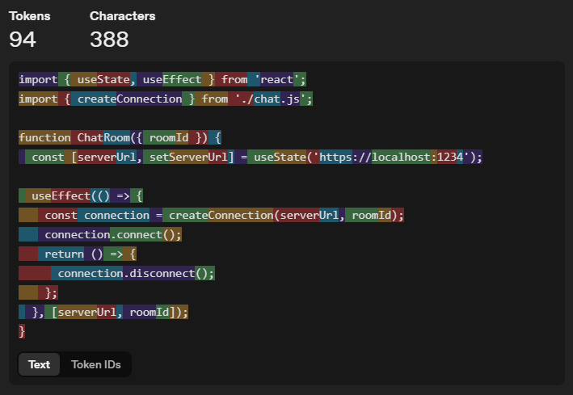
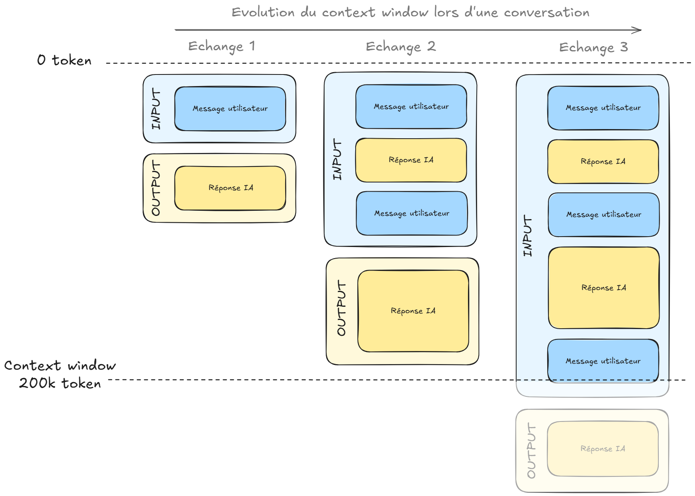
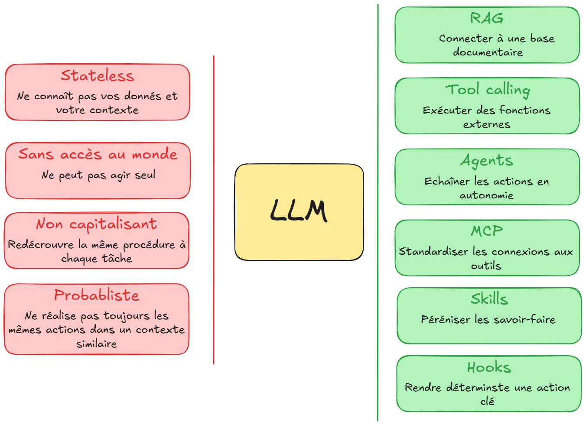

# Chapitre 1 — Ce que l'IA change pour un développeur

---

## 1.1 D'où ça vient — l'essentiel

L'IA générative repose sur 70 ans de recherche, avec ses périodes d'enthousiasme et ses « hivers » de désillusion. Le tournant technique date de 2017 : l'architecture **Transformer** (Google) rend possible l'entraînement de modèles de langage à très grande échelle, les LLM (*Large Language Models*). En 2020, GPT-3 est le premier LLM puissant accessible par une API.

Pour le grand public, la bascule vient plus tard : fin 2022, ChatGPT, qui s'appuie sur GPT-3.5, montre qu'une simple interface conversationnelle suffit à rendre ces modèles utilisables par tous. Dans la foulée, l'IA entre dans l'IDE (Copilot) et dans les architectures applicatives (LangChain), puis les modèles se mettent à agir et pas seulement à répondre : agents, MCP.

Ce qui change pour un développeur, c'est l'accessibilité programmatique : les LLM sont devenus des API comme les autres, consommables en quelques lignes de code. L'IA n'est plus un domaine réservé aux équipes de recherche, c'est une brique d'intégration.


---

## 1.2 La mécanique essentielle

Comprendre comment fonctionne un LLM n'est pas optionnel pour bien l'utiliser. Les concepts suivants ont des implications directes sur la façon de concevoir son utilisation professionnelle et individuelle de l'IA générative.

### Pas de mémoire, pas d'état

Un LLM est fondamentalement **sans état**. Entre deux questions, il ne se souvient de rien. Chaque requête repart de zéro côté modèle.

Ce que ça implique dans la pratique : pour qu'une conversation soit cohérente, c'est l'application (GitHub Copilot, ChatGPT, ...) qui doit gérer l'historique complet à chaque appel. Un assistant qui "se souvient" de ce qu'on lui a dit hier ne mémorise rien lui-même : l'application stocke l'historique et le réinjecte dans chaque prompt.

C'est ce qui rend la **context window** (fenêtre contextuelle) si critique : c'est le seul canal par lequel le modèle reçoit l'information propre à votre échange, en plus de ce qu'il a appris à l'entraînement.

### Tokens

Un LLM ne manipule pas directement du texte, il lit des tokens. Un token représente en moyenne un peu moins d'un mot (les mots courants font souvent un token, les mots rares ou techniques peuvent en faire plusieurs).

Ce que ça implique concrètement :

- Le coût d'un appel API est calculé en tokens (entrée + sortie)
- Toute chose étant égale par ailleurs, c'est surtout le nombre de tokens générés en sortie qui détermine la rapidité de la réponse ; un prompt volumineux en entrée la ralentit aussi, mais dans une moindre mesure
- La context window est limitée en tokens
- Un fichier de code de 500 lignes représente environ 5 000 à 8 000 tokens selon le langage



[=> Tool tokenizer visuel de OpenAI](https://platform.openai.com/tokenizer)

### Context window

C'est la quantité totale de texte (c.-à-d. en tokens) que le modèle peut traiter en une seule fois : prompt système + historique de conversation + instruction courante + réponse générée. Cette limite, spécifique à chaque modèle, est techniquement indépassable.

Comme il n'y a pas de mémoire entre les appels, la context window est souvent chargée intentionnellement : historique de conversation, fichiers de code pertinents, documentation, exemples. Cette accumulation a un coût et une limite.

Quelques repères :

- GPT 3.5: 4 096 tokens
- GPT 6 series : 1,05M tokens
- Claude Sonnet 3.5 : 200 000 tokens
- Claude Sonnet 5.5 : 1M tokens
- Gemini 3.8 Flash : 1M tokens

Après avoir fortement évolué depuis leurs premières versions, la plupart des modèles grand public sont stabilisés aujourd'hui autour de 1M de tokens.

Attention : ces chiffres sont la limite technique maximale du modèle. La fenêtre réellement disponible dans un outil (assistant, IDE, agent) peut très souvent être plus basse : l'outil ou l'offre commerciale la plafonne, ou la fenêtre étendue doit être activée explicitement. Vérifiez la valeur effective dans votre outil plutôt que de vous fier à la fiche du modèle.

Plus la context window est grande, plus le modèle peut recevoir de contexte. Mais une fenêtre contextuelle plus grande n'est pas obligatoirement la panacée : si elle est surchargée, elle augmente le coût de la requête et le temps de réponse, et dégrade la qualité de l'attention sur les éléments importants (phénomène [lost in the middle](https://www.emergentmind.com/papers/2307.03172) par exemple), donc la qualité de la réponse.



### Température

La température contrôle le degré d'aléatoire dans la génération du modèle.

Pour comprendre techniquement : à chaque étape, le modèle calcule une distribution de probabilité sur tous les tokens possibles. La température modifie cette distribution avant l'échantillonnage.

- **Température basse (proche de 0)** : les tokens les plus probables dominent. Plus la température est basse, plus la génération est déterministe et reproductible.
- **Température élevée (0.7–1.0)** : les tokens moins probables ont plus de chances d'être sélectionnés. Les réponses sont plus variées, parfois plus créatives, parfois moins cohérentes.

En pratique pour un dev :

- **Température basse** pour générer du code, des tests, des données structurées
- **Température haute** pour brainstormer des solutions, générer des alternatives, proposer des formulations

Certaines gammes de modèles récentes n'exposent plus la température : l'aléa est alors fixé par l'éditeur, et c'est un réglage de l'effort de réflexion (*thinking effort*) qui permet d'ajuster la profondeur du raisonnement avant la réponse. Ce sont deux leviers différents : un effort de réflexion élevé ne rend pas la génération plus déterministe, il donne simplement plus de temps de calcul au modèle pour raisonner.

### Ce que le modèle fait vraiment

Un LLM génère sa réponse en prédisant, token après token, la suite la plus probable étant donné tout ce qui précède. Il a appris des patterns statistiques sur des milliards de lignes de code : il produit du code plausible, sans vérifier que ce code fait ce qu'on attend.

Conséquence directe : le modèle peut produire du code syntaxiquement parfait qui ne fait pas ce qui est attendu: introduire des bugs subtils qui "ressemblent" à du bon code, ou inventer des APIs qui n'existent pas. C'est ce qu'on appelle une **hallucination**: une réponse plausible mais incorrecte.

> La validation humaine n'est pas une étape optionnelle. C'est la condition pour que l'IA soit un outil plutôt qu'une source de dette technique.

---

## 1.3 Les briques d'intégration

Un LLM seul a des limitations structurelles importantes. Comprendre ces limitations explique pourquoi et comment l'écosystème autour des LLM s'est développé aussi rapidement.



**Limitation 1 : le modèle ne connaît pas votre contexte.**

Un LLM est entraîné sur des données publiques jusqu'à une certaine date. Il ne connaît pas la documentation interne d'un projet, les contrats d'un client, la codebase propriétaire.

Si on l'interroge sur ces sujets sans lui fournir le contexte, il va soit répondre de façon générique, soit halluciner une réponse plausible.

**Limitation 2 : le modèle ne peut rien faire par lui-même.**

Un LLM produit uniquement du texte. Il ne peut pas consulter une base de données, appeler une API, créer un fichier ou pousser un commit. Il est isolé du monde.

**Limitation 3 : le modèle redécouvre la même procédure à chaque fois.**

Un agent qui exécute une tâche récurrente (générer des tests selon vos conventions, faire une revue de PR selon votre checklist) repart de zéro à chaque session. Soit vous retapez le contexte à chaque fois, soit vous l'intégrez dans le fichier de contexte permanent, au risque de le saturer avec des procédures qui ne servent que ponctuellement.

**Limitation 4 : le modèle reste probabiliste même sur ce qui devrait être garanti.**

Demander à un agent de toujours lancer les tests après une modification, ou de ne jamais toucher aux fichiers de migration, fonctionne la plupart du temps. Mais cette instruction dans un prompt ou un fichier de contexte reste une consigne que le modèle peut interpréter, oublier en session longue, ou déprioriser face à d'autres contraintes.

Des techniques et outils répondent à ces limitations.

### RAG — Retrieval-Augmented Generation

Réponse à la limitation 1 (connaissance).

Plutôt que d'espérer que le modèle connaisse les bonnes réponses, on lui donne accès à une base de documents au moment où il en a besoin. Avant de répondre, on recherche pour lui les passages pertinents et il construit sa réponse en s'appuyant dessus.


Cas d'usage typiques : chatbot sur documentation interne, search dans une codebase, assistant sur une base de connaissance métier.

### Function calling / Tool calling

Réponse à la limitation 2 (action). Ce mécanisme permet au LLM de demander l'exécution d'une fonction externe. Le modèle produit une instruction structurée ("appelle cet outil avec ces paramètres"), l'application l'exécute, et renvoie le résultat au modèle qui l'utilise pour construire sa réponse.


C'est la brique de base du fonctionnement agentique.

### Agents et systèmes agentiques

Un agent utilise le tool calling en boucle pour accomplir une tâche complexe en plusieurs étapes. Le modèle décide quels outils appeler, dans quel ordre, en fonction du résultat de chaque étape. Cette boucle réflexion → action → observation est connue sous le nom de **ReAct** (*Reason + Act*).


```
Tâche → LLM planifie → appelle outil 1 → reçoit résultat
      → LLM réévalue → appelle outil 2 → reçoit résultat
      → LLM réévalue → produit la réponse finale
```

C'est ce qui permet à Claude Code de lire le projet, d'écrire du code, d'exécuter les tests, de corriger les erreurs, et de recommencer, sans intervention humaine à chaque étape.

### MCP — Model Context Protocol

Standard ouvert (initié par Anthropic et cédé en décembre 2025 à l'Agentic AI Foundation, un fonds de la Linux Foundation) qui standardise la façon dont les agents se connectent aux outils externes. 

Avant MCP : connecter un agent à GitHub + Jira + une BDD = trois intégrations sur mesure à développer et maintenir. Avec MCP : un agent compatible se branche sur tous les outils qui supportent le protocole.

L'écosystème MCP couvre aujourd'hui GitHub, Jira, Atlassian, Salesforce, Playwright, des dizaines de bases de données, et des milliers d'autres connecteurs.

### Skills — le savoir-faire à la demande

Réponse à la limitation 3 : une **skill** est un paquet d'instructions (et éventuellement de scripts ou de ressources) qui documente une procédure précise. L'agent la charge seulement quand la tâche en cours en a besoin, pas en permanence. Concrètement, un fichier `SKILL.md` dans un dossier `skills/`, invocable en commande explicite ou déclenché automatiquement quand l'agent détecte que la tâche correspond.

C'est la même logique que le fichier de contexte projet (Chapitre 3) mais appliquée à des procédures ponctuelles plutôt qu'à des règles permanentes : le fichier de contexte dit "voici comment ce projet fonctionne", une skill dit "voici comment faire cette tâche précise, quand elle se présente".

### Hooks — l'automatisation déterministe

Réponse à la limitation 4 : un **hook** est un script (commande shell, appel HTTP, appel d'outil MCP, ...) déclenché automatiquement par l'application à un point précis du cycle de vie de l'agent — avant qu'il modifie un fichier, après qu'il termine une session, avant qu'il exécute une commande. Contrairement à une instruction dans un prompt, un hook s'exécute systématiquement : ce n'est plus une probabilité, c'est du code.

Exemple : un hook post-édition qui relance automatiquement la suite de tests dès qu'un fichier source est modifié, sans dépendre du fait que l'agent "pense" à le faire.

### Subagents — déléguer une sous-tâche

Un **subagent** est un agent secondaire, à contexte isolé et éventuellement à modèle dédié (un modèle rapide et économique pour une tâche de recherche répétitive, le modèle principal réservé au raisonnement), invoqué par l'agent principal pour une sous-tâche précise. Il permet d'organiser le travail à plus grande échelle sans encombrer le contexte de l'agent principal.

---

## 1.4 Le marché des modèles — ce qu'un dev doit savoir

### GPT — OpenAI

Intégré dans GitHub Copilot et disponible via Azure (Microsoft Foundry). OpenAI structure sa gamme en paliers de capacité nommés : **Astra** (le plus capable, le modèle de référence pour le raisonnement complexe et le code), **Sol** (une performance proche d'Astra à moindre coût), **Terra** (rapide et efficace, orienté raisonnement visuel et usage d'un poste de travail), **Luna** (le plus économique, pour les gros volumes de tâches ciblées).

Le numéro identifie la génération (GPT-6, GPT-6.1), le nom identifie le palier, et les deux évoluent indépendamment : les paliers ne changent pas de génération en même temps (au moment de la rédaction, Astra et Luna sont en GPT-6, Sol et Terra en GPT-6.1).

### Claude — Anthropic

La gamme s'organise en paliers : **Haiku** (le plus rapide, pour les gros volumes et les tâches à faible latence), **Sonnet** (le meilleur compromis entre vitesse et intelligence), **Opus** (les tâches agentiques de code longues, et le point de départ que recommande Anthropic pour la plupart des charges de travail), et **Fable** (au-dessus d'Opus, pour le raisonnement exigeant et les tâches agentiques de longue durée, au prix d'un coût et d'une latence plus élevés). Les quatre paliers de la génération actuelle offrent une context window de 1M tokens.

Un palier **Mythos**, encore plus capable, est mentionné par Anthropic mais ne figure pas dans la gamme proposée publiquement.

### Gemini — Google DeepMind

Intégration native dans Firebase, Google Cloud et l'écosystème Google. 

Jusqu'à la génération 3, la gamme est segmentée par palier : **Pro** (capacité maximale, raisonnement complexe), **Flash** (bon rapport coût/performance, taillé pour l'agentic et le développement logiciel), **Flash-Lite** (le plus économique, gros volumes). La génération 4 change de convention et utilise des noms propres : **Gemini 4 Argon**, publié à l'automne 2026, est le modèle phare de raisonnement, présenté pour l'ingénierie logicielle complexe et les agents autonomes. Un second modèle, **Carbon**, est annoncé.

Côté modèle rapide, **Gemini 3.8 Flash** (septembre 2026) est, avec Gemini 3.5 Flash-Lite, celui que Google recommande pour les nouveaux projets. Il est conçu pour l'ingénierie logicielle longue durée et les agents autonomes.

### Mistral — Mistral AI

Mistral AI se distingue des autres acteurs de cette section par trois particularités :

- **Un éditeur français, avec des modèles maison.** Mistral développe ses propres modèles. Son catalogue héberge aussi des modèles tiers (GLM de Z.ai, DeepSeek), qu'il faut distinguer des modèles Mistral.
- **Des modèles à poids ouverts.** Les poids de plusieurs modèles sont téléchargeables, ce qui permet de les auto-héberger (on-premise ou sur une infrastructure souveraine) en plus de l'accès par API. « Poids ouverts » ne veut pas dire open source au sens strict, et les licences varient selon le modèle : Apache 2.0 pour Large 3, Small 4 et les Ministral 3, licences spécifiques pour Large 4 et Medium 3.5. À lire avant tout usage commercial.
- **Une gamme organisée par taille.** **Large** (généraliste multimodal, le plus capable), **Medium** (orienté agentique et code), **Small** (hybride, qui réunit instruct, raisonnement et code dans un modèle léger), **Ministral** (petits modèles de 3B, 8B et 14B de paramètres) et **Codestral** (complétion de code).

Cette gamme bouge vite : Devstral (agentic coding) et Magistral (raisonnement) ont été dépréciés puis retirés, avec Medium 3.5 et Small 4 comme remplaçants.

L'intérêt principal : répondre aux contraintes de confidentialité ou de souveraineté qui excluent les fournisseurs cloud américains. L'hébergement effectif (API Mistral ou auto-hébergement) et la licence restent à valider modèle par modèle.

> **Ce qui compte pour choisir un modèle :** la qualité sur le type de tâche (benchmark de code), la taille de la context window, les contraintes data client, et le coût par token. Pas le marketing. Les noms de modèles et leurs paliers changent plusieurs fois par an : vérifiez toujours la page officielle du fournisseur.

---

## 1.5 Ce qu'il faut retenir

Trois idées structurent la suite du module :

- **Le modèle est sans état et probabiliste.** Il ne connaît que ce qui se trouve dans sa context window et peut produire du code plausible mais faux : la validation humaine n'est pas optionnelle.
- **Un LLM seul ne suffit pas.** RAG, tool calling, agents, MCP, skills, hooks et subagents répondent chacun à une limite précise, et c'est leur combinaison qui fait les outils de développement actuels.
- **Le choix d'un modèle est un arbitrage** entre la qualité sur la tâche, la context window réellement disponible, les contraintes de données et le coût.

Reste à savoir quelle place donner à l'IA dans votre pratique de développeur : quel niveau de délégation, de l'autocomplétion à l'agent autonome, et quel niveau de validation en face. C'est l'objet du Chapitre 2.

---

## Glossaire du module

Les termes suivants sont utilisés tout au long des 6 chapitres.

---

**Agentic coding**
Approche structurée de collaboration avec l'IA : Specify → Plan → Implement → Validate. Le dev reste décisionnaire, délègue l'exécution.

**Agents / Systèmes agentiques**
Architectures où le modèle enchaîne plusieurs actions en autonomie pour accomplir une tâche complexe en s'appuyant sur le tool calling.

**AGENTS.md**
Fichier de contexte projet standardisé, lu nativement par la plupart des outils agentiques (Copilot, Cursor, Codex, Gemini CLI...). Né chez OpenAI en 2025, gouverné aujourd'hui par l'Agentic AI Foundation aux côtés de MCP.

**Chain of thought (CoT)**
Technique de prompting qui demande au modèle de raisonner étape par étape avant de répondre. Elle améliorait nettement la qualité sur les tâches de raisonnement et les algorithmes complexes ; les modèles à raisonnement l'intègrent désormais en interne (voir le réglage d'effort de réflexion).

**Chunking**
Découpage d'un document ou d'une codebase en segments pour l'indexation dans un système RAG. La qualité du chunking impacte directement la qualité des réponses.

**Context window**
Espace de travail du modèle sur une requête : quantité totale de texte (prompt + historique + réponse) qu'il peut traiter en une seule fois. En dehors de cet espace, il n'a aucune mémoire. Mesurée en tokens.

**Embeddings**
Représentations vectorielles de texte ou de code. Permettent de mesurer la similarité sémantique entre deux passages. Base technique du retrieval dans les systèmes RAG.

**Few-shot**
Technique de prompting qui fournit 2 à 5 exemples dans le prompt pour guider le format ou le style de la réponse. Très efficace pour les tâches répétitives et structurées.

**Fine-tuning**
Ré-entraînement d'un modèle existant sur un dataset spécifique. Coûteux, complexe, rarement nécessaire, le RAG et le prompt engineering couvrent la majorité des besoins.

**Hallucination**
Réponse plausible mais incorrecte produite par le modèle. Peut prendre la forme d'une API inventée, d'une logique erronée, ou d'un fait inexact. Inévitable. La validation humaine est la parade.

**Hook**
Script (commande shell, appel HTTP, appel d'outil MCP) déclenché automatiquement par l'application à un point précis du cycle de vie de l'agent (avant une modification, après une session…). Rend déterministe un comportement qui ne reposerait sinon que sur une instruction probabiliste.

**MCP (Model Context Protocol)**
Protocole standard initié par Anthropic (puis cédé à l'Agentic AI Foundation, aux côtés d'AGENTS.md), et massivement adopté par l'industrie. Permet à un agent de se connecter à des outils externes (GitHub, Jira, BDD…) sans développement spécifique pour chaque connexion.

**On-premise**
Déploiement d'un modèle sur l'infrastructure propre de l'organisation. Aucune donnée ne sort du périmètre. Requis pour les contextes à contraintes de souveraineté maximales.

**Prompt / Prompt engineering**
Instruction envoyée au modèle. Le prompt engineering est l'art de formuler des instructions qui produisent des résultats fiables et prévisibles (Chapitre 3).

**RAG (Retrieval-Augmented Generation)**
Architecture qui connecte un LLM à une base documentaire ou de code : avant de répondre, le modèle recherche les passages pertinents et s'appuie dessus. Résout le problème des données internes inconnues du modèle.

**ReAct (Reason + Act)**
Schéma de fonctionnement d'un agent : le modèle alterne réflexion, appel d'un outil et observation du résultat, puis recommence jusqu'à pouvoir répondre. C'est la boucle décrite dans la section Agents.

**Retrieval**
Étape de recherche dans un système RAG : trouver les passages les plus pertinents dans la base pour répondre à une question donnée. La qualité du retrieval conditionne la qualité des réponses.

**Skill (agent skill)**
Paquet d'instructions (et éventuellement de scripts ou ressources) qui documente une procédure précise, chargé par l'agent à la demande plutôt qu'injecté en permanence dans le contexte.

**Structured output**
Capacité du modèle à produire une réponse dans un format structuré (JSON, XML, schéma défini). Indispensable pour l'intégration dans des pipelines applicatifs.

**Subagent**
Agent secondaire à contexte isolé, éventuellement rattaché à un modèle dédié, invoqué par l'agent principal pour traiter une sous-tâche précise sans polluer le contexte principal.

**System prompt**
Instruction permanente envoyée au modèle avant chaque échange. Définit le rôle, les contraintes, le contexte. Les fichiers de contexte projet (`AGENTS.md`…) jouent un rôle comparable à l'échelle d'un projet : l'outil en injecte le contenu dans le contexte du modèle.

**Température**
Paramètre qui contrôle l'aléatoire de la génération. Plus elle est basse, plus la sortie est déterministe (code, tests). Haute = varié (brainstorming, alternatives). Certains modèles récents ne l'exposent plus.

**Token**
Unité de traitement et de facturation d'un LLM. Un peu moins d'un mot en moyenne. Détermine le coût des appels API et la limite de la context window.

**Tool calling / Function calling**
Mécanisme permettant au LLM de demander l'exécution d'une fonction externe (API, BDD, fichier). L'application exécute et renvoie le résultat. Brique de base des agents.

**Vibe coding**
Générer du code sans le lire ni le valider, en jugeant uniquement au résultat. Pertinent pour itérer vite sur du code jetable (POC, prototype, exploration). Risqué dès que ce code vise la production : bugs silencieux, dette technique invisible, perte de maîtrise progressive.

**Zero-shot**
Technique de prompting sans exemple, on donne uniquement l'instruction. Fonctionne bien pour les tâches simples et bien définies.

---

## ✅ Quiz — Chapitre 1

_8 questions — environ 8 minutes_

---

**Question 1.** De quelle façon un LLM génère-t-il sa réponse ?

- A) Il recherche la réponse exacte dans sa base de données d'entraînement
- B) Il prédit le token suivant le plus probable, étape par étape
- C) Il formule plusieurs réponses candidates et sélectionne la meilleure
- D) Il traduit le prompt en requête structurée puis reformule le résultat

> ✅ **Réponse : B** — C'est le mécanisme fondamental : une génération séquentielle, token par token, où chaque token est choisi selon une distribution de probabilité. Dans son fonctionnement de base, la réponse n'est donc ni retrouvée dans une base de données (A), ni choisie parmi plusieurs réponses complètes générées en amont (C), ni issue d'une requête structurée (D).

---

**Question 2.** On envoie un fichier de 800 lignes de TypeScript dans notre prompt. Qu'est-ce que ça implique en termes de context window ?

- A) Rien. Les modèles modernes ont une context window illimitée
- B) Le fichier sera tronqué automatiquement à 500 lignes
- C) Environ 8 000 à 12 000 tokens consommés sur la context window disponible
- D) Le modèle ne peut pas traiter du code directement, seulement du texte

> ✅ **Réponse : C** — 800 lignes de TypeScript représentent environ 8 000 à 12 000 tokens selon la densité du code. Ça compte dans le budget de la context window et dans le coût de l'appel API.

---

**Question 3.** Pour générer des tests unitaires reproductibles sur une fonction existante, avec un modèle qui expose le paramètre de température, quelle valeur est la plus adaptée ?

- A) Haute (0.8–1.0): pour avoir des cas de test variés et créatifs
- B) Moyenne (0.4–0.6): pour un équilibre entre créativité et précision
- C) Basse (0.0–0.2): pour des résultats reproductibles et prévisibles
- D) La température n'a aucun impact sur la génération de tests

> ✅ **Réponse : C** — Les tests doivent être précis et reproductibles : plus la température est basse, plus la génération est déterministe. La créativité (A) et un compromis (B) ne sont pas des critères souhaitables ici, et D est faux puisque la température modifie directement le tirage des tokens. Certains modèles récents n'exposent plus ce paramètre, auquel cas la question ne se pose pas.

---

**Question 4.** Vous voulez qu'un agent applique des instructions précises (framework à utiliser, cas à couvrir, conventions de mock) uniquement lorsqu'il génère des tests, sans les ajouter au fichier de contexte permanent du projet. Quel est le meilleur moyen ?

- A) Rédiger un prompt détaillé et le retaper à chaque demande de génération de tests
- B) Configurer un hook qui s'exécute après chaque modification de fichier
- C) Créer un subagent dédié, avec son propre contexte isolé
- D) Écrire une skill dédiée à la génération de tests, chargée à la demande

> ✅ **Réponse : D** — Une skill est exactement faite pour ça : une procédure précise, écrite une fois, chargée par l'agent seulement quand la tâche correspond. Le prompt retapé (A) n'est pas réutilisable : il faut le reproduire à chaque demande. Le hook (B) automatise une action déterministe (relancer une commande) mais ne porte pas des instructions de génération. Le subagent (C) isole un contexte mais ne résout pas en soi le besoin d'instructions réutilisables.

---

**Question 5.** Une hallucination dans un contexte de génération de code, c'est quoi concrètement ?

- A) Le modèle génère du code dans le mauvais langage
- B) Le modèle produit du code syntaxiquement correct mais logiquement faux, invente des APIs ou des dépendances
- C) Le modèle refuse de générer du code sur certains sujets
- D) Le modèle répète plusieurs fois le même bloc de code

> ✅ **Réponse : B** — Une hallucination c'est une réponse plausible mais incorrecte. En code : une API qui n'existe pas, une logique inversée, une dépendance manquante. Le code compile mais il est faux.

---

**Question 6.** Votre chatbot interne doit répondre sur une documentation propriétaire modifiée chaque semaine. Quelle approche est la plus adaptée ?

- A) Un RAG : indexer la documentation et injecter les passages pertinents dans le prompt
- B) Un fine-tuning du modèle à chaque mise à jour
- C) Coller toute la documentation dans la context window à chaque requête
- D) Augmenter la température pour obtenir des réponses plus variées

> ✅ **Réponse : A** — Le RAG apporte au modèle les passages utiles au moment de la requête, sans ré-entraîner. B est coûteux et inadapté à une base qui change chaque semaine. C sature la context window, augmente le coût et dégrade l'attention. D n'a aucun rapport avec la connaissance.

---

**Question 7.** Dans un échange de tool calling, qui exécute réellement la fonction demandée par le modèle ?

- A) L'application qui orchestre l'échange
- B) Le modèle lui-même
- C) Le fournisseur du modèle, automatiquement
- D) L'utilisateur, manuellement

> ✅ **Réponse : A** — Le modèle ne produit qu'une instruction structurée (« appelle cet outil avec ces paramètres »). L'application l'exécute, puis renvoie le résultat au modèle, qui construit sa réponse.

---

**Question 8.** La fiche d'un modèle annonce 1M de tokens de contexte, mais dans votre outil vous atteignez la limite bien avant. Quelle est l'explication la plus probable ?

- A) La fiche du modèle est fausse
- B) Le modèle oublie progressivement le début de la conversation
- C) La température est trop haute
- D) L'outil ou l'offre plafonne la fenêtre disponible, sous le maximum technique du modèle

> ✅ **Réponse : D** — Le maximum technique d'un modèle et la fenêtre réellement disponible dans un outil diffèrent souvent. Vérifiez la valeur effective dans votre outil plutôt que de vous fier à la fiche du modèle.
