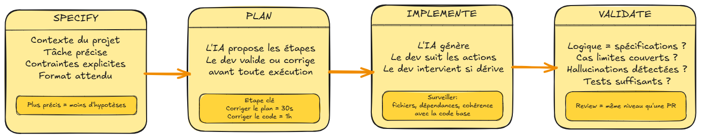
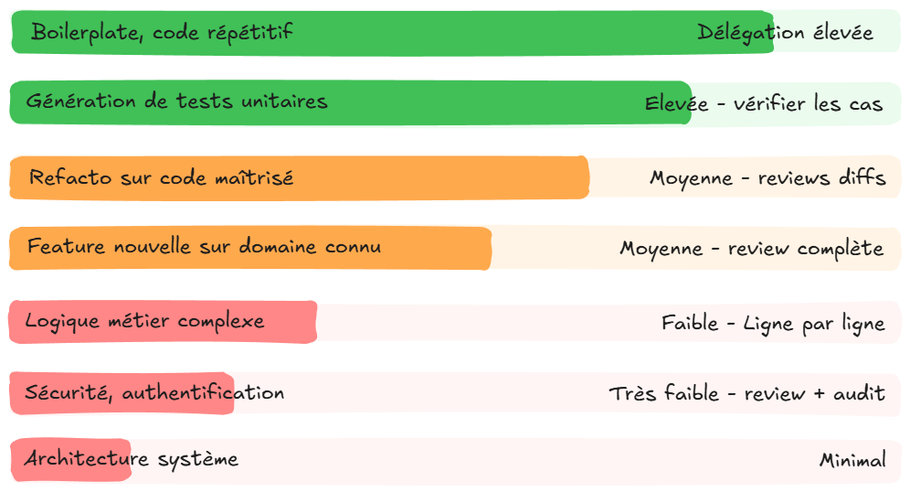
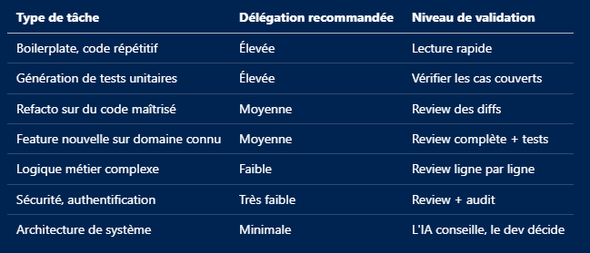
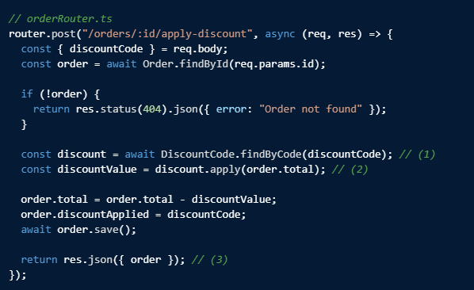
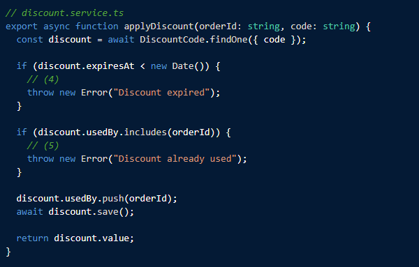

# Chapitre 2 — Vibe Coding vs Agentic Coding

---

## 2.1 Le vibe coding

Le terme a été popularisé par Andrej Karpathy début 2025 pour décrire une pratique déjà répandue : générer du code avec l'IA en se fiant au fait que "ça a l'air de marcher", sans forcément le lire ligne à ligne, le comprendre en détail ou le valider formellement. C'est un mode de collaboration avec l'IA à part entière, pas un accident de parcours. Reste à savoir dans quel contexte il est pertinent.

### Pourquoi c'est tentant — et parfois légitime

Le vibe coding produit des résultats visibles immédiatement. Une feature qui aurait pris une journée prend une heure. Les tests passent. Le démo fonctionne. Pour un prototype jetable, une exploration personnelle d'un framework inconnu, un POC de démonstration en hackathon, c'est le bon choix : la vitesse prime légitimement sur la compréhension exhaustive quand le code n'a pas vocation à survivre.

Le risque apparaît quand ce même code change de destination, lorsqu'il glisse en production, ou devient la base d'une feature livrée à un client (voir §2.4), sans repasser par une phase de compréhension et de validation. C'est dans ce cas-là que les problèmes suivants deviennent réels.

### Ce que ça produit, sans review

**Des bugs silencieux.**
Le modèle génère du code syntaxiquement correct mais logiquement faux. Une condition inversée sur un cas limite, une gestion d'erreur manquante, une hypothèse implicite sur la forme des données : le code compile, les tests unitaires passent, mais le comportement est incorrect dans des situations que les tests ne couvrent pas.

**De la dette technique invisible.**
Du code généré sans compréhension est du code que personne ne sait maintenir. Dans un contexte professionnel, c'est le code que l'organisation devra faire évoluer pendant des années. Si le développeur qui l'a écrit ne comprend pas la logique, personne ne pourra l'expliquer lors des passations.

**Une perte de maîtrise progressive.**
Plus on accepte sans comprendre, moins on est capable de guider l'IA dans la bonne direction lors de l'itération suivante. L'IA s'appuie sur ce qu'on lui fournit : si le contexte est du code non maîtrisé, la qualité des suggestions se dégrade d'autant plus au fil du temps.

**Des hallucinations non détectées.**
Une méthode inventée qui ressemble à la bonne syntaxe, une dépendance qui n'existe pas dans la version utilisée, une API dont le comportement a changé : sans review, ces erreurs passent. Certaines n'apparaissent qu'en production.

```typescript
// Exemple typique de hallucination non détectée en vibe coding
// Le modèle a inventé .findByIdAndPopulate() qui n'existe pas
const user = await User.findByIdAndPopulate(id, "orders");
// Erreur silencieuse jusqu'au premier appel en prod
```

### Ce que le vibe coding n'est pas

Il est important de distinguer le vibe coding de l'acceptance rapide sur des tâches simples. Accepter une suggestion d'autocomplétion d'une ligne après l'avoir lue n'est pas du vibe coding, accepter la génération d'un bloc de 200 lignes de logique métier complexe sans le lire, oui.

---

## 2.2 L'agentic coding

L'agentic coding part d'un principe simple : le développeur délègue l'exécution, pas la décision. L'IA génère, le développeur comprend, valide et reste aux commandes à chaque étape.

### Le workflow en détail



**SPECIFY**

Avant de demander quoi que ce soit au modèle, définir précisément ce qu'on souhaite obtenir. Pas "ajoute une feature de discount", mais :

```
Contexte : module de commande, fichiers Order.ts et OrderService.ts joints
Tâche : ajouter la gestion des codes de remise (discount codes)
Contraintes :
  - Un code s'applique une seule fois par utilisateur
  - Les codes expirés doivent retourner une erreur métier, pas une erreur 500
  - La réduction est en pourcentage ou en valeur absolue selon le type
Format attendu : modifications dans OrderService.ts + tests unitaires
```

Plus la spécification est précise, moins l'IA doit faire d'hypothèses, moins il y a de chances de divergence.

**PLAN**

Avant d'exécuter, demander au modèle de proposer un plan d'implémentation et le valider. C'est l'étape la plus sous-estimée du workflow.

```
Humain : "Propose un plan d'implémentation avant de coder."

IA : "Voici comment je compte procéder :
  1. Ajouter l'entité DiscountCode avec les champs type, value, expiresAt, usedBy[]
  2. Créer validateDiscountCode() dans OrderService qui vérifie expiration et usage
  3. Modifier createOrder() pour appeler validateDiscountCode() si un code est fourni
  4. Tests : code valide, code expiré, code déjà utilisé, code inexistant"

Humain : "Step 1 : ajouter usedBy[] directement sur DiscountCode crée un problème
        de scalabilité. Préfère une table de jointure OrderDiscountCode."
```

Corriger le plan prend 30 secondes. Corriger l'implémentation après qu'elle a divergé dans la mauvaise direction peut prendre une heure.

**IMPLEMENT**

L'IA génère. Le développeur suit et peut intervenir à tout moment. En agent mode, cela signifie surveiller les actions effectuées, pas simplement attendre le résultat final.

Points de surveillance :

- Les fichiers modifiés correspondent-ils à ce qui était prévu ?
- Les dépendances introduites sont-elles justifiées ?
- Les patterns utilisés sont-ils cohérents avec le reste de la codebase ?

**VALIDATE**

Review du code produit avant toute intégration. Pas une lecture en diagonale, une review de la même qualité que celle que l'on ferait sur une PR d'un collègue.

Checklist minimale :

- La logique correspond à la spécification
- Les cas limites sont couverts
- Pas d'hallucinations (APIs inexistantes, types incorrects, imports manquants)
- Les tests couvrent les comportements critiques
- Le code est maintenable par quelqu'un qui ne connaît pas le contexte

---

## 2.3 Le spectre entre les deux

Ce n'est encore une fois pas un binaire. Dans une même journée de travail, un développeur augmenté se positionne à des endroits différents sur ce spectre selon le contexte.





La règle générale : plus la tâche est critique et irréversible, plus la validation doit être rigoureuse. Un test mal généré est facile à corriger. Une faille de sécurité en production, beaucoup moins.

---

## 2.4 Ce que ça change concrètement

### Sur les gains de productivité

Les deux approches répondent à des besoins différents, pas au même besoin en mieux ou en moins bien. L'agentic coding produit des gains mesurables et durables sur des tâches bien définies et destinées à durer : les chiffres cités régulièrement dans l'industrie, comme les +55% de vélocité sur les tâches de dev, en sont la mesure. Le vibe coding produit un gain différent, sur un terrain différent: la vitesse d'itération sur un prototype, une exploration, un POC. Là où la structure de l'agentic coding serait un coût disproportionné par rapport à l'enjeu.

Le point de vigilance n'est pas de choisir l'un contre l'autre, mais de ne pas confondre les deux registres : les gains de vitesse du vibe coding ne se transposent pas tels quels sur du code destiné à durer. Ils s'effacent généralement lors de la phase de stabilisation, de debugging et de maintenance, si le code n'a jamais été conçu ni validé pour ça.

### Sur la qualité

Un développeur qui pratique l'agentic coding comprend chaque ligne qu'il intègre. Il peut l'expliquer, la déboguer, la faire évoluer. C'est la définition de la qualité maintenable.

### Sur les missions ESN

En contexte de mission, le code livré au client engage la responsabilité professionnelle, mais ça ne condamne pas le vibe coding en bloc pour autant, ça déplace simplement la question. 

Si la mission demande de prototyper une idée, d'explorer une piste technique ou de produire un POC pour valider une direction avant de s'engager, le vibe coding a toute sa place, au même titre qu'en usage personnel. Ce qui change avec l'expérience, c'est justement la capacité à distinguer les deux registres : quel outil, pour quelle tâche, et surtout quelle destination pour le code produit.

Le vibe coding reste en revanche inadapté à du code qui sera maintenu par des équipes client pendant des années. L'agentic coding positionne le développeur ESN comme un professionnel qui sait choisir le bon mode de collaboration avec l'IA selon l'enjeu, pas comme quelqu'un qui applique la même recette à toutes les tâches.

---

## 2.5 Exercice

### Partie 1 — Auto-évaluation

Sur les tâches listées ci-dessous, évaluez honnêtement votre comportement habituel avec un outil IA :


Identifiez la tâche où votre comportement est le plus proche du vibe coding. Rédigez en 3-4 lignes comment vous l'aborderiez différemment avec le workflow agentic : quelle spécification vous fourniriez, ce que vous valideriez dans le plan, ce que vous checkeriez dans la review.

---

### Partie 2 — Review de diff

L'agent a généré le diff suivant suite à la demande :

> Ajoute une route POST /orders/:id/apply-discount qui applique un code de remise à une commande existante. Un code ne peut être utilisé qu'une seule fois par utilisateur.

Passez-le en revue comme si c'était une PR d'un collègue. Identifiez tous les problèmes avant de lire la correction.





_Prenez le temps d'analyser avant de lire la correction ci-dessous._

---

<details>
<summary><strong>Correction — 6 problèmes identifiés</strong></summary>

**(1) Hallucination : `DiscountCode.findByCode()` n'est pas une méthode Mongoose standard.**
La méthode correcte est `DiscountCode.findOne({ code: discountCode })`. Le code compile si une méthode statique custom existe, mais plante en runtime sinon.

**(2) Pas de gestion du cas où `discount` est null.**
Si le code de remise n'existe pas, `discount` est `null` et `discount.apply()` lève une TypeError non gérée, le client reçoit une erreur 500 au lieu d'une 404 ou 400 explicite.

**(3) La route du router n'appelle pas `discount.service.ts`.**
L'agent a généré deux implémentations parallèles sans les connecter. La logique de validation (expiration, usage unique) dans `discount.service.ts` n'est jamais appelée depuis la route. Les deux fichiers coexistent mais le service est mort code.

**(4) Comportement incorrect si `discount` est null.**
Dans `discount.service.ts`, si `findOne` retourne null, `discount.expiresAt` lève une TypeError. Aucun guard sur l'existence du discount avant d'accéder à ses propriétés.

**(5) La condition d'usage unique compare un orderId à `usedBy`.**
La spécification originale demandait qu'un code ne soit utilisable qu'une seule fois par **utilisateur**, pas par commande. L'agent a implémenté la mauvaise contrainte métier. Le code est logiquement cohérent mais ne correspond pas au besoin.

**(6) Pas de transaction.**
`order.save()` et `discount.save()` sont deux opérations séparées. Si `order.save()` réussit et `discount.save()` échoue, le discount est appliqué à la commande mais pas marqué comme utilisé, il peut être réutilisé indéfiniment.

## </details>

## ✅ Quiz — Chapitre 2

---

**Question 1.** Quelle est la définition précise du vibe coding ?

- A) Utiliser l'IA pour générer du code rapidement sur des tâches simples
- B) Générer du code sans le lire, le comprendre ni le valider, en se fiant au fait que "ça semble marcher"
- C) Utiliser plusieurs outils IA en parallèle pour comparer les résultats
- D) Générer du code en dehors des heures de travail pour éviter les interruptions

> ✅ **Réponse : B** — Le vibe coding se définit par l'absence de lecture, de compréhension et de validation, pas par la vitesse d'exécution — ce qui le distingue de l'acceptance rapide sur des tâches simples et bien comprises. Ce n'est pas une définition condamnatoire en soi : c'est un mode de collaboration légitime dans certains contextes (prototype, exploration) et risqué dans d'autres, selon la destination du code (§2.1).

---

**Question 2.** Un développeur accepte une suggestion d'autocomplétion d'une ligne après l'avoir lue et comprise. Est-ce du vibe coding ?

- A) Oui, toute acceptance rapide est du vibe coding
- B) Non, le critère est la compréhension, pas la vitesse d'acceptance
- C) Oui, si la ligne fait partie d'un bloc plus large non validé
- D) Cela dépend du type de fichier modifié

> ✅ **Réponse : B** — Le critère distinctif est la compréhension, pas la vitesse. Lire et comprendre une suggestion avant de l'accepter est de l'agentic coding, même si ça prend deux secondes.

---

**Question 3.** Dans le workflow agentique, pourquoi l'étape PLAN est-elle souvent la plus sous-estimée ?

- A) Parce que le modèle refuse souvent de planifier avant d'implémenter
- B) Parce que corriger un plan divergent avant l'exécution prend 30 secondes, corriger une implémentation divergente peut prendre une heure
- C) Parce que le plan généré par l'IA est toujours correct et ne nécessite pas de validation
- D) Parce que l'étape SPECIFY suffit à éviter toute divergence

> ✅ **Réponse : B** — Valider le plan avant d'exécuter est le meilleur investissement de temps dans le workflow. Une correction en amont de l'exécution coûte infiniment moins qu'une correction après que l'IA a implémenté dans la mauvaise direction.

---

**Question 4.** Vous voulez valider rapidement la faisabilité d'une idée avec un prototype jetable, non destiné à être mis en production ni maintenu. Quelle approche est la plus adaptée ?

- A) Appliquer intégralement le workflow Specify → Plan → Implement → Validate, comme pour n'importe quelle tâche
- B) Refuser d'utiliser l'IA sur ce type de tâche pour éviter tout risque de dette technique
- C) Accepter la génération rapide sans review approfondie. Le prototype n'a pas vocation à survivre, la vitesse prime légitimement
- D) Systématiquement écrire les tests avant de générer le code (TDD), même pour un prototype

> ✅ **Réponse : C** — Comme vu en 1.6 et 2.1, ce qui rend le vibe coding risqué n'est pas le mode de génération, c'est la destination du code. Un prototype jetable qui reste jetable ne justifie pas l'effort de validation d'un livrable en production.

---

**Question 5.** Pour quelle tâche la délégation à l'IA doit-elle être la plus faible ?

- A) Génération de tests unitaires
- B) Refacto d'une fonction sur un domaine maîtrisé
- C) Génération de boilerplate répétitif
- D) Implémentation d'un mécanisme d'authentification

> ✅ **Réponse : D** — La sécurité et l'authentification sont dans la catégorie "très faible délégation" du tableau. Les erreurs dans ces domaines ont des conséquences graves et irréversibles. L'IA peut assister, mais chaque ligne doit être comprise et validée.

---

**Question 6.** Un développeur pratique l'agentic coding sur une feature de gestion de paiements. Il valide le plan, review les diffs, et vérifie que les tests couvrent les cas critiques. Il n'a pas relu la section de gestion des erreurs HTTP car "elle ressemble aux autres". Est-ce suffisant ?

- A) Oui, si le plan était bon et les tests passent, la review partielle est acceptable
- B) Non, la review doit couvrir l'intégralité du code produit, y compris les sections qui "ressemblent" aux autres
- C) Oui, les sections de gestion d'erreurs sont généralement correctement générées
- D) Cela dépend de la taille totale du diff

> ✅ **Réponse : B** — Sur du code de paiement, "ressemble aux autres" n'est pas suffisant. Les hallucinations produisent précisément du code qui ressemble à du bon code. La review doit être complète sur les domaines critiques.

---

**Question 7.** Un agent doit respecter des contraintes projet (stack, conventions, patterns) de façon identique quel que soit l'outil utilisé par les membres de l'équipe (Copilot, Cursor, Claude Code...). Quel mécanisme garantit cette cohérence sans dupliquer le contenu dans plusieurs fichiers ?

- A) Rédiger la spécification dans le prompt à chaque nouvelle tâche
- B) Un fichier `AGENTS.md` unique à la racine du projet, lu nativement par la majorité des outils actuels
- C) Un fichier de contexte différent par outil, maintenu manuellement en synchronisation
- D) Compter sur la mémoire du modèle entre les sessions

> ✅ **Réponse : B** — `AGENTS.md` a été conçu précisément pour ça : un fichier unique, standardisé, lu nativement par la majorité des outils, qui évite la duplication et la divergence entre fichiers spécifiques à chaque outil (Chapitre 3). D est faux : un LLM n'a pas de mémoire entre les sessions (Chapitre 1).

---

**Question 8.** Pourquoi le même usage du vibe coding est-il acceptable sur un prototype mais problématique sur du code de production ?

- A) Les outils IA génèrent un code de moins bonne qualité en environnement de production
- B) Sur un prototype, le code n'a pas vocation à être maintenu ; en production, il sera fait évoluer par des équipes qui n'ont pas le contexte de génération, sans que la compréhension ait jamais été vérifiée
- C) Les licences des outils IA ne couvrent pas l'usage en environnement de production
- D) Les prototypes ne contiennent jamais de logique métier critique

> ✅ **Réponse : B** — Ce qui change, ce n'est pas l'outil ni la qualité de génération, c'est la destination du code (§2.1). Un prototype jetable n'a pas besoin d'être compris, puisqu'il ne sera tout simplement pas maintenu. Du code de production le sera, par des personnes qui n'ont pas le contexte de sa génération, d'où la nécessité de la compréhension et de la validation vues en agentic coding.
