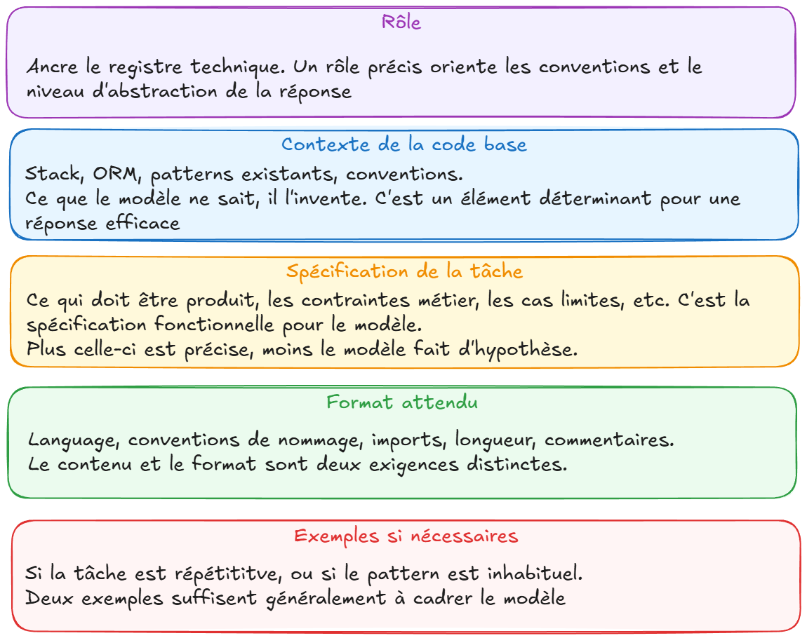

# Chapitre 3 — Instruire l'agent : du prompt au savoir-faire

---

## 3.1 Pourquoi le prompt engineering pour dev est différent

Un prompt généraliste cherche à obtenir une réponse utile. Un prompt de développeur cherche à obtenir du code correct, cohérent avec une codebase existante, dans un format précis, sur un domaine technique spécifique.

Les exigences sont plus strictes : un texte approximatif peut être acceptable, un code approximatif introduit des bugs. La tolérance à l'approximation est fondamentalement différente.

Trois différences structurelles :

**Le contexte est décisif.**
Un LLM sans contexte projet va générer du code générique. Avec le bon contexte (architecture, conventions, contraintes métier) il génère du code cohérent avec ce qui existe. La qualité du contexte fourni est souvent plus déterminante que le modèle utilisé.

**Le format de sortie compte autant que le contenu.**
En usage généraliste, le format de la réponse peut être secondaire. En dev, recevoir du code dans le mauvais langage, avec les mauvaises conventions de nommage, ou sans les imports nécessaires crée du travail supplémentaire. Spécifier le format attendu fait partie du prompt.

**La validation est systématique.**
En usage généraliste, on lit la réponse et on juge. En dev, chaque ligne de code produite doit être comprise et validée. Un bon prompt réduit la surface de validation en contraignant le modèle dans la bonne direction dès le départ.

---

## 3.2 Anatomie d'un prompt de dev efficace

Un prompt de dev structuré comporte cinq éléments. Tous ne sont pas toujours nécessaires mais chaque élément absent est une hypothèse que le modèle fera à votre place.



### Rôle

Définir le rôle du modèle ancre le registre technique de la réponse.

```
Tu es un développeur senior TypeScript spécialisé en architecture Node.js.
```

Son effet est généralement modeste : il joue surtout sur le vocabulaire, le niveau de détail et le ton de la réponse. Il ne remplace ni le contexte codebase ni la spécification, et ne rend pas le modèle plus compétent.

### Contexte codebase

Ce que le modèle ne sait pas, il va l'inventer. Lui fournir le contexte pertinent évite les hallucinations sur l'architecture et les conventions existantes.

```
Contexte :
- Framework : Express 5, TypeScript 6 strict
- ORM : Prisma 7
- Pattern : controllers séparés des services, pas de logique métier dans les routes
- Tests : Vitest
- Les erreurs HTTP sont gérées via un middleware centralisé, pas dans chaque route
```

### Spécification de la tâche

La tâche elle-même, formulée précisément. Pas "ajoute une feature de paiement", la description complète de ce qui doit être produit, incluant les cas limites et les contraintes métier.

```
Tâche : implémenter la méthode processRefund(orderId, amount) dans OrderService
Contraintes :
- amount ne peut pas dépasser le total de la commande originale
- Un remboursement partiel est possible
- Si la commande est déjà remboursée intégralement, retourner une erreur métier (pas une erreur 500)
- Loguer l'opération avec winston (instance importée depuis @/lib/logger)
```

### Contraintes de format

Ce que vous attendez comme output, pas seulement comme contenu.

```
Format attendu :
- Uniquement le code de la méthode, pas la classe entière
- Pas d'imports (ils sont déjà en place)
- Commentaires uniquement sur les parties non évidentes
- TypeScript strict, pas de any
```

### Exemples (si nécessaire)

Un exemple concret de ce qu'on attend. Particulièrement utile pour des patterns inhabituels ou des conventions spécifiques au projet.

```
Exemple de pattern d'erreur métier dans ce projet :
throw new BusinessError('REFUND_EXCEEDS_TOTAL', {
  orderId,
  requestedAmount: amount,
  maxRefundable: order.total
});
```

---

## 3.3 Les techniques classiques

### Zero-shot prompting

Pas d'exemple, uniquement l'instruction. Fonctionne bien pour les tâches simples et bien définies où le modèle a suffisamment de contexte.

```
Écris une fonction TypeScript qui valide qu'un email a un format correct.
Retourne un boolean. Pas de dépendances externes.
```

### Few-shot prompting

Deux à cinq exemples dans le prompt pour guider le format ou le style. Particulièrement efficace pour les tâches répétitives où le pattern doit être cohérent.

```
Génère des messages d'erreur selon ce pattern :

Exemple 1 :
Code : ORDER_NOT_FOUND
Message : "La commande {orderId} est introuvable."

Exemple 2 :
Code : PAYMENT_DECLINED
Message : "Le paiement a été refusé. Vérifiez vos informations bancaires."

Génère maintenant :
Code : DISCOUNT_EXPIRED
Code : INSUFFICIENT_STOCK
Code : ADDRESS_INVALID
```

### Chain of thought : le raisonnement derrière le rideau

Le chain of thought consiste à demander au modèle de raisonner étape par étape avant de produire sa réponse. La technique a longtemps été un levier majeur sur les algorithmes complexes et les problèmes de logique non triviale :

```
Avant d'écrire le code, explique ta stratégie pour implémenter
un rate limiter en mémoire qui supporte plusieurs fenêtres temporelles
(par minute ET par heure). Identifie les cas limites à gérer.
Ensuite seulement, écris l'implémentation.
```

Aujourd'hui, ce pattern est largement intégré par les modèles eux-mêmes : les modèles à raisonnement réfléchissent avant de répondre, et un réglage d'effort de réflexion (*thinking effort*, voir Chapitre 1) en ajuste la profondeur. Les agents poussent la logique plus loin en planifiant, en exécutant et en réévaluant à chaque étape. Dans la plupart des cas, il n'est donc plus nécessaire d'écrire « réfléchis étape par étape ».

Il reste utile de le connaître, pour trois raisons :

- il explique pourquoi un effort de réflexion plus élevé améliore les tâches complexes, au prix de plus de temps et de tokens ;
- il garde son intérêt avec un modèle sans raisonnement intégré ;
- c'est le même principe que l'étape PLAN du workflow agentic (Chapitre 2) : faire expliciter la stratégie avant d'exécuter, pour la valider.

### Itération guidée

Le premier résultat n'est pas toujours le bon. Plutôt que de regénérer depuis zéro, guider l'itération est généralement plus efficace.

```
// Premier échange
"Génère la fonction de calcul de TVA"

// Après review
"La fonction ne gère pas le cas des produits exonérés de TVA (taux = 0).
Modifie uniquement la logique de sélection du taux, ne touche pas au reste."
```

La précision de la correction ("modifie uniquement X, ne touche pas à Y") évite que le modèle ne réécrive tout ce qui fonctionnait déjà.

---

## 3.4 Les fichiers de contexte projet

Un fichier de contexte projet est un prompt permanent, situé à la racine de votre codebase, qui est envoyé au modèle avant chaque échange dans le cadre de ce projet.

C'est la façon la plus efficace de contextualiser un assistant IA à une codebase sans répéter le contexte à chaque prompt.

Chaque outil a sa convention historique :

- GitHub Copilot : `.github/copilot-instructions.md`
- Claude Code : `CLAUDE.md`
- Cursor : `.cursor/rules/` (fichiers `.mdc`)

Le contenu est de même nature dans les trois cas : du texte libre structuré (Cursor y ajoute un en-tête qui précise quand appliquer chaque règle). Mais depuis 2025, cette fragmentation a un remplaçant.

### Vers un standard unique : AGENTS.md

`AGENTS.md` est un fichier unique à la racine du projet, reconnu par un grand nombre d'outils (Codex, Cursor, Windsurf, Zed, GitHub Copilot…). Selon l'outil, il est lu directement, après un réglage (Gemini CLI, Aider), ou via un import depuis le fichier propre à l'outil (voir plus bas). Il répond directement au problème posé par la liste ci-dessus : maintenir plusieurs fichiers au contenu identique, avec le risque qu'ils divergent dès que l'un est mis à jour et pas les autres.

Sa gouvernance suit celle de MCP (Chapitre 1) : porté par l'Agentic AI Foundation, sous l'égide de la Linux Foundation.

En pratique : écrire `AGENTS.md` comme fichier de référence. Pour les outils qui demandent un import, leur fichier propre devient alors un simple pointeur.

Exemple avec Claude Code : ses versions récentes lisent `AGENTS.md` seul, mais l'ignorent dès qu'un `CLAUDE.md` existe. Si vous gardez un `CLAUDE.md` (pour des consignes propres à Claude Code, par exemple), il doit donc importer `AGENTS.md` explicitement avec la syntaxe `@`. Une simple phrase du type « voir AGENTS.md » ne charge rien : ce n'est qu'un texte.

```markdown
@AGENTS.md

## Claude Code
Utiliser le mode plan pour les changements dans src/payments/.
```

Ça évite la duplication et la divergence, sans attendre que tous les outils convergent complètement.

### Ce qu'on y met

```markdown
# Contexte projet — API Orders

## Stack

- Node.js 24 (LTS), TypeScript 6.x strict
- Express 5
- Prisma 7 (PostgreSQL). Pas de requêtes SQL directes
- Vitest pour les tests, pas Jest
- Winston pour les logs

## Architecture

- Structure : controllers / services / repositories
- Pas de logique métier dans les controllers ni les routes
- Les erreurs métier sont des instances de BusinessError (voir src/errors/BusinessError.ts)
- Toutes les routes sont authentifiées sauf /health et /auth/\*

## Conventions

- Nommage : camelCase pour les variables et fonctions, PascalCase pour les classes
- Dans les handlers async, laisser remonter les erreurs (Express 5 les transmet au middleware d'erreurs) : pas de try/catch qui renvoie la réponse à la main
- Pas de any, utiliser unknown et type guards si nécessaire
- Les imports de types : import type { ... }

## Ce qu'il ne faut pas faire

- Ne pas modifier les migrations Prisma existantes
- Ne pas utiliser console.log — utiliser logger.info / logger.error
- Ne pas installer de nouvelles dépendances sans validation explicite
```

### Ce qu'on n'y met pas

Le fichier de contexte n'est pas un cahier des charges complet. Il doit rester lisible et ciblé sur ce qui impacte la génération de code au quotidien. Un fichier trop long dilue les instructions importantes.

À éviter : les descriptions fonctionnelles de features, les conventions évidentes, les informations qui ne changent pas la façon dont le code est généré.

Pour les procédures ponctuelles (générer des tests selon un pattern précis, faire une revue de PR selon une checklist), un autre mécanisme est plus adapté : les skills, présentés juste après.

---

## 3.5 Skills — le savoir-faire par tâche

### Quand les cinq éléments du prompt se répètent

Sur une tâche récurrente (générer des tests, faire une revue de PR, documenter un service) quatre des cinq éléments du prompt ne changent pas vraiment d'une fois à l'autre. Le rôle reste le même, le contexte codebase aussi, le format attendu aussi, les exemples aussi. Seule la spécification de la tâche varie : quelle fonction tester, quel diff passer en revue.

Retaper ces quatre éléments à chaque fois est un gaspillage. Les intégrer au fichier de contexte permanent (AGENTS.md, ci-dessus) n'est pas non plus satisfaisant : ce sont des instructions qui ne servent qu'à ce type de tâche précis, pas à toutes les générations de code sur le projet. Un AGENTS.md qui accumule ce genre de contenu devient vite trop long, et dilue les instructions qui, elles, s'appliquent vraiment partout.

C'est le problème que les skills résolvent : une skill fige les éléments stables d'un prompt récurrent — rôle, contexte, format, exemples — dans un fichier chargé uniquement quand la tâche correspond. Elle complète AGENTS.md plutôt qu'elle ne le remplace : AGENTS.md répond à "comment ce projet fonctionne, en permanence", une skill répond à "comment faire cette tâche précise, quand elle se présente".

### Anatomie d'une skill

Le format d'une skill suit le standard ouvert Agent Skills, repris par plusieurs outils ; les emplacements et certaines options varient d'un outil à l'autre. Une skill est un fichier Markdown en deux parties :

- **Le frontmatter** : un bloc délimité par `---` en tête de fichier, qui contient les métadonnées (`name`, `description`). C'est la seule partie que l'outil lit en permanence. Le `name` donne la commande d'invocation (`/generate-tests`) ; dans Claude Code, il vaut par défaut le nom du dossier de la skill. La `description`, fortement recommandée, permet à l'agent de décider seul s'il doit charger la skill pour la tâche en cours. Une description vague ou trop générique, et la skill ne se déclenche jamais, ou au mauvais moment.
- **Le corps** : les instructions elles-mêmes (rôle, contexte, format, exemples). Il n'est chargé que lorsque la skill est invoquée ou jugée pertinente, ce qui garde le contexte léger.

Le frontmatter joue donc le rôle d'un index : il coûte quelques tokens par skill, alors que le corps peut être aussi détaillé que nécessaire sans peser sur les autres échanges.

```markdown
---
name: generate-tests
description: Génère des tests Vitest conformes aux conventions du projet
---

Tu es un développeur senior TypeScript spécialisé en tests unitaires.

Contexte :
- Framework : Vitest avec vi.mock() pour les dépendances
- Mocker systématiquement les repositories et le logger
- Un test par cas : nominal, cas limites, cas d'erreur

Format attendu :
- Uniquement le fichier de test, pas de modification du code testé
- Un describe() par méthode testée

Exemple de structure attendue :
describe('processRefund', () => {
  it('rembourse partiellement une commande valide', async () => { ... })
  it('lève BusinessError si le montant dépasse le total', async () => { ... })
})
```

Ce qui reste à fournir au moment de l'invocation : uniquement la spécification de la tâche, le reste est déjà fixé.

```
/generate-tests processRefund() dans OrderService
```

### Skill ou AGENTS.md : lequel utiliser ?

| | AGENTS.md | Skill |
|---|---|---|
| Portée | Tout le projet, toutes les tâches | Une tâche précise, récurrente |
| Chargement | Systématique, à chaque échange | À la demande, quand la tâche correspond |
| Contenu type | Stack, architecture, conventions | Rôle, format et exemples pour une tâche type |

Une règle simple : si l'information sert à *toute* génération de code sur le projet, elle va dans AGENTS.md. Si elle ne sert qu'à *une* tâche récurrente précise, elle va dans une skill.

AGENTS.md et les skills ont toutefois une limite commune : ce sont des instructions. Le modèle les lit et les suit *le plus souvent*, mais rien ne l'y oblige. Pour une règle qui doit s'appliquer à chaque fois, sans exception, il faut passer de l'instruction à l'automatisation : c'est le rôle des hooks.

---

## 3.6 Hooks — des règles qui s'exécutent à coup sûr

### Quand l'instruction ne suffit pas

Écrire "lance toujours les tests après une modification" dans AGENTS.md fonctionne la plupart du temps. Mais le modèle peut l'oublier, d'autant plus sur une longue session ou une tâche lourde. Pour une règle de formatage, c'est tolérable. Pour une règle de sécurité ("ne jamais toucher au fichier `.env`"), ça ne l'est pas.

Un hook répond à ce problème : c'est un script que l'application exécute automatiquement à un moment précis du cycle de vie de l'agent. Il ne dépend pas du modèle : ce n'est plus une probabilité, c'est du code.

### Anatomie d'un hook

Un hook associe trois choses :

- **Un événement** : le moment du cycle de vie où il se déclenche. Les plus courants : avant l'exécution d'un outil (`PreToolUse`), après (`PostToolUse`), à la fin d'une réponse de l'agent ou à l'ouverture d'une session. Les noms exacts varient selon l'outil.
- **Un filtre** (*matcher*) : à quels outils il s'applique, par exemple uniquement les outils d'édition de fichiers (`Edit|Write`). Il porte sur le nom de l'outil, pas sur le fichier visé. Pour filtrer par fichier ou par argument, certains outils offrent un champ de condition (Claude Code : `if`, par exemple `Edit(*.ts)`) ; sinon, c'est le script qui fait le tri en lisant l'action reçue.
- **Une action** : la commande à exécuter, le plus souvent un script shell, qui reçoit en entrée le détail de l'action de l'agent.

Selon l'événement, le résultat du script a un effet concret. Un hook "avant" peut **bloquer** l'action de l'agent et lui renvoyer un message d'erreur, qu'il utilisera pour corriger sa démarche. Un hook "après" peut **lancer une vérification** et lui en renvoyer le résultat.

Exemple, au format de Claude Code (`.claude/settings.json`) : lancer le formatage et le lint après chaque édition de fichier.

```json
{
  "hooks": {
    "PostToolUse": [
      {
        "matcher": "Edit|Write",
        "hooks": [
          { "type": "command", "command": "npm run lint:fix >&2 || exit 2" }
        ]
      }
    ]
  }
}
```

Pour que l'agent soit informé d'un échec, le code de sortie compte. Avec Claude Code, un script qui se termine par le **code 2** est un échec bloquant : son message d'erreur (stderr) est renvoyé à l'agent, qui peut corriger dans la foulée, sans que le développeur ait à intervenir. Tout autre code non nul, comme le code 1 d'un lint en échec, est traité comme une erreur non bloquante : l'action se poursuit et rien ne garantit que l'agent en soit informé. D'où le `>&2 || exit 2` de l'exemple (syntaxe bash) : il envoie la sortie de la commande vers l'erreur standard et force le code 2 en cas d'échec.

### Le piège du code de sortie

Deux versions du même hook de lint :

```bash
# Version fragile : le lint échoue (code 1), rien ne garantit que l'agent le sache
npm run lint

# Version fiable : l'échec est bloquant (code 2) et le message revient à l'agent
npm run lint >&2 || exit 2
```

| Le lint échoue | Version fragile | Version fiable |
|---|---|---|
| Effet | L'action se poursuit, rien ne garantit que l'agent voie l'erreur | Le message d'erreur est renvoyé à l'agent, qui corrige |

Les deux versions se ressemblent, et les deux « fonctionnent » tant que le lint passe : la différence n'apparaît qu'au premier échec. Un hook mal écrit ne produit aucune erreur visible, il laisse la règle sans protection tout en donnant l'impression qu'elle est appliquée.

Règle pratique : testez toujours un hook en le faisant échouer volontairement (introduisez une erreur de lint, tentez de toucher une migration) et vérifiez ce que voit l'agent.

### Hook, skill ou AGENTS.md : lequel utiliser ?

| | AGENTS.md | Skill | Hook |
|---|---|---|---|
| Nature | Instruction permanente | Procédure à la demande | Script automatique |
| Déclenchement | Lu à chaque échange | Choisi par le modèle selon la tâche | Par l'événement, sans le modèle |
| Garantie | Probabiliste | Probabiliste | Déterministe |
| Usage type | Stack, conventions | Générer des tests, revue de PR | Lint, tests, blocage de fichiers sensibles |

Règle de décision : si une consigne est violée de temps en temps et que cela a un coût (sécurité, qualité, build cassé), ne la répétez pas dans le prompt, transformez-la en hook. Si elle relève du jugement ou du style, elle reste une instruction.

---

## 3.7 Les erreurs classiques

### Trop vague

```
// Mauvais
"Améliore cette fonction"

// Mieux
"Refactorise cette fonction pour extraire la logique de validation dans
une fonction séparée validateOrderInput(). Garde la même signature externe."
```

Sans critère de succès explicite, le modèle optimise selon ses propres heuristiques qui ne correspondent pas forcément aux vôtres.

### Trop chargé

Plus le contexte envoyé au modèle est volumineux, plus il risque de perdre de vue certaines contraintes (le phénomène « lost in the middle » vu au Chapitre 1). Le problème vient moins d'un prompt de quelques centaines de tokens que de l'accumulation : un `AGENTS.md` qui enfle au fil des mois, un historique de conversation interminable, des instructions contradictoires entre le fichier de contexte et la demande. Un contexte dense, structuré et sans contradiction vaut mieux qu'un contexte exhaustif.

### Contexte manquant sur les dépendances

```
// Mauvais — le modèle va inventer une implémentation Redis
"Ajoute du caching sur cette route"
```

```
// Mieux
"Ajoute du caching sur cette route en utilisant l'instance Redis
exportée depuis src/lib/redis.ts. TTL de 5 minutes. Invalide le cache
quand l'entité est mise à jour."
```

### Absence de validation demandée

```
// Mauvais
"Génère les tests pour cette fonction"

// Mieux
"Génère les tests Vitest pour cette fonction. Couvre au minimum :
le cas nominal, les cas limites (valeur nulle, valeur négative),
et les cas d'erreur (entité non trouvée, violation de contrainte).
Après génération, liste les cas que tu n'as PAS couverts."
```

La dernière ligne, "liste les cas que tu n'as pas couverts", est particulièrement efficace : elle force le modèle à évaluer lui-même la complétude de sa réponse.

---

## 3.8 Assembler le tout : AGENTS.md, skills et hooks

Les sections précédentes présentent chaque mécanisme isolément. En pratique, ils se répartissent les rôles sur un même projet. Reprenons l'API Orders, avec une version volontairement raccourcie de chaque fichier.

### L'arborescence

```
api-orders/
├── AGENTS.md                      ← contexte permanent
└── .claude/
    ├── settings.json              ← déclaration des hooks
    ├── hooks/
    │   └── protect-migrations.sh
    └── skills/
        ├── generate-tests/SKILL.md
        └── review-pr/SKILL.md
```

Les emplacements ci-dessus sont ceux de Claude Code. Les autres outils ont leurs propres chemins, mais la répartition des rôles reste la même.

### Couche 1 — AGENTS.md : ce qui est vrai tout le temps

```markdown
# Contexte projet — API Orders

## Stack
- Node.js 24 (LTS), TypeScript 6.x strict, Express 5
- Prisma 7 (PostgreSQL), Vitest pour les tests

## Architecture
- controllers / services / repositories
- Erreurs métier : instances de BusinessError

## Conventions
- Pas de any, utiliser unknown et type guards
- Pas de console.log, utiliser logger
```

Il décrit le projet, rien de plus. Pas de procédure de test, pas de checklist de revue.

### Couche 2 — Skills : ce qui est vrai pour une tâche

```markdown
---
name: generate-tests
description: Génère des tests Vitest pour un service ou un repository du projet
---

Tu es un développeur senior TypeScript spécialisé en tests unitaires.
- Mocker systématiquement les repositories et le logger
- Un describe() par méthode, un test par cas : nominal, limites, erreurs
- Uniquement le fichier de test, ne pas modifier le code testé
- Termine en listant les cas que tu n'as pas couverts
```

```markdown
---
name: review-pr
description: Relit un diff selon la checklist de revue de l'équipe
---

Relis le diff en vérifiant, dans l'ordre :
1. Pas de logique métier dans les controllers
2. Les erreurs métier passent par BusinessError
3. Chaque nouvelle route est authentifiée
4. Les nouveaux comportements sont couverts par des tests

Réponds par une liste de remarques classées : bloquant / à corriger / suggestion.
```

Chaque skill n'est chargée que lorsque sa `description` correspond à la tâche. Elles ne pèsent pas sur le contexte le reste du temps.

### Couche 3 — Hooks : ce qui ne doit jamais être oublié

```json
{
  "hooks": {
    "PreToolUse": [
      {
        "matcher": "Edit|Write",
        "hooks": [{ "type": "command", "command": ".claude/hooks/protect-migrations.sh" }]
      }
    ],
    "PostToolUse": [
      {
        "matcher": "Edit|Write",
        "hooks": [{ "type": "command", "command": "npm run lint:fix >&2 || exit 2" }]
      }
    ],
    "Stop": [
      {
        "hooks": [{ "type": "command", "command": "npm test -- --run >&2 || exit 2" }]
      }
    ]
  }
}
```

Le script de blocage lit l'action de l'agent et la refuse si elle touche une migration existante :

```bash
#!/bin/bash
# Lit l'action de l'agent (JSON sur l'entrée standard) et refuse la
# modification d'une migration Prisma existante.
file=$(jq -r '.tool_input.file_path // empty')
file=${file//\\//}   # Windows : normalise les séparateurs

if [[ "$file" == *"prisma/migrations/"* && -e "$file" ]]; then
  echo "Les migrations Prisma existantes sont immuables. Crée une nouvelle migration." >&2
  exit 2   # bloque l'action et renvoie le message à l'agent
fi
```

Prérequis : `jq` installé et script exécutable (`chmod +x`). Les deux lignes qui normalisent le chemin et testent l'existence du fichier sont expliquées dans l'exercice 3.9.

### Une session type

Le développeur tape `/generate-tests processRefund() dans OrderService`.

1. **AGENTS.md** est déjà dans le contexte : l'agent connaît la stack et les conventions.
2. **La skill `generate-tests`** se charge : rôle, mocks et format sont fixés.
3. L'agent écrit le fichier de test. Le **hook `PostToolUse`** lance le lint, qui corrige le style sans que personne n'y pense.
4. Si l'agent tentait de « réparer » un test en modifiant une migration, le **hook `PreToolUse`** refuserait et lui expliquerait pourquoi.
5. En fin de tâche, le **hook `Stop`** lance la suite de tests. Un échec est renvoyé à l'agent, qui corrige avant de rendre la main.

### Où va chaque règle ?

| Règle | Couche | Pourquoi |
|---|---|---|
| Utiliser Vitest, pas Jest | AGENTS.md | Vrai pour toute génération de code |
| Pas de `any` | AGENTS.md | Convention permanente, relève du style |
| Format et checklist de revue de PR | Skill | Une seule tâche, récurrente |
| Structure d'un fichier de test | Skill | Une seule tâche, récurrente |
| Ne jamais modifier une migration existante | Hook | Critique et vérifiable par un script |
| Code formaté et lint propre | Hook | Mécanique, doit être systématique |
| Tests au vert avant de conclure | Hook | Doit être systématique, pas laissé au jugement du modèle |

Une règle migre vers un hook quand trois conditions sont réunies : elle est vérifiable par un script, la violer a un coût, et vous l'avez déjà vue violée. Tant qu'une règle relève du jugement ou du style, elle reste une instruction.

---

## 3.9 Exercice : pourquoi ces deux lignes ?

Le script de protection des migrations de la section 3.8 comporte deux éléments peu évidents : la ligne qui normalise les séparateurs de chemin, et la condition `-e "$file"`. Voici la première version du script, sans eux :

```bash
#!/bin/bash
file=$(jq -r '.tool_input.file_path // empty')
if [[ "$file" == *"prisma/migrations/"* ]]; then
  echo "Les migrations Prisma existantes sont immuables. Crée une nouvelle migration." >&2
  exit 2
fi
```

Deux symptômes ont été constatés :

1. Sur un poste Windows, l'agent a modifié une migration existante sans être bloqué.
2. Sur n'importe quel poste, quand l'agent essaie d'écrire lui-même le fichier d'une nouvelle migration, le hook le refuse aussi.

Expliquez la cause de chaque symptôme, et ce que corrige chacun des deux ajouts, avant de lire la correction.

<details>
<summary><strong>Correction — 2 défauts</strong></summary>

**(1) Les chemins Windows ne correspondent jamais au motif.**
Selon la documentation de Claude Code, `tool_input.file_path` est un chemin absolu avec le séparateur natif de la plateforme : sous Windows, des antislashs (`C:\projet\prisma\migrations\...`). Le motif `*"prisma/migrations/"*`, écrit avec des barres obliques, n'est jamais trouvé : le hook se déclenche, ne détecte rien et laisse tout passer. C'est le pire cas pour un hook de sécurité : on se croit protégé. La ligne `file=${file//\\//}` remplace les antislashs par des barres obliques avant le test.

**(2) Le hook bloque aussi la création de fichiers.**
Le message demande de créer une nouvelle migration, mais écrire ce fichier avec l'outil d'écriture de l'agent passe par le même hook et le même chemin : il est refusé. Le hook doit distinguer la modification d'un fichier existant de la création d'un nouveau. La condition `-e "$file"` ne s'applique qu'aux fichiers déjà présents sur le disque.

**Ce qu'il faut retenir.** Ces deux défauts sont silencieux : aucun message d'erreur ne les signale. Seul un test qui tente de violer la règle, sur chaque système utilisé par l'équipe, les révèle.

</details>

---

## ✅ Quiz — Chapitre 3

_10 questions — environ 10 minutes_

---

**Question 1.** Parmi les cinq éléments d'un prompt de dev structuré, lequel est souvent le plus déterminant pour la qualité du code généré sur une codebase existante ?

- A) Le contexte codebase (stack, conventions, patterns existants)
- B) Le rôle donné au modèle
- C) La longueur de la spécification de la tâche
- D) Le nombre d'exemples few-shot fournis

> ✅ **Réponse : A** — Sans contexte codebase, le modèle génère du code générique qui peut être correct en isolation mais incohérent avec ce qui existe. La qualité du contexte fourni est souvent plus déterminante que le modèle utilisé. Le rôle (B) joue surtout sur le registre de la réponse.

---

**Question 2.** Un développeur génère des messages d'erreur standardisés pour une dizaine de cas différents. Quelle technique de prompting est la plus adaptée ?

- A) Zero-shot. La tâche est simple et bien définie
- B) Chain of thought. Le modèle doit raisonner sur chaque cas
- C) Few-shot. Deux ou trois exemples du pattern attendu suffisent à cadrer tous les cas
- D) Itération guidée. Générer un par un et corriger au fil de l'eau

> ✅ **Réponse : C** — Le few-shot est conçu pour les tâches répétitives où le pattern doit être cohérent. Deux ou trois exemples cadrent le format, le ton et la structure de tous les cas suivants.

---

**Question 3.** Avec un modèle récent à raisonnement intégré, que devient le chain of thought ?

- A) Il a disparu : les modèles ne raisonnent plus avant de répondre
- B) Le modèle le pratique lui-même en interne, et un réglage d'effort de réflexion en ajuste la profondeur : l'écrire explicitement est souvent superflu
- C) Il est obligatoire pour que le modèle comprenne les consignes
- D) Il remplace la spécification de la tâche

> ✅ **Réponse : B** — Le pattern est désormais largement intégré aux modèles et aux agents. Il reste utile à connaître : il explique l'effet de l'effort de réflexion, garde son intérêt avec un modèle sans raisonnement intégré, et correspond à l'étape PLAN du workflow agentic. A est faux, le raisonnement s'est généralisé. C et D confondent la technique avec le contexte et la spécification.

---

**Question 4.** Dans un contexte d'itération guidée, un développeur reçoit une implémentation correcte à 80%. Quelle approche est la plus efficace pour corriger le 20% restant ?

- A) Regénérer depuis zéro avec un prompt amélioré
- B) Demander au modèle d'améliorer sa réponse sans plus de détail
- C) Diviser la tâche en deux prompts séparés
- D) Spécifier précisément ce qui doit changer et ce qui ne doit pas être touché

> ✅ **Réponse : D** — La précision de la correction ("modifie uniquement X, ne touche pas à Y") évite que le modèle ne réécrive les parties qui fonctionnaient déjà. Regénérer depuis zéro perd l'acquis du premier échange.

---

**Question 5.** Quelle instruction dans un prompt de génération de tests améliore la complétude de façon particulièrement efficace ?

- A) "Génère le maximum de tests possible"
- B) "Assure-toi que la couverture de code est supérieure à 80%"
- C) "Après génération, liste les cas que tu n'as pas couverts"
- D) "Génère des tests pour tous les chemins d'exécution"

> ✅ **Réponse : C** — Demander au modèle de lister ce qu'il n'a pas couvert force une auto-évaluation de sa propre réponse. C'est une technique simple qui révèle quasi systématiquement des cas limites manquants.

---

**Question 6.** Un développeur donne ce prompt : "Ajoute du caching sur cette route." Quel est le risque principal de cette formulation ?

- A) Le modèle va refuser de répondre sans plus de contexte
- B) Le modèle va générer une implémentation de caching qui ne correspond pas à la bibliothèque utilisée dans le projet
- C) Le modèle va générer trop de code et dépasser la context window
- D) Le modèle va demander des clarifications avant de répondre

> ✅ **Réponse : B** — Sans spécifier la bibliothèque de caching utilisée (Redis, Memcached, cache mémoire custom), le modèle va choisir selon ses heuristiques ou inventer une implémentation. Le contexte manquant sur les dépendances est une des erreurs les plus fréquentes.

---

**Question 7.** Quel est l'intérêt principal d'un `AGENTS.md` par rapport à un fichier de contexte propre à chaque outil ?

- A) Il est plus court à écrire
- B) Il remplace les skills
- C) Il n'est chargé que sur demande
- D) Un seul fichier standard, reconnu par la plupart des outils, évite la duplication et la divergence

> ✅ **Réponse : D** — Plusieurs fichiers au contenu identique divergent dès que l'un est mis à jour et pas les autres. A et C ne sont pas des propriétés d'`AGENTS.md` : il est chargé en permanence. B confond deux mécanismes complémentaires.

---

**Question 8.** Vous voulez que l'agent applique une checklist de revue de PR uniquement quand vous lui demandez une revue. Où la placer ?

- A) Dans une skill, chargée à la demande
- B) Dans `AGENTS.md`, pour qu'elle soit toujours disponible
- C) Dans un hook `PostToolUse`
- D) Dans le message de commit

> ✅ **Réponse : A** — Une skill est faite pour une procédure précise, chargée seulement quand la tâche correspond. B alourdit le contexte permanent à chaque échange. C sert à exécuter un script, pas à porter des instructions. D n'a aucun lien avec le comportement de l'agent.

---

**Question 9.** La règle « ne jamais modifier une migration existante » figure dans `AGENTS.md`, et l'agent l'a pourtant violée deux fois. Que faire ?

- A) La transformer en hook qui bloque l'action : elle est vérifiable par un script, coûteuse à violer, et déjà violée
- B) La répéter en majuscules dans `AGENTS.md`
- C) La déplacer dans une skill
- D) Changer de modèle

> ✅ **Réponse : A** — Une instruction reste probabiliste. Une règle migre vers un hook quand elle est vérifiable par un script, que la violer a un coût et qu'on l'a déjà vue violée. B et C restent des instructions, D ne traite pas la cause.

---

**Question 10.** Avec Claude Code, un hook `PostToolUse` lance `npm run lint`. Le lint échoue (code de sortie 1). Que se passe-t-il ?

- A) L'agent reçoit l'erreur et corrige dans la foulée
- B) L'action de l'agent est annulée
- C) Rien ne bloque : l'action se poursuit, et seul un code de sortie 2 garantit que le message est renvoyé à l'agent
- D) La session est interrompue

> ✅ **Réponse : C** — La documentation distingue le code 2 (échec bloquant, message renvoyé à l'agent) de tous les autres codes non nuls (erreur non bloquante). C'est pourquoi un hook qui doit faire respecter une règle sort en code 2. Sur un `PostToolUse`, l'action a de toute façon déjà eu lieu : B est donc faux, et D ne correspond à aucun comportement.
