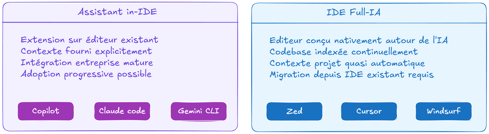
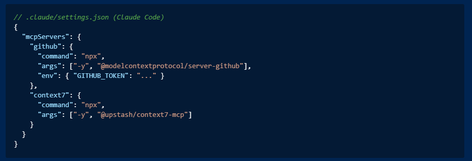
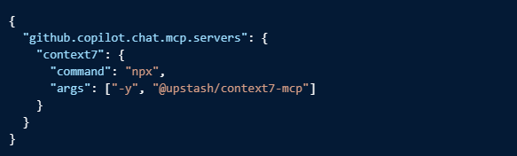

# Chapitre 4 — Panorama des outils

## 4.1 Deux familles d'outils

Les outils IA pour développeurs se divisent en deux familles architecturalement différentes. La distinction n'est pas cosmétique, elle impacte la façon dont l'outil comprend le projet, la profondeur de l'autonomie qu'il peut exercer, et les cas d'usage pour lesquels il est le plus pertinent.

### Assistants in-IDE

Un assistant in-IDE est une extension qui s'intègre dans un éditeur existant (VS Code, JetBrains, Neovim). Il observe ce qui est tapé, le fichier ouvert, et éventuellement le workspace, et propose des suggestions ou répond à des questions dans un panel chat.

**Caractéristiques :**

- L'éditeur reste celui qu'on utilise déjà
- Le contexte projet est fourni explicitement (fichiers ouverts, `#codebase`, fichier d'instructions)
- L'intégration enterprise est généralement plus mature : SSO, politiques de données, licences gérées par la DSI
- Adoption progressive possible, on peut commencer par la complétion et monter en autonomie

**Représentants :** GitHub Copilot, Claude Code (mode IDE), Gemini CLI

Cette frontière s'estompe : plusieurs assistants in-IDE (GitHub Copilot en tête, avec Copilot CLI) proposent désormais aussi un mode agent autonome en terminal, hors de l'éditeur — historiquement le terrain des agents CLI ci-dessous.

### IDE full IA

Un IDE full IA est un éditeur conçu nativement autour de l'IA. La compréhension du projet n'est pas une feature ajoutée, c'est l'architecture de base. L'éditeur indexe en permanence la codebase pour que le modèle ait un contexte projet sans configuration manuelle.

**Caractéristiques :**

- Compréhension du projet natif et quasi-automatique
- Expérience plus fluide sur les tâches multi-fichiers
- Moins de configuration initiale pour les projets complexes
- Migration depuis un IDE existant requise. Coût d'adoption non nul

**Représentants :** Cursor, Windsurf, Zed

---

## 4.2 Les outils en détail

### GitHub Copilot

**Type :** Assistant in-IDE
**Modèles disponibles :** GPT, Claude Sonnet, Gemini (selon plan)
**Intégration :** VS Code, JetBrains, Visual Studio, Neovim, Xcode

Le standard de facto en entreprise. 90% des Fortune 100 l'utilisent. L'avantage principal n'est pas la performance brute du modèle, c'est l'intégration enterprise : politiques de données claires, gestion des licences centralisée, SSO, Copilot Enterprise pour les contraintes de confidentialité maximales.

**Modes :**

- **Inline completion** : suggestions contextuelles pendant la frappe
- **Copilot Chat** : chat dans l'éditeur, questions sur le code, explications
- **Edit mode** : modifications multi-fichiers selon les instructions
- **Agent mode** : tâches autonomes avec planification et exécution
- **Copilot CLI** : agent autonome en terminal, hors de l'IDE — en disponibilité générale depuis 2026, avec ses propres modes Plan et Autopilot. Rapproche Copilot de la catégorie "agent CLI" (Claude Code, Codex CLI, Gemini CLI)

**Fichier de contexte :** `.github/copilot-instructions.md` (et `AGENTS.md` désormais supporté nativement)

**Plan Free :** 2 000 complétions et 50 messages chat par mois. Suffisant pour une utilisation de formation ou exploratoire.

---

### Claude Code

**Type :** Agent CLI (aussi disponible en extension VS Code et JetBrains)
**Modèle :** Claude Sonnet
**Intégration :** Terminal, VS Code, JetBrains

Claude Code est conçu pour le workflow agentic : il lit le projet, planifie, exécute, itère. Contrairement à un assistant in-IDE qui attend les instructions, Claude Code peut opérer en autonomie sur des tâches complexes avec un niveau de supervision choisi.

**Modes :**

- **Interactive** : conversation dans le terminal, contrôle total
- **Plan mode** : le modèle présente un plan avant d'exécuter à valider avant de lancer
- **Sub-agents** : décompose les tâches complexes en sous-tâches parallèles ou séquentielles

**Fichier de contexte :** `CLAUDE.md` (à la racine du projet)

**Ce qui le différencie :** la gestion du contexte projet est plus profonde. Claude Code lit les fichiers dont il a besoin, pas seulement ceux qui sont ouverts dans l'éditeur. Sur des tâches de refacto large ou de migration, c'est significatif.

**Plan Free :** quota généreux via claude.ai, suffisant pour de l'exploration.

---

### Cursor

**Type :** IDE full IA (fork de VS Code)
**Modèles disponibles :** Claude, GPT, Gemini (selon plan)
**Intégration :** IDE autonome

Cursor a popularisé le concept d'IDE natif IA. La codebase est indexée en permanence, ce qui permet au modèle de répondre à des questions sur l'ensemble du projet sans que le développeur ait à spécifier quels fichiers sont pertinents. L'expérience est plus fluide sur les projets complexes, au prix d'une migration depuis son éditeur habituel.

**Modes :**

- **Tab completion** : complétion avancée multi-lignes
- **Chat** : questions sur la codebase entière
- **Composer** : modifications multi-fichiers
- **Agent** : tâches autonomes

**Fichier de contexte :** `.cursorrules`

**Adoption :** environ 18% de part de marché payant parmi les IDE IA en 2025.

---

### Windsurf

**Type :** IDE full IA
**Modèles disponibles :** Claude, GPT, Gemini (selon plan)
**Intégration :** IDE autonome (Codeium)

Concurrent direct de Cursor. Interface plus épurée, bonne gestion du contexte sur les projets multi-dépôts. Développé par Codeium. En juillet 2025, le rachat prévu par OpenAI (3 Md$) est tombé à l'eau pour des raisons de propriété intellectuelle ; Google DeepMind a récupéré une licence sur la technologie et une partie de l'équipe R&D (dont le CEO), puis Cognition (éditeur de Devin) a racheté le reste — produit, marque, équipe, contrats. L'évolution du produit est à suivre dans ce contexte de rachat mouvementé.

**Fichier de contexte :** `.windsurfrules`

---

### Zed

**Type :** IDE full IA
**Modèles disponibles :** Claude, GPT, Gemini (selon plan)
**Intégration :** IDE autonome, écrit en Rust

Positionné sur la performance et la réactivité de l'éditeur autant que sur l'IA. Fonctionnalités agentiques (édits multi-fichiers, agent autonome) alignées sur Cursor et Windsurf, avec une base de code volontairement plus légère.

**Fichier de contexte :** `AGENTS.md`

---

### Gemini CLI

**Type :** Agent CLI
**Modèle :** Gemini Flash / Gemini Pro
**Intégration :** Terminal

Lancé en 2025, Gemini CLI est l'équivalent de Claude Code pour l'écosystème Google. Context window particulièrement large (1M tokens), ce qui lui permet de charger des projets entiers en une seule fois. **Gratuit** avec un quota généreux (60 requêtes par minute, 1 000 par jour) — ce qui en fait un bon point d'entrée sans engagement financier.

**Fichier de contexte :** `GEMINI.md`

---

### Codex CLI

**Type :** Agent CLI (aussi disponible en extension VS Code)
**Modèle :** GPT-5 / GPT-5-Codex
**Intégration :** Terminal, VS Code

L'équivalent OpenAI de Claude Code et Gemini CLI : un agent qui lit le projet, planifie et exécute en autonomie, avec un mode plan/review avant exécution. Fait partie du même écosystème que ChatGPT (authentification, quotas partagés selon l'abonnement).

**Fichier de contexte :** `AGENTS.md` (Codex est l'un des outils à l'origine du standard — voir Chapitre 3)

**À mentionner aussi : OpenCode.** Agent CLI open source, non lié à un éditeur de modèle en particulier — connecté à plus de 75 providers (OpenAI, Google, modèles locaux via Ollama...). Une alternative pertinente quand la neutralité vis-à-vis du fournisseur de modèle est un critère de choix, au prix d'une intégration enterprise moins mature que Copilot ou Claude Code.

---

## 4.3 MCP, ce que ça change pour les agents

Le Model Context Protocol mérite une section dédiée ici parce qu'il est le facteur qui transforme un agent en outil réellement utile sur une codebase de production.

Un agent qui ne peut accéder qu'aux fichiers du projet est limité. Un agent qui peut lire les tickets Jira du sprint, interroger la base de données de staging, vérifier l'état des pipelines CI, et naviguer dans la documentation, c'est un collaborateur.

**Serveurs MCP notables pour les développeurs :**

L'écosystème MCP compte aujourd'hui des milliers de serveurs. Les références à connaître pour une activité de développement :

**Classiques — gestion de projet et code**

**Données et bases de données**

**Documentation et recherche**

**Tests et qualité**

**Frontend et design**

**Infrastructure**

**Pour découvrir l'écosystème :** [mcpmarket.com/leaderboards](https://mcpmarket.com/leaderboards) maintient un classement des serveurs par popularité mis à jour en continu.

**Comment ça s'installe :**

L'installation se fait en deux étapes : ajouter le serveur dans le fichier de configuration de l'outil, et fournir les credentials nécessaires (généralement via des variables d'environnement).

- **Claude Code**: fichier `.claude/settings.json` à la racine du projet ou dans `~/.claude/settings.json` pour une config globale
- **Cursor**: même structure JSON dans ~/.cursor/mcp.json :
  
- **VsCode Copliot**:  
  

**Note de sécurité importante :** les serveurs MCP s'exécutent avec les permissions de l'utilisateur courant. Un serveur `filesystem` mal configuré peut lire l'intégralité du disque. Un serveur qui combine accès à des données privées et capacité à faire des requêtes externes est un vecteur d'exfiltration potentiel. En contexte de mission, ne configurer que les serveurs nécessaires et avec le minimum de permissions requis.

---

## Agent Plugins — le niveau au-dessus de MCP

MCP standardise l'accès de l'agent aux outils externes. Les **Agent Plugins** standardisent l'agent lui-même : un plugin empaquette skills, hooks, subagents et serveurs MCP dans une unité versionnée, installable en une commande — et partageable entre développeurs, entre projets, voire entre outils.

C'est la réponse à un problème très concret vu au Chapitre 3 : configurer un agent (fichier de contexte, skills réutilisables, hooks de vérification) est aujourd'hui un travail manuel, répété projet par projet, outil par outil. Un plugin le rend installable en une commande, versionné comme n'importe quelle dépendance.

**Ce qu'un plugin peut contenir :**

- Des **skills** portables (dossier `skills/`, un `SKILL.md` par savoir-faire)
- Des serveurs **MCP** préconfigurés
- Des **agents** ou **subagents** spécialisés
- Des **hooks**, des **slash commands** — composants spécifiques à certains clients (VS Code/Copilot notamment)

**Comment ça s'installe :**

- Depuis un marketplace, dans la vue Extensions de VS Code (`@agentPlugins`)
- Depuis un dépôt Git directement, via la commande `Chat: Install Plugin From Source`
- En local, pour développer son propre plugin, via le paramètre `chat.pluginLocations`

**Ce qui différencie un plugin d'un simple fichier de contexte :** le versioning sémantique, l'installation en une commande, et la portabilité — un même plugin peut fonctionner sur VS Code, sur le CLI Copilot, et (avec le namespace adapté) sur Claude Code. Sujet pratique du Chapitre 6.

---

## 4.4 Matrice de choix de l'IDE

Il n'y a pas de bon choix universel. Le bon outil dépend du contexte.

**Règles pratiques :**

- Le client a une politique DSI stricte sur les outils : Copilot Enterprise
- Le projet de formation ou d'exploration, sans contrainte : Gemini CLI (gratuit) ou Claude Code
- La tâche est un workflow agentic complexe (migration, refacto large) : Claude Code, Codex CLI, ou Copilot CLI
- L'équipe veut migrer vers un IDE full IA : Cursor, Windsurf ou Zed
- La neutralité vis-à-vis du fournisseur de modèle est un critère : OpenCode

---

## 4.5 Enjeux enterprise

### Confidentialité du code

C'est la première question que pose une DSI. Les niveaux de garantie varient selon l'offre :

- **Copilot Free / Business** : le code est potentiellement utilisé pour améliorer les modèles (selon les paramètres de l'organisation)
- **Copilot Enterprise** : garantie contractuelle que le code n'est pas utilisé pour l'entraînement. C'est la réponse aux contraintes de confidentialité standard.
- **Azure OpenAI Service** : traitement garanti dans les datacenters de la région configurée. Pour les exigences de data residency EU.
- **Déploiement on-premise** : aucune donnée ne sort de l'infrastructure. Pour les exigences maximales.
- **Mistral open source** : modèle déployé sur infrastructure propre, auditable.

### Licences et shadow IT

Utiliser un outil IA avec un compte personnel sur du code client crée une situation de non-conformité dont les conséquences peuvent être sérieuses : résiliation de contrat, mise en cause pour violation de confidentialité, responsabilité personnelle engagée. Ce n'est pas un risque théorique.

Ce que ça implique en pratique :

- Avant d'utiliser un outil IA sur du code client, identifier la politique de l'organisation cliente sur le sujet
- Si la politique n'existe pas, la faire émerger — c'est une conversation à avoir avec le référent technique ou la DSI du client, pas une décision individuelle
- Ne jamais supposer que l'absence de politique = autorisation tacite
- Les comptes personnels ne sont jamais une solution acceptable sur du code propriétaire, quelle que soit la "prudence" dont on pense faire preuve

---

## ✅ Quiz — Chapitre 4

---

**Question 1.** Quelle est la différence architecturale principale entre un assistant in-IDE et un IDE full IA ?

- A) Un IDE full IA supporte plus de langages de programmation
- B) Un IDE full IA indexe la codebase nativement pour donner un contexte projet au modèle sans configuration manuelle ; un assistant in-IDE s'intègre dans un éditeur existant
- C) Un assistant in-IDE est plus rapide car il n'indexe pas la codebase
- D) Un IDE full IA fonctionne uniquement en mode agent, pas en complétion

> ✅ **Réponse : B** — La distinction fondamentale est architecturale : l'IDE full IA est conçu nativement autour de la compréhension de projet, l'assistant in-IDE l'ajoute par-dessus un éditeur existant. Cela impacte la fluidité sur les tâches multi-fichiers et le coût de configuration.

---

**Question 2.** Un développeur en mission sur une codebase TypeScript volumineuse veut effectuer une migration d'une bibliothèque vers une autre sur 150 fichiers. Quel type d'outil est le plus adapté ?

- A) Un assistant in-IDE en mode complétion inline
- B) Un agent CLI (Claude Code, Codex CLI, Gemini CLI, Copilot CLI...), capable de lire l'ensemble du projet et de planifier la migration
- C) Un IDE full IA uniquement — les agents CLI ne peuvent pas traiter autant de fichiers
- D) Un outil de refacto statique, l'IA n'est pas adaptée à ce type de tâche

> ✅ **Réponse : B** — Une migration sur 150 fichiers est exactement le cas d'usage où un agent CLI apporte le plus, quel que soit l'éditeur : il lit le projet, planifie les modifications, exécute et itère. Claude Code, Codex CLI, Gemini CLI ou même Copilot CLI (désormais disponible en terminal) sont tous valables ici. Le mode agent de Cursor le serait également.

---

**Question 3.** Quel est le rôle du fichier `CLAUDE.md` dans un projet ?

- A) Stocker les clés API de Claude Code
- B) Définir les règles de linting spécifiques à Claude Code
- C) Fournir un contexte projet permanent injecté avant chaque échange avec Claude Code
- D) Configurer les serveurs MCP du projet

> ✅ **Réponse : C** — `CLAUDE.md` est le fichier de contexte projet de Claude Code : stack, conventions, patterns, contraintes. Il est injecté automatiquement avant chaque échange, évitant de répéter le contexte dans chaque prompt.

---

**Question 4.** Quel serveur MCP permettrait à un agent de ne pas halluciner sur les APIs d'une bibliothèque dont la documentation a évolué depuis l'entraînement du modèle ?

- A) `github` — pour accéder au code source de la bibliothèque
- B) `playwright` — pour naviguer sur le site de documentation
- C) `context7` — pour accéder à la documentation à jour des librairies
- D) `fetch` — pour faire une requête HTTP sur la documentation

> ✅ **Réponse : C** — Context7 est un serveur MCP spécialisé dans la fourniture de documentation de librairies à jour. Il résout directement le problème d'hallucination sur des APIs dont le comportement a changé après la date d'entraînement du modèle.

---

**Question 5.** Un développeur en mission utilise Claude Code avec son compte personnel sur du code appartenant au client. Quel est le problème principal ?

- A) Claude Code n'est pas autorisé en contexte professionnel
- B) La performance de Claude Code est réduite sur les comptes personnels
- C) C'est du shadow IT : code propriétaire du client dans un service non validé, licence hors périmètre de l'organisation
- D) Il n'y a pas de problème si le développeur fait attention à ne pas coller de données sensibles

> ✅ **Réponse : C** — Utiliser un compte personnel sur du code client est du shadow IT indépendamment des précautions prises. La politique de rétention des données, la conformité des licences et la visibilité de l'organisation ne sont pas assurées.

---

**Question 6.** Pour une équipe dont le client a une politique DSI stricte sur les outils de développement, quel outil est le plus adapté ?

- A) Claude Code. Parce qu'il est le plus performant sur les tâches agentic
- B) Cursor. Parce que la compréhension projet est native
- C) Copilot Enterprise. Parce que les garanties de confidentialité et la gestion enterprise sont les plus matures
- D) Gemini CLI. Parce qu'il est gratuit et ne nécessite pas de validation DSI

> ✅ **Réponse : C** — Copilot Enterprise est conçu pour les contraintes enterprise : garantie contractuelle sur la confidentialité, gestion centralisée des licences, SSO, politiques de données. C'est la réponse standard aux exigences DSI strictes.

---

**Question 7.** Quel est l'avantage principal du plan gratuit de Gemini CLI pour un contexte de formation ?

- A) Il n'a aucune limitation de context window
- B) Il offre un quota généreux (60 req/min, 1 000/jour) avec une context window de 1M tokens, sans engagement financier
- C) Il est le seul outil IA gratuit disponible pour les développeurs
- D) Il est intégré nativement dans VS Code sans configuration

> ✅ **Réponse : B** — Le plan gratuit de Gemini CLI est particulièrement généreux pour de l'exploration et de la formation : quota élevé, context window très large, sans carte de crédit. C'est un point d'entrée accessible pour apprendre les patterns agentic.

---

**Question 8.** Un agent configure MCP avec le serveur `playwright`. Quelle capacité cela lui donne-t-il que la lecture des fichiers du projet ne permet pas ?

- A) Exécuter du code TypeScript dans le navigateur
- B) Naviguer dans l'application en cours d'exécution, observer l'état de l'UI et générer des tests e2e depuis ce qu'il observe
- C) Déployer l'application sur un environnement de staging
- D) Accéder au code source des dépendances npm

> ✅ **Réponse : B** — Playwright MCP donne à l'agent la capacité d'interagir avec une application en cours d'exécution comme le ferait un utilisateur : naviguer, cliquer, observer l'état, prendre des captures. Cela permet de générer des tests e2e basés sur le comportement réel de l'application.
