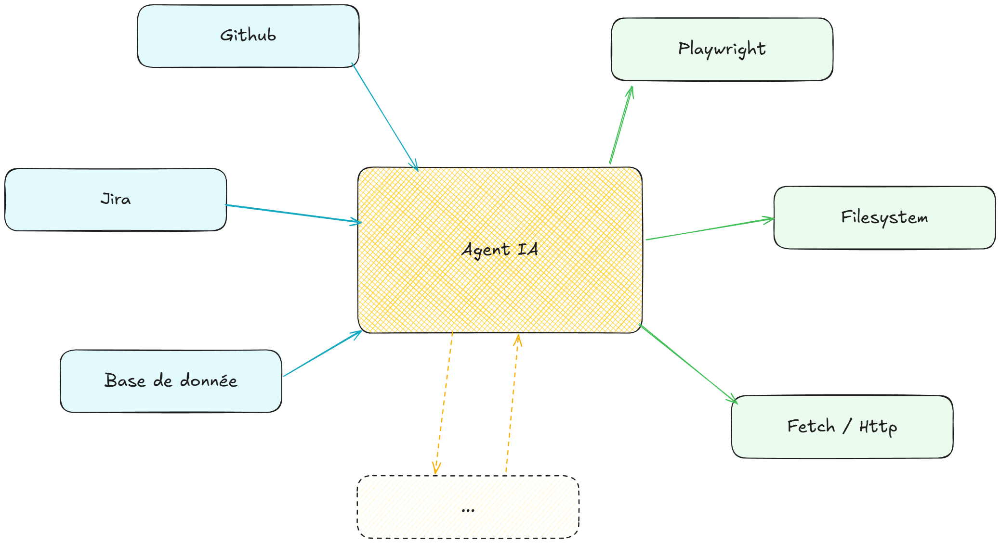
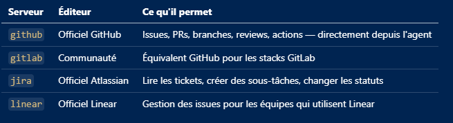
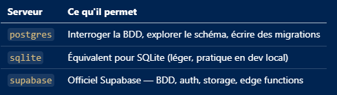
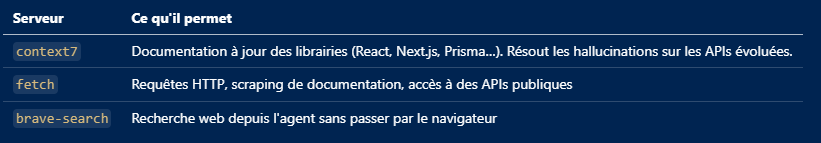
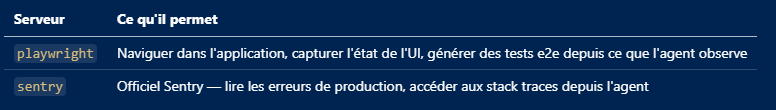
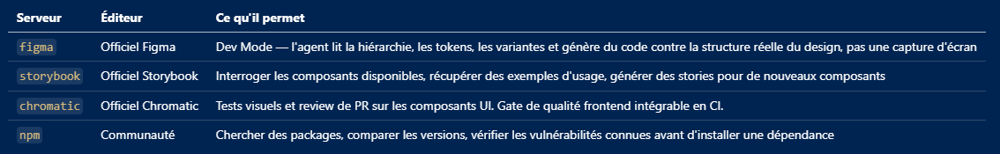
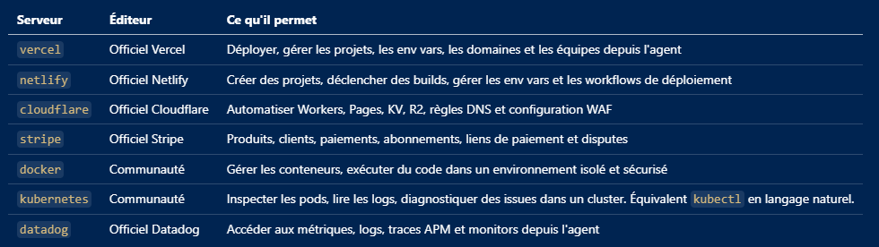

# Chapitre 4 — Panorama des outils

---

Les outils présentés dans ce chapitre évoluent plus vite que le reste du module. En quelques mois, des offres gratuites ont disparu ou changé de nom, des produits ont été rachetés ou rebaptisés, et des projets open source ont cessé d'être maintenus. Les abonnements, les quotas et les garanties sur les données changent régulièrement.

Pour cette raison, ce chapitre ne donne ni tarifs ni quotas. Il décrit ce qui dure : la nature des outils (leur forme d'usage, leur éditeur, leur ouverture), les concepts qu'ils partagent, et les questions à poser avant d'en adopter un. Pour les offres et les conditions, la source de référence est toujours la page officielle de l'outil, consultée le jour de la décision.

Ce panorama décrit l'état du marché fin 2026.

---

## 4.1 Les formes d'usage

Plutôt que de classer les outils par famille, il est plus utile de les classer par **forme d'usage**, car un même outil en prend souvent plusieurs : GitHub Copilot existe en extension d'IDE, en agent en terminal et en agent cloud ; Claude Code en terminal, en extension et en application desktop ; Devin en IDE, en terminal et dans le cloud.

| Forme | Principe | Atouts | Points d'attention |
|---|---|---|---|
| **IDE natif IA** (application desktop) | Un éditeur conçu autour de l'IA, qui indexe la codebase pour donner un contexte projet au modèle sans configuration manuelle | Expérience fluide sur les tâches multi-fichiers, peu de configuration initiale | Migration depuis l'éditeur habituel, coût d'adoption non nul |
| **Extension ou plugin d'éditeur** | L'IA s'ajoute à un éditeur existant (VS Code, JetBrains, Visual Studio…) | On garde son éditeur et ses habitudes, adoption progressive, intégration enterprise généralement mature | Le contexte projet est fourni explicitement (fichiers ouverts, fichier d'instructions) |
| **Agent en terminal** (CLI) | Un agent qui lit le projet, planifie, exécute des commandes et itère, indépendamment de l'éditeur | Autonomie sur les tâches larges (migration, refacto), automatisable (scripts, CI) | La supervision passe par les diffs et le terminal, pas par l'éditeur |
| **Agent cloud** (en ligne) | Un agent qui travaille sur un serveur ou un bac à sable distant, souvent déclenché depuis une issue ou une PR | Tâches asynchrones et parallèles, pas de machine locale mobilisée | Le code est envoyé sur l'infrastructure du fournisseur (voir 4.8) |

Ces formes se mélangent. Un IDE natif IA propose aussi un agent, une extension propose un mode terminal, un agent en terminal s'installe dans un éditeur. La forme d'usage compte pour deux raisons : elle détermine ce que l'outil voit du projet, et elle détermine où partent les données.

---

## 4.2 Les outils en détail

Chaque fiche situe l'outil : qui l'édite, si son code est ouvert, son historique, ses formes d'usage et ses particularités. Elle ne revient ni sur les tarifs ni sur les conditions (voir l'introduction du chapitre et les sections 4.7 et 4.8).

### GitHub Copilot

**Éditeur :** GitHub (Microsoft).
**Code :** service propriétaire. Certains composants sont publiés : l'extension Copilot Chat pour VS Code l'a été sous licence MIT, la CLI sous une licence propriétaire dont le code est consultable.
**Formes d'usage :** extension d'IDE (VS Code, JetBrains, Visual Studio, Xcode, Eclipse), agent en terminal (Copilot CLI), agent cloud (Copilot cloud agent, qui travaille sur GitHub).
**Particularités :** intégré à GitHub (issues, pull requests, revue de code), modèles de plusieurs fournisseurs selon le plan. Dans VS Code, les modes sont Ask, Agent et Plan. Lit `.github/copilot-instructions.md` et `AGENTS.md`.

### Claude Code

**Éditeur :** Anthropic.
**Code :** propriétaire. La licence du dépôt est « tous droits réservés », soumise aux conditions commerciales d'Anthropic. Le dépôt public héberge les issues, des plugins et des exemples.
**Formes d'usage :** agent en terminal, extensions IDE (VS Code, JetBrains), application desktop, intégration à GitHub (mention `@claude`).
**Particularités :** utilise uniquement les modèles Claude, via l'API d'Anthropic ou via les offres d'Amazon, Google Cloud et Microsoft. Skills, hooks, subagents et plugins y sont particulièrement développés, et plusieurs autres outils savent lire ses formats (skills, plugins, `CLAUDE.md`). Lit `CLAUDE.md` et, en son absence, `AGENTS.md`.

### Codex (OpenAI)

**Éditeur :** OpenAI.
**Code :** la CLI est publiée sous licence Apache-2.0 (open source).
**Formes d'usage :** agent en terminal (Codex CLI), extension IDE, application desktop, agent cloud (Codex Web).
**Particularités :** modèles OpenAI. Connexion par compte ChatGPT ou par clé API. Codex est l'un des outils à l'origine du standard `AGENTS.md` (voir Chapitre 3).

### Cursor

**Éditeur :** Anysphere.
**Code :** propriétaire.
**Formes d'usage :** IDE natif IA (fork de VS Code), agent en terminal (CLI, commande `agent`), agents cloud (anciennement « background agents »), lancés depuis l'IDE, le web, Slack, GitHub ou Linear.
**Particularités :** a popularisé le concept d'IDE natif IA : l'éditeur indexe la codebase en permanence, propose une complétion avancée (Tab) et un mode agent. Modèles de plusieurs fournisseurs, plus des modèles propres (famille Composer, qui est un modèle et non un mode). Lit `.cursor/rules/` et `AGENTS.md`, et charge aussi les skills d'autres outils. Propose un mode de confidentialité (Privacy Mode).

### Devin Desktop (anciennement Windsurf)

**Éditeur :** Cognition.
**Code :** propriétaire.
**Historique :** Windsurf était développé par Codeium. En juillet 2025, le rachat prévu par OpenAI (3 Md$) est tombé à l'eau pour des raisons de propriété intellectuelle. Google DeepMind a récupéré une licence sur la technologie et une partie de l'équipe R&D (dont le CEO), puis Cognition (éditeur de Devin) a racheté le reste (produit, marque, équipe, contrats). Le 2 juin 2026, Windsurf est devenu Devin Desktop : c'est le même IDE, rebaptisé sous la marque Devin.
**Formes d'usage :** IDE desktop (base VS Code), Devin CLI en terminal, Devin Cloud (agent autonome dans le cloud), Devin Review pour les pull requests.
**Particularités :** un panneau de pilotage réunit les agents locaux et les agents cloud. Lit `AGENTS.md`, `.devin/rules/` et, par import, des fichiers d'autres outils (`CLAUDE.md`, `.cursor/rules/`). Les anciens chemins `.windsurf/` restent lus.

### Zed

**Éditeur :** Zed Industries.
**Code :** open source (GPL-3.0 pour l'essentiel, certains composants en Apache-2.0).
**Formes d'usage :** éditeur natif écrit en Rust (ce n'est pas un fork de VS Code), avec un agent intégré.
**Particularités :** misé sur la performance et la réactivité. Zed sait aussi héberger des agents externes (Claude, Codex, OpenCode, Copilot, Cursor…) grâce à l'ACP (*Agent Client Protocol*), un protocole qui permet à un éditeur de piloter un agent tiers. Plusieurs autres outils (Devin CLI, Mistral Vibe) s'y branchent aussi.

### Google : de Gemini CLI à Antigravity

**Éditeur :** Google.
**Gemini CLI :** agent en terminal open source (Apache-2.0). Depuis le 18 juin 2026, son périmètre est réduit aux licences d'entreprise (Gemini Code Assist) : l'accès individuel est passé à Antigravity.
**Antigravity :** plateforme de développement agentique. Application desktop (agents en parallèle), CLI (`agy`), IDE, SDK Python, extensions pour VS Code, Visual Studio, JetBrains, Zed, Xcode et Eclipse. Modèles Gemini et de partenaires. Le code n'est pas présenté comme open source.
**Particularités :** c'est un exemple de transition de produit : un outil très diffusé change de périmètre et de nom en quelques mois. Antigravity CLI reprend les mécanismes de Gemini CLI (skills, hooks, subagents, extensions devenues plugins) et lit `GEMINI.md` et `AGENTS.md`.

### JetBrains : AI Assistant et Junie

**Éditeur :** JetBrains, éditeur des IDE du même nom.
**Formes d'usage :** AI Assistant est un plugin intégré aux IDE JetBrains (chat, agents, complétion). Junie est l'agent de code de JetBrains, utilisable en terminal (Junie CLI) et dans les IDE.
**Particularités :** Junie fonctionne avec le modèle de votre choix (clés d'API personnelles, modèles locaux). Pertinent pour les équipes qui travaillent déjà dans l'écosystème JetBrains (Java, Kotlin, Python, .NET…).

### Mistral Vibe

**Éditeur :** Mistral AI (France).
**Formes d'usage :** Vibe est un produit unifié qui regroupe l'assistant de chat (anciennement Le Chat) et un agent de code. L'agent de code existe en terminal (`vibe`, paquet Python), en extension VS Code et en sessions cloud. Il se branche aussi sur JetBrains et Zed via l'ACP.
**Particularités :** fonctionne avec les modèles hébergés par Mistral, avec des modèles locaux ou avec n'importe quelle API compatible OpenAI. Pertinent quand la souveraineté ou le recours à des modèles à poids ouverts est un critère (voir Chapitre 1).

### Alternatives open source

Les outils open source sont portés par des équipes plus petites et évoluent plus vite. Ils permettent de choisir son modèle (clés d'API personnelles, modèles locaux) et d'auditer le code de l'outil lui-même.

| Outil | Formes d'usage | Licence | À savoir |
|---|---|---|---|
| **OpenCode** | Terminal, application desktop (bêta) | MIT | Agent en terminal indépendant de tout fournisseur de modèle : plus de 75 fournisseurs via Models.dev, modèles locaux (Ollama, par exemple) |
| **Cline** | Extension VS Code, plugin JetBrains (non open source), CLI, application desktop | Apache-2.0 | Agent autonome, aussi proposé sous forme de SDK. Roo Code en est issu (voir ci-dessous) |
| **Kilo Code** | Extension VS Code, plugin JetBrains, CLI, agent cloud | MIT | Sa CLI est un fork d'OpenCode |
| **Goose** | Application desktop, CLI, API | Apache-2.0 | Agent généraliste, pas seulement dédié au code. Passé de Block à la Linux Foundation (Agentic AI Foundation) |
| **Aider** | Terminal | Apache-2.0 | Programmation en binôme avec un LLM, centrée sur git |

Un projet open source peut aussi s'arrêter. En mai 2026, l'extension Roo Code a été arrêtée et son dépôt archivé. Le dépôt de Continue indique ne plus être activement maintenu. Avant d'adopter un outil open source dans une équipe, regardez sa gouvernance (société, fondation), le nombre de mainteneurs et le rythme des publications.

### À surveiller

- **Kiro** (AWS) : un IDE basé sur Code OSS, avec une CLI, centré sur le développement piloté par les spécifications (la demande est transformée en exigences, conception et tâches avant l'implémentation).
- **Amp** : un agent en terminal et en application web, présenté par son éditeur comme indépendant.

### Ce qu'en disent les développeurs

L'enquête Stack Overflow 2026 (30 903 réponses au total) a demandé à ses répondants quels agents ou assistants de code ils avaient utilisés au cours de l'année écoulée. Il s'agit d'un usage déclaré, avec plusieurs réponses possibles, par des répondants volontaires : ce n'est pas une part de marché.

| Outil | Part des répondants l'ayant utilisé |
|---|---|
| Claude Code | 65,5 % |
| GitHub Copilot | 58,7 % |
| OpenAI Codex | 29,5 % |
| Cursor | 25,5 % |
| Google Antigravity | 16,0 % |
| Gemini Code Assist | 14,6 % |
| OpenCode | 13,6 % |
| JetBrains AI | 12,8 % |
| Windsurf | 6,5 % |
| Cline | 4,5 % |

Retenez surtout deux enseignements : la plupart des développeurs combinent plusieurs outils d'IA (40,5 % en utilisent trois à cinq par semaine, toutes catégories d'outils confondues), et un outil très cité cette année peut être remplacé l'année suivante.

---

## 4.3 MCP, ce que ça change pour les agents

Le Model Context Protocol mérite une section dédiée ici parce qu'il est le facteur qui transforme un agent en outil réellement utile sur une codebase de production.

Un agent qui ne peut accéder qu'aux fichiers du projet est limité. Un agent qui peut lire les tickets Jira du sprint, interroger la base de données de staging, vérifier l'état des pipelines CI, et naviguer dans la documentation, c'est un collaborateur.



**Serveurs MCP notables pour les développeurs :**

L'écosystème MCP compte aujourd'hui des milliers de serveurs. Les références à connaître pour une activité de développement :

**Classiques — gestion de projet et code**



**Données et bases de données**



**Documentation et recherche**



**Tests et qualité**



**Frontend et design**



**Infrastructure**



**Vérifiez l'état d'un serveur avant de l'installer.** Les serveurs MCP changent de mainteneur et de statut. Plusieurs serveurs de référence historiques (GitHub, GitLab, PostgreSQL, SQLite, Brave Search, Slack, Sentry, Puppeteer…) ont été archivés, certains au profit de serveurs maintenus par les éditeurs eux-mêmes (par exemple le serveur officiel de GitHub, ou celui de Brave). Le dépôt des serveurs de référence ne conserve aujourd'hui qu'une poignée de serveurs d'exemple (Fetch, Filesystem, Git, Memory, Time…), qu'il présente comme des implémentations pédagogiques, pas comme des solutions prêtes pour la production.

**Pour découvrir l'écosystème :** le [registre MCP officiel](https://registry.modelcontextprotocol.io/) référence les serveurs publiés. Des annuaires tiers existent aussi : ils sont pratiques, mais ne garantissent ni la qualité ni la sécurité des serveurs listés.

**Comment ça s'installe :**

L'installation se fait en deux étapes : déclarer le serveur dans la configuration de l'outil, et fournir les credentials nécessaires (généralement via des variables d'environnement). Le protocole est le même partout, mais **la configuration diffère d'un outil à l'autre**, y compris dans le nom de la clé racine :

| Outil | Où se déclare un serveur MCP | Clé racine |
|---|---|---|
| Claude Code | `.mcp.json` (projet, à committer), `~/.claude.json` (local ou utilisateur), ou commande `claude mcp add` | `mcpServers` |
| Cursor | `.cursor/mcp.json` (projet), `~/.cursor/mcp.json` (global) | `mcpServers` |
| VS Code (Copilot) | `.vscode/mcp.json` (commande « MCP: Add Server ») | `servers` |
| Copilot CLI | `~/.copilot/mcp-config.json` ou `copilot mcp add` | `mcpServers` |
| Codex | `~/.codex/config.toml` ou `.codex/config.toml` (projet), ou `codex mcp add` | tables `[mcp_servers.<nom>]` |
| OpenCode | `opencode.json` (projet) ou `~/.config/opencode/opencode.json` | `mcp` |
| Zed | fichier de paramètres de Zed | `context_servers` |
| Devin | `.devin/mcp_config.json` (projet), `~/.config/devin/mcp_config.json` (utilisateur) | `mcpServers` |

Exemple avec Claude Code : la commande ajoute le serveur au fichier `.mcp.json` du projet, que l'équipe partage via git.

```bash
claude mcp add --scope project context7 -- npx -y @upstash/context7-mcp
```

```json
{
  "mcpServers": {
    "context7": {
      "command": "npx",
      "args": ["-y", "@upstash/context7-mcp"]
    }
  }
}
```

Dans VS Code, le même type de serveur se déclare dans `.vscode/mcp.json`, avec une autre clé racine :

```json
{
  "servers": {
    "playwright": {
      "type": "stdio",
      "command": "npx",
      "args": ["-y", "@playwright/mcp@latest"]
    }
  }
}
```

Ne recopiez pas une configuration d'un outil à l'autre sans vérifier le format attendu.

**Note de sécurité importante :** les serveurs MCP locaux s'exécutent avec les permissions de l'utilisateur courant. Un serveur `filesystem` mal configuré peut lire l'intégralité du disque. Un serveur qui combine accès à des données privées et capacité à faire des requêtes externes est un vecteur d'exfiltration potentiel. Un serveur de navigateur comme Playwright MCP n'est pas une frontière de sécurité non plus. En contexte de mission, ne configurer que les serveurs nécessaires, d'un éditeur identifié, et avec le minimum de permissions requis.

---

## 4.4 Plugins : empaqueter la configuration d'un agent

MCP standardise l'accès de l'agent aux outils externes. Les **plugins** vont plus loin : ils empaquettent la configuration de l'agent lui-même dans une unité versionnée et installable. Ils répondent à un problème vu au Chapitre 3 : configurer un agent (fichier de contexte, skills réutilisables, hooks de vérification) est un travail manuel, répété projet par projet et outil par outil.

Un plugin contient généralement des **skills** et des **serveurs MCP**, et selon l'outil des **agents spécialisés**, des **hooks** et des **commandes**. Les skills et les serveurs MCP sont les composants réellement portables d'un outil à l'autre. Les agents, les hooks et les commandes dépendent du client qui les lit.

### Deux écosystèmes équivalents

Claude Code et l'écosystème VS Code / GitHub Copilot ont chacun leur format de plugin, et ils convergent :

| | Claude Code | VS Code / GitHub Copilot |
|---|---|---|
| Format | `.claude-plugin/plugin.json` | Agent Plugins, un standard ouvert (`plugin.json`). VS Code lit aussi les formats Copilot, Claude et OpenPlugin |
| Catalogue | Un *marketplace* est un dépôt avec un fichier `.claude-plugin/marketplace.json`, c'est un catalogue, pas une boutique hébergée. Celui d'Anthropic est ajouté par défaut | Des marketplaces au schéma de Claude Code, dont certains fournis par GitHub |
| Installation | `/plugin marketplace add <propriétaire>/<dépôt>`, puis `/plugin install <plugin>@<marketplace>` | `Chat: Install Plugin from Source` (URL Git ou dossier local) ou éditeur de personnalisations. Commandes `/plugin` dans Copilot CLI |
| Portée | Utilisateur, projet (via la configuration versionnée) ou local | Utilisateur ou espace de travail |
| Contenu | Skills, agents, hooks, serveurs MCP | Skills et MCP (portables) ; agents, hooks et commandes dans l'espace de noms du client |

D'autres outils ont leur variante : Cursor (`.cursor-plugin/plugin.json`, et aussi le standard Agent Plugins), Codex (`.codex-plugin/plugin.json`, non pris en charge dans son extension IDE), Devin CLI (`.devin-plugin/plugin.json`, avec repli sur le format Claude), Antigravity (les extensions Gemini sont devenues des plugins). OpenCode a une notion différente : des modules JavaScript ou des paquets npm qui ajoutent des outils et des hooks, plus proches d'une extension de code que d'un paquet de skills.

La documentation de VS Code prévient que la prise en charge d'un format ne garantit pas que chaque composant fonctionne dans chaque client. Plusieurs réglages de VS Code sur les plugins sont d'ailleurs encore marqués expérimentaux : le sujet est jeune.

### Alternative sans plugin : un socle portable dans le dépôt

Un plugin se justifie quand il faut distribuer et mettre à jour une configuration sur plusieurs projets. Pour un seul dépôt, une alternative plus légère existe : versionner dans le projet un fichier `AGENTS.md` et des skills dans un dossier `.agents/skills/`. Ce dossier est lu par Copilot, Codex, Cursor, Devin, Zed, OpenCode et Antigravity. Claude Code lit `.claude/skills/` (que Copilot, Cursor et OpenCode lisent aussi).

| | Plugin | Socle dans le dépôt |
|---|---|---|
| Distribution | Installation en une commande, depuis un marketplace ou un dépôt Git | Chaque projet embarque sa copie |
| Versionnement et mises à jour | Versionné, mis à jour de façon centralisée | Mis à jour projet par projet |
| Portabilité | Dépend du format du client | Skills et fichier de contexte lisibles par la plupart des outils |
| Sujet du Chapitre 6 | Plugin d'équipe | Standards partagés par projet |

Dans les deux cas, un plugin installé peut exécuter du code avec les droits de l'utilisateur : il se relit comme n'importe quelle dépendance (voir Chapitre 6).

---

## 4.5 Comparer les outils

Les outils changent de nom et de chemins, mais ils reposent sur les mêmes concepts. Deux comparatifs permettent de s'y retrouver : le premier par forme d'usage, le second par concept.

### Formes d'usage et ouverture du code

Le signe « — » signifie « non documenté ou sans objet ».

| Outil | IDE ou application desktop | Extension d'éditeur | Terminal | Cloud | Code ouvert |
|---|---|---|---|---|---|
| GitHub Copilot | ✓ (application Copilot) | ✓ | ✓ | ✓ | Non (certains composants publiés) |
| Claude Code | ✓ (desktop) | ✓ | ✓ | ✓ (mention `@claude` dans GitHub) | Non |
| Codex | ✓ (desktop) | ✓ | ✓ | ✓ (Codex Web) | CLI : Apache-2.0 |
| Cursor | ✓ (IDE) | — | ✓ (`agent`) | ✓ (agents cloud) | Non |
| Devin | ✓ (Desktop) | — | ✓ (Devin CLI) | ✓ (Devin Cloud) | Non précisé |
| Zed | ✓ (IDE) | — | — | — | GPL-3.0 (composants Apache-2.0) |
| Antigravity | ✓ (App, IDE) | ✓ | ✓ (`agy`) | — | Non précisé |
| JetBrains (AI Assistant, Junie) | — | ✓ | ✓ (Junie CLI) | — | Non précisé |
| Mistral Vibe | — | ✓ (VS Code) | ✓ | ✓ | Non précisé |
| OpenCode | ✓ (bêta) | — | ✓ | — | MIT |
| Cline | ✓ | ✓ | ✓ | — | Apache-2.0 |
| Kilo Code | — | ✓ | ✓ | ✓ | MIT |

### Les mêmes concepts, sous des noms et des chemins différents

Les chemins ci-dessous sont ceux de la documentation officielle consultée en octobre 2026. Ils changent : retenez la logique, vérifiez les noms dans la documentation.

| Outil | Contexte projet | Skills | Hooks | MCP | Plugins | Subagents |
|---|---|---|---|---|---|---|
| Claude Code | `CLAUDE.md` (`AGENTS.md` en son absence) | `.claude/skills/` | `.claude/settings.json` | `.mcp.json` | `.claude-plugin/` | Oui |
| GitHub Copilot | `.github/copilot-instructions.md`, `AGENTS.md` | `.github/skills/`, `.agents/skills/`, `.claude/skills/` | `.github/hooks/*.json` | `.vscode/mcp.json`, `~/.copilot/mcp-config.json` | Agent Plugins | `.github/agents/` |
| Codex | `AGENTS.md` | `.agents/skills/` | `hooks.json`, `config.toml` | `config.toml` | `.codex-plugin/` (pas dans l'extension IDE) | `.codex/agents/*.toml` |
| Cursor | `.cursor/rules/` (`.mdc`), `AGENTS.md` | `.cursor/skills/`, `.agents/skills/` | `.cursor/hooks.json` | `.cursor/mcp.json` | `.cursor-plugin/`, Agent Plugins | `.cursor/agents/` |
| Devin | `AGENTS.md`, `.devin/rules/` | `.devin/skills/`, `.agents/skills/` | `.devin/hooks.v1.json` | `.devin/mcp_config.json` | `.devin-plugin/` | `.devin/agents/` |
| Zed | Premier fichier trouvé dans une liste (`.rules`, `AGENTS.md`, `CLAUDE.md`…) | `.agents/skills/` | Non trouvé | `context_servers` (paramètres) | Extensions (autre notion) | Outil `spawn_agent` |
| OpenCode | `AGENTS.md` (repli sur `CLAUDE.md`) | `.opencode/skills/`, `.agents/skills/`, `.claude/skills/` | Via les plugins | Clé `mcp` dans `opencode.json` | Modules JS/TS, npm | `.opencode/agents/` |
| Antigravity | `GEMINI.md`, `AGENTS.md` | `.agents/skills/` | Oui (hooks de cycle de vie) | `.agents/mcp_config.json` | Plugins | Oui |

### Ce que cela change pour vous

Les compétences se transfèrent d'un outil à l'autre. Un fichier de contexte, des skills, des hooks, des serveurs MCP, des plugins et des subagents existent dans la quasi-totalité des outils cités, et ce que vous avez appris au Chapitre 3 s'applique partout. Les différences portent surtout sur les noms et les emplacements.

Les outils se lisent d'ailleurs entre eux : `AGENTS.md` et le dossier `.agents/skills/` sont reconnus par la plupart d'entre eux, et plusieurs outils chargent aussi les fichiers de Claude Code (`.claude/skills/`, `CLAUDE.md`). C'est ce qui rend un socle portable (voir 4.4) réaliste.

---

## 4.6 Choisir : quelques règles pratiques

Il n'y a pas de bon choix universel. Le bon outil dépend du contexte, et les règles ci-dessous portent sur la forme d'usage et le cadre contractuel plutôt que sur un produit.

| Critère | À privilégier | Exemples |
|---|---|---|
| Le client a une politique stricte sur les outils | L'offre validée par sa DSI, avec les garanties contractuelles sur les données (voir 4.8) | Les offres professionnelles des outils ci-dessus |
| Exploration ou formation, hors code client | Une offre individuelle d'entrée de gamme, ou un outil open source avec votre propre clé de modèle | OpenCode, Cline, Kilo Code |
| Workflow agentic complexe (migration, refacto large) | Un agent en terminal | Claude Code, Codex CLI, Copilot CLI, Devin CLI, Cursor CLI, OpenCode |
| Migrer vers un IDE natif IA | Un IDE conçu autour de l'IA | Cursor, Devin Desktop, Zed, Antigravity |
| L'équipe travaille dans l'écosystème JetBrains | Les outils intégrés à ces IDE | AI Assistant, Junie |
| Neutralité vis-à-vis du fournisseur de modèle | Un outil qui accepte vos propres clés | OpenCode, Cline, Kilo Code |
| Souveraineté | Des modèles à poids ouverts, auto-hébergés ou utilisés via un outil compatible | Mistral Vibe, OpenCode avec des modèles locaux |
| Équipe qui utilise plusieurs outils | Des formats portables, versionnés dans le dépôt | `AGENTS.md`, Agent Skills, MCP |

---

## 4.7 Offres et conditions : où vérifier, quoi vérifier

Les offres changent plus vite que tout le reste. Plutôt que de les décrire, cette section donne les repères qui durent et renvoie vers les pages officielles.

### Les types d'offre

On retrouve presque toujours les mêmes catégories : une offre **individuelle** (gratuite ou payante), une offre **équipe**, une offre **entreprise**, et un accès par **clé d'API** ou via un fournisseur cloud. Elles diffèrent surtout par :

- les **limites d'usage** et leur mode de décompte (crédits, requêtes, tokens, quota hebdomadaire). Plusieurs outils ont changé de mode de facturation en quelques mois ;
- les **modèles accessibles** ;
- les **conditions sur les données** (entraînement, rétention, voir 4.8) ;
- les **contrôles d'administration** (SSO, politiques, journaux d'audit).

### Les conditions d'utilisation comptent autant que le prix

Une offre peut être gratuite et assortie de conditions qui la rendent inutilisable en mission. Un exemple : les conditions d'Antigravity interdisent d'utiliser un compte Antigravity avec des logiciels tiers, et citent nommément Claude Code et OpenCode. Les offres « gratuites » sont aussi les premières à disparaître : l'accès individuel gratuit de Gemini CLI a pris fin en juin 2026 au profit d'Antigravity.

### Où vérifier

| Outil | Offres et limites | Données et sécurité |
|---|---|---|
| GitHub Copilot | [Plans Copilot](https://docs.github.com/en/copilot/get-started/plans) | [FAQ Copilot](https://github.com/features/copilot) |
| Claude Code | [Tarifs Claude](https://claude.com/pricing) | [Usage des données](https://code.claude.com/docs/en/data-usage) |
| Codex | [Documentation Codex](https://learn.chatgpt.com/docs) (page tarifs) | [Documentation Codex](https://learn.chatgpt.com/docs) |
| Cursor | [Tarifs Cursor](https://cursor.com/pricing) | [Sécurité](https://cursor.com/security) et [usage des données](https://cursor.com/data-use) |
| Antigravity | [Plans Antigravity](https://antigravity.google/docs/plans/) | [FAQ Antigravity](https://antigravity.google/docs/faq/) |
| Devin | [Documentation Devin](https://docs.devin.ai) | [Documentation Devin](https://docs.devin.ai) |
| Mistral Vibe | [Vibe](https://mistral.ai/products/vibe) | [Documentation Mistral](https://docs.mistral.ai/) |
| Azure (modèles OpenAI) | [Types de déploiement](https://learn.microsoft.com/azure/ai-foundry/foundry-models/concepts/deployment-types) | [Données et confidentialité](https://learn.microsoft.com/legal/cognitive-services/openai/data-privacy) |

### Avant d'adopter un outil pour une équipe

1. Quelle offre exactement (individuelle, équipe, entreprise) et quelles sont ses limites d'usage ?
2. Les données envoyées servent-elles à entraîner des modèles ? Combien de temps sont-elles conservées ?
3. Où le code est-il traité (région, zone de données) ?
4. L'offre est-elle compatible avec la politique du client ?
5. Les conditions d'utilisation autorisent-elles l'usage prévu (CI, outils tiers, comptes partagés) ?
6. Quelles garanties sur la propriété intellectuelle du code généré ?
7. Quels contrôles d'administration (SSO, journaux, restriction de modèles) ?
8. Que se passe-t-il si l'offre change : la configuration de l'équipe est-elle portable ?

---

## 4.8 Données, confidentialité et licences

### Qui voit quoi, selon la forme d'usage

- **Extension ou agent en terminal** : le code est lu localement, mais la partie envoyée au modèle (fichiers lus, historique, prompt) part chez le fournisseur du modèle.
- **Agent cloud** : le dépôt est cloné sur l'infrastructure du fournisseur, qui exécute l'agent dans une machine virtuelle ou un bac à sable.
- **Modèle auto-hébergé** : rien ne sort de l'infrastructure de l'organisation.

### Entraînement et rétention selon le type de compte

Les garanties dépendent du **type de compte**, pas seulement de l'outil :

| Offre | Entraînement sur vos données | À savoir |
|---|---|---|
| Copilot Free, Pro, Pro+ | Possible, désactivable dans les paramètres | |
| Copilot Business, Enterprise | Non, d'après GitHub | Données traitées sous le cadre contractuel de protection des données de GitHub |
| Claude Code, comptes grand public (Free, Pro, Max) | Selon un réglage du compte | Rétention de 5 ans si l'utilisation est autorisée, 30 jours sinon |
| Claude Code, offres commerciales (Team, Enterprise, API) | Non, sauf programme dédié | Rétention standard de 30 jours ; rétention zéro sur demande pour certaines offres Enterprise |
| Cursor, Privacy Mode activé | Non | Accords de rétention zéro avec les fournisseurs de modèles, vérifications d'abus possibles |
| Cursor, sans Privacy Mode | Possible | Les données peuvent servir à améliorer et entraîner les modèles |
| Azure (modèles OpenAI) | Non | Stockage au repos dans la géographie choisie. Traitement dans la région choisie (Standard), la zone de données UE (Data Zone) ou toute région (Global) |
| Modèle à poids ouverts auto-hébergé | Sans objet | Aucune donnée ne sort ; licence du modèle à vérifier |

### Les trois sens du mot « licence »

Le mot recouvre trois réalités à ne pas confondre :

1. **La licence de l'outil lui-même.** Open source (Codex CLI est sous licence Apache-2.0), propriétaire (le dépôt public de Claude Code est publié « tous droits réservés »), ou propriétaire consultable (le code de Copilot CLI est visible, mais sa licence interdit de le modifier). Un dépôt public n'est pas un dépôt open source.
2. **Le code généré et les garanties de propriété intellectuelle.** Les plans individuels de Copilot n'incluent pas de garantie d'indemnisation en cas de litige sur la propriété intellectuelle. Pour les offres professionnelles, vérifiez dans le contrat si une garantie existe. Les outils peuvent aussi filtrer les suggestions qui correspondent à du code public (Copilot compare à partir d'environ 65 lexèmes).
3. **La licence des modèles.** Un modèle à poids ouverts n'est pas pour autant libre de droits : la licence peut limiter l'usage commercial (voir Chapitre 1).

### Contrôles d'entreprise

Les offres professionnelles ajoutent des contrôles qui comptent pour une DSI : exclusion de contenus sensibles (Copilot Business et Enterprise), réglages de confidentialité imposés à l'équipe (Cursor), restriction des modèles et des outils autorisés (Claude Code en configuration managée, contrôles d'accès par dépôt, modèle et MCP chez Cursor Enterprise).

### Licences et shadow IT

Utiliser un outil IA avec un compte personnel sur du code client crée une situation de non-conformité dont les conséquences peuvent être sérieuses : résiliation de contrat, mise en cause pour violation de confidentialité, responsabilité personnelle engagée. Ce n'est pas un risque théorique.

Ce que ça implique en pratique :

- Avant d'utiliser un outil IA sur du code client, identifier la politique de l'organisation cliente sur le sujet
- Si la politique n'existe pas, la faire émerger — c'est une conversation à avoir avec le référent technique ou la DSI du client, pas une décision individuelle
- Ne jamais supposer que l'absence de politique = autorisation tacite
- Les comptes personnels ne sont jamais une solution acceptable sur du code propriétaire, quelle que soit la "prudence" dont on pense faire preuve

---

## ✅ Quiz — Chapitre 4

_10 questions — environ 10 minutes_

---

**Question 1.** Parmi ces affirmations sur les formes d'usage des outils IA, laquelle est exacte ?

- A) Un même outil peut se présenter sous plusieurs formes : GitHub Copilot existe par exemple en extension d'IDE, en agent en terminal et en agent cloud
- B) Un IDE natif IA est une extension à installer dans VS Code
- C) Un agent en terminal ne peut pas modifier plusieurs fichiers
- D) Un agent cloud s'exécute toujours sur le poste du développeur

> ✅ **Réponse : A** — Les outils se classent moins par famille que par forme d'usage, et la plupart en proposent plusieurs. B est faux : un IDE natif IA est un éditeur à part entière. C est faux : les agents en terminal sont justement faits pour les tâches multi-fichiers. D est faux : un agent cloud s'exécute sur l'infrastructure du fournisseur, ce qui pose la question des données.

---

**Question 2.** Un développeur en mission sur une codebase TypeScript volumineuse veut effectuer une migration d'une bibliothèque vers une autre sur 150 fichiers. Quel type d'outil est le plus adapté ?

- A) Un assistant en complétion inline
- B) Un outil de refacto statique, l'IA n'est pas adaptée à ce type de tâche
- C) Un IDE natif IA uniquement : les agents en terminal ne peuvent pas traiter autant de fichiers
- D) Un agent capable de lire l'ensemble du projet et de planifier la migration, comme un agent en terminal (Claude Code, Codex CLI, Copilot CLI, OpenCode…)

> ✅ **Réponse : D** — Une migration sur 150 fichiers est exactement le cas d'usage où un agent apporte le plus : il lit le projet, planifie les modifications, exécute et itère. Le mode agent d'un IDE natif IA convient aussi, mais ce n'est pas le seul choix. A ne couvre pas la tâche, B est faux, et C affirme à tort une limite des agents en terminal.

---

**Question 3.** Avec Claude Code, comment partager avec l'équipe, via git, la configuration d'un serveur MCP propre au projet ?

- A) Dans `~/.claude.json`, le fichier personnel de l'utilisateur
- B) Dans `.claude/settings.json`, qui contient les définitions de serveurs
- C) Dans un fichier `.mcp.json` à la racine du projet, committé (par exemple avec `claude mcp add --scope project`)
- D) Dans le README du projet, que chacun recopie à la main

> ✅ **Réponse : C** — Le fichier `.mcp.json` du projet est fait pour être partagé via git. A est un emplacement personnel, non partagé. B est faux : `.claude/settings.json` ne contient pas les définitions de serveurs, seulement des approbations. D reproduit la duplication que MCP cherche à éviter.

---

**Question 4.** Quel serveur MCP permettrait à un agent de limiter les hallucinations sur les APIs d'une bibliothèque dont la documentation a évolué depuis l'entraînement du modèle ?

- A) `github` — pour accéder au code source de la bibliothèque
- B) `context7` — pour accéder à la documentation de librairies à jour
- C) `playwright` — pour naviguer sur le site de documentation
- D) `fetch` — pour faire une requête HTTP sur la documentation

> ✅ **Réponse : B** — Context7 fournit à l'agent de la documentation de librairies à jour et par version, ce qui réduit le risque d'API inventée ou périmée. Il ne le supprime pas : cette documentation est alimentée par la communauté, et son exactitude n'est pas garantie. `fetch` (D) et `playwright` (C) permettent de lire une page, mais sans organiser la documentation par bibliothèque et par version. `github` (A) donne le code source, pas la documentation.

---

**Question 5.** Un développeur en mission utilise Claude Code avec son compte personnel sur du code appartenant au client. Quel est le problème principal ?

- A) Claude Code n'est pas autorisé en contexte professionnel
- B) La performance de Claude Code est réduite sur les comptes personnels
- C) Il n'y a pas de problème si le développeur fait attention à ne pas coller de données sensibles
- D) C'est du shadow IT : code propriétaire du client dans un service non validé, avec des conditions (entraînement, rétention) qui diffèrent de celles d'une offre professionnelle

> ✅ **Réponse : D** — Utiliser un compte personnel sur du code client est du shadow IT indépendamment des précautions prises. Les garanties dépendent du type de compte : sur un compte grand public, l'entraînement peut dépendre d'un réglage et la rétention être plus longue que sur une offre commerciale. La politique de l'organisation cliente n'est pas respectée et rien ne la rend visible.

---

**Question 6.** Un client exige que le code de la mission ne soit pas utilisé pour entraîner des modèles. Quelle option est cohérente avec cette exigence ?

- A) Copilot Free, avec les paramètres par défaut
- B) Copilot Business ou Enterprise, pour lesquels GitHub indique ne pas utiliser les données pour l'entraînement
- C) Un compte individuel gratuit, quel que soit l'outil
- D) N'importe quel outil, à condition de ne pas coller de données sensibles

> ✅ **Réponse : B** — Les garanties dépendent du type de compte : sur les plans individuels de Copilot, les interactions peuvent servir à l'entraînement (désactivable), alors que Business et Enterprise sont exclus de cet usage selon GitHub. Les comptes gratuits individuels (A, C) n'offrent pas ce cadre. D déplace la responsabilité sur le développeur et ne répond pas à l'exigence du client.

---

**Question 7.** Les offres, les noms et les produits des outils IA changent vite. Quelle pratique limite le plus le risque de dépendre d'un outil précis ?

- A) Garder le contexte, les skills et la configuration MCP dans des formats portables, versionnés dans le dépôt (`AGENTS.md`, Agent Skills, MCP)
- B) Choisir l'outil le plus utilisé du moment
- C) Ne conserver la configuration que dans les paramètres personnels de chaque développeur
- D) Attendre que les offres se stabilisent avant d'utiliser un outil

> ✅ **Réponse : A** — Des formats communs, versionnés avec le code, permettent de changer d'outil sans refaire la configuration de l'équipe. B ne protège pas d'un changement d'offre : l'outil le plus utilisé peut lui aussi évoluer. C disperse la configuration et la rend impossible à partager. D n'est pas tenable face à un marché qui bouge en continu.

---

**Question 8.** Un agent configure MCP avec le serveur `playwright`. Quelle capacité cela lui donne-t-il que la lecture des fichiers du projet ne permet pas ?

- A) Exécuter du code TypeScript dans le navigateur
- B) Déployer l'application sur un environnement de staging
- C) Naviguer dans l'application en cours d'exécution, observer l'état de l'UI et générer des tests e2e depuis ce qu'il observe
- D) Accéder au code source des dépendances npm

> ✅ **Réponse : C** — Playwright MCP donne à l'agent la capacité d'interagir avec une application en cours d'exécution comme le ferait un utilisateur : naviguer, cliquer, observer l'état, prendre des captures. Cela permet de générer des tests e2e basés sur le comportement réel de l'application.

---

**Question 9.** Un client vous demande si l'outil IA que vous utilisez est « open source ». Que devez-vous vérifier ?

- A) Que son dépôt de code est public sur GitHub
- B) La licence du code de l'outil lui-même, qui est distincte des conditions d'utilisation du service et de la licence des modèles
- C) Que l'outil utilise un modèle à poids ouverts
- D) Que l'outil est gratuit

> ✅ **Réponse : B** — Le mot « licence » recouvre trois réalités : celle de l'outil, celle du code généré (garanties de propriété intellectuelle) et celle des modèles. Un dépôt public n'est pas forcément open source : celui de Claude Code est publié « tous droits réservés », celui de Copilot CLI est consultable mais ne peut pas être modifié, alors que Codex CLI est sous licence Apache-2.0. Utiliser un modèle à poids ouverts (C) ne dit rien sur la licence de l'outil, et la gratuité (D) non plus.

---

**Question 10.** Un collègue propose d'adopter pour toute l'équipe un outil parce que son offre gratuite est très généreuse. Quelle vérification est la plus importante avant de l'adopter ?

- A) Le nombre de développeurs qui l'utilisent dans le monde
- B) Le nom du modèle utilisé par défaut
- C) Les conditions de l'offre : traitement des données (entraînement, rétention), conditions d'utilisation et pérennité de l'offre
- D) Aucune : une offre gratuite est toujours acceptable tant qu'on ne l'utilise pas sur du code client

> ✅ **Réponse : C** — Les garanties dépendent du type de compte, les conditions d'utilisation peuvent exclure certains usages, et les offres gratuites sont les premières à changer ou à disparaître (l'accès individuel gratuit de Gemini CLI a pris fin en juin 2026). La popularité (A) et le modèle par défaut (B) ne renseignent pas sur ces points. D est faux : la prudence ne s'arrête pas au code client, et les conditions comptent aussi pour une équipe qui expérimente.
