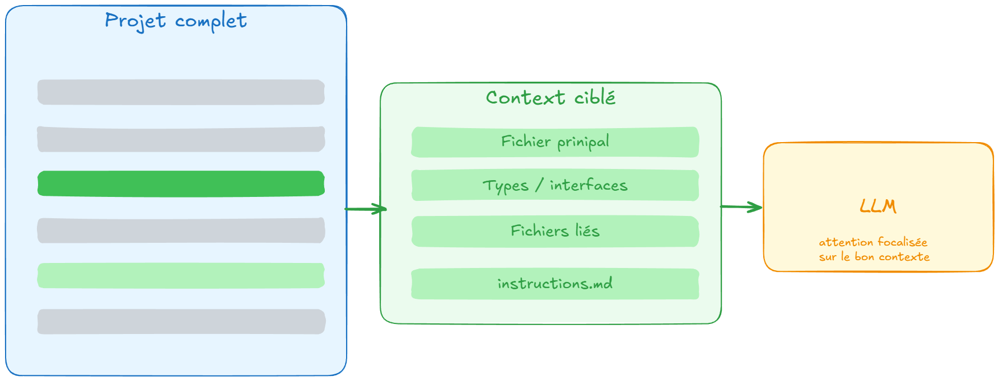
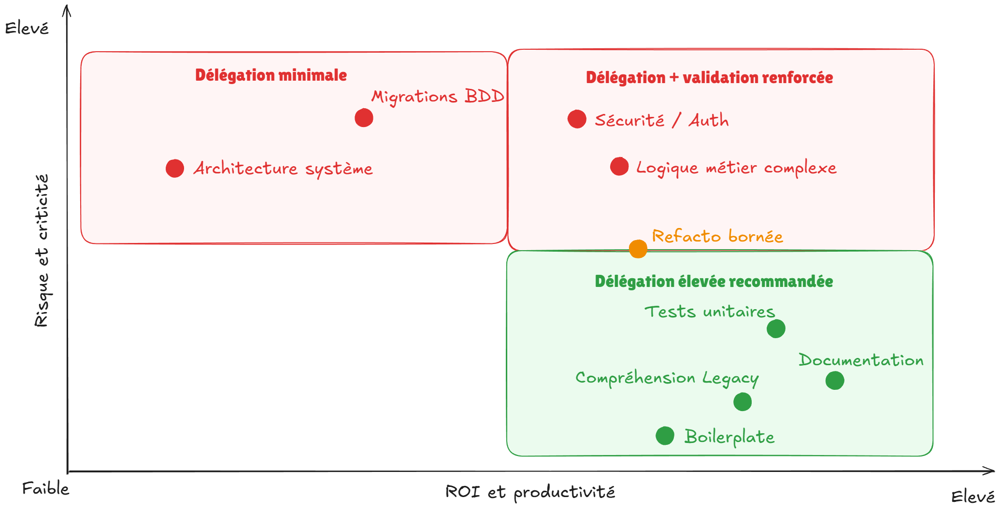
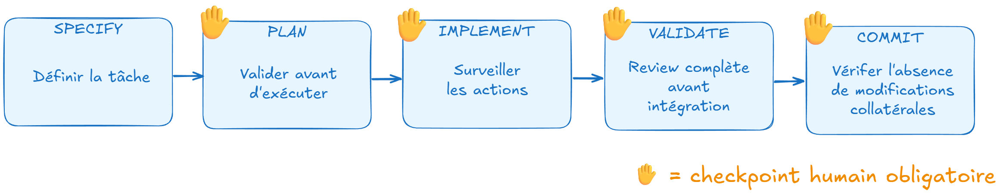

# Chapitre 5 — Workflows avancés et qualité

---

## 5.1 Gérer le contexte sur de gros projets

Les context windows atteignent aujourd'hui 1M de tokens, ce qui ne règle pas le problème. Un projet de plusieurs dizaines de milliers de lignes occupe vite plusieurs centaines de milliers de tokens, et remplir la fenêtre coûte plus cher, ralentit les réponses et dégrade l'attention (Chapitre 1). La fenêtre disponible dans un outil est en plus souvent plus basse que le maximum du modèle.

La question n'est donc pas "comment envoyer tout le projet" mais "comment orienter l'agent vers le bon contexte au bon moment". Un agent explore d'ailleurs lui-même le projet (recherche, lecture de fichiers) : votre rôle est de cadrer le périmètre et de lui donner des repères.



### Le découpage des tâches

La première règle : une tâche = un périmètre de fichiers. Plutôt que de demander à l'agent de "refactoriser le module de paiement", identifier les fichiers concernés et travailler composant par composant.

```
// Mauvais — périmètre flou, contexte trop large
"Améliore l'architecture du module de paiement"
```

```
// Mieux — périmètre explicite, contexte ciblé
"Refactorise PaymentService.ts pour extraire la logique de validation
dans un PaymentValidator séparé. Fichiers concernés : PaymentService.ts,
types/Payment.ts. Ne touche pas aux controllers."
```

### Ce qu'on met dans le contexte

Priorité décroissante pour remplir la context window :

1. **Le fichier principal de la tâche**. Obligatoire
2. **Les types et interfaces pertinents**. Le modèle doit connaître les contrats
3. **Les fichiers qui appellent ou sont appelés par le fichier principal**. Pour la cohérence des interfaces
4. **Les tests existants**. Pour comprendre les comportements attendus
5. **Le fichier de contexte projet** (`AGENTS.md` ou le fichier propre à l'outil). Injecté automatiquement si configuré

Ce qu'on n'envoie généralement pas : les fichiers utilitaires génériques, la configuration, les migrations, les assets.

Avec un agent, une partie de ces éléments est lue par l'agent lui-même. Il reste utile de lui indiquer par où commencer et ce qu'il ne doit pas toucher.

### Les techniques pour les gros projets

- **Cadrer le périmètre.** Nommez les fichiers concernés et ceux à ne pas toucher, comme dans l'exemple ci-dessus.
- **Un `AGENTS.md` par dossier dans un monorepo.** Les règles communes restent à la racine, les règles propres à un module vivent dans son dossier. Dans le standard `AGENTS.md`, les instructions du fichier le plus proche du fichier édité prennent le pas sur les autres.

```
monorepo/
├── AGENTS.md                  ← règles communes à tout le dépôt
└── packages/
    ├── payments/
    │   └── AGENTS.md          ← règles propres au module de paiement
    └── orders/
        └── AGENTS.md          ← règles propres au module de commande
```

- **Déléguer l'exploration à un subagent.** Il travaille dans un contexte isolé (Chapitre 1) et ne remonte à l'agent principal qu'un résumé, sans l'encombrer de tous les fichiers qu'il a lus.
- **Repartir d'un contexte neuf** quand la conversation s'est alourdie (voir ci-dessous).
- **Garder le fichier de contexte court.** Certains outils plafonnent la taille cumulée de ces fichiers (32 KiB par défaut pour Codex), et un fichier trop long dilue les instructions importantes (Chapitre 3).

### Saturation de la context window

Quand la context window est surchargée, le coût et le temps de réponse augmentent (Chapitre 1), et la qualité de l'attention du modèle se dégrade. Les symptômes de qualité :

- Le modèle ignore des contraintes spécifiées en début de prompt
- Les réponses deviennent moins cohérentes avec le contexte
- Le modèle "oublie" les conventions établies plus tôt dans la conversation

Le remède : redémarrer la conversation avec un contexte recentré (ou compacter l'historique quand l'outil le permet), plutôt que de continuer à accumuler dans le même fil.

---

## 5.2 Les cas à fort ROI

Certaines tâches bénéficient particulièrement de l'assistance IA. Les identifier permet de concentrer l'effort de structuration là où le gain est le plus élevé.



### Legacy comprehension

Comprendre une codebase inconnue est l'une des tâches les plus consommatrices de temps en mission. L'IA accélère ce travail de façon significative.

```
"Lis OrderService.ts et explique :
1. La responsabilité principale de cette classe
2. Les dépendances externes (services, repositories)
3. Les cas limites ou les patterns inhabituels que tu identifies
4. Ce qui te semble être de la dette technique"
```

Ce prompt produit en quelques secondes une carte de navigation dans un fichier qu'il faudrait longtemps pour lire attentivement. Sur une migration ou une reprise de projet, l'économie de temps est substantielle.

Point de vigilance : l'explication produite par le modèle reste une hypothèse. Avant de vous y fier pour modifier le code, vérifiez-la contre le code lui-même, ou avec des tests de caractérisation (des tests qui figent le comportement actuel).

### Génération de tests

La génération de tests est l'un des cas d'usage au meilleur rapport qualité/effort. Le modèle connaît les patterns de test, peut identifier les cas limites, et la validation est directe : un test qui passe ou échoue.

```
"Génère les tests Vitest pour calculateRefund() ci-dessous.
Cas à couvrir obligatoirement :
- Remboursement partiel valide
- Remboursement total valide
- Montant supérieur au total → BusinessError
- Commande déjà remboursée → BusinessError
- Commande non trouvée → BusinessError

Mocking : vi.mock() sur OrderRepository et logger.
Après génération, liste les cas que tu n'as pas couverts."
```

Point de vigilance : un test généré teste le comportement tel qu'il est implémenté, pas forcément tel qu'il devrait être. Si le code a un bug, le test généré peut passer en validant le comportement incorrect. La review des tests reste indispensable.

### Documentation

La documentation est une tâche souvent reportée en développement. L'IA en réduit le coût au point où elle peut être produite en continu plutôt qu'en rattrapage.

```
"Génère la documentation JSDoc pour les méthodes publiques de OrderService.ts.
Pour chaque méthode :
- Description en une phrase
- Paramètres avec leurs types et contraintes
- Valeur de retour
- Les BusinessErrors possibles
- Un exemple d'appel si la signature est complexe"
```

Point de vigilance : une documentation générée décrit ce que le code fait, pas ce qu'il devrait faire. Si le code a un bug, la documentation le documente. Relisez les descriptions du comportement métier.

### Refacto assistée

L'IA est efficace sur des refactos bien bornés et bien définis. Le pattern le plus fiable : extraction de fonction, renommage, changement de signature, conversion de pattern (callbacks vers async/await, class vers hooks React).

```
"Refactorise les 3 fonctions suivantes pour éliminer la duplication.
Contrainte : garde les mêmes signatures externes.
Propose d'abord l'approche avant de coder."
```

---

## 5.3 Les cas à risque

Certaines tâches nécessitent une vigilance accrue, pas parce que l'IA ne peut pas les traiter, mais parce que les conséquences d'une erreur sont plus sévères.

### Sécurité et authentification

L'IA peut générer du code d'authentification syntaxiquement correct qui contient des failles : mauvaise gestion des sessions, hashage insuffisant, vérifications manquantes sur les tokens. Les patterns de sécurité évoluent, et un modèle entraîné avant une CVE importante peut reproduire un pattern vulnérable.

Approche recommandée : l'IA génère, un audit humain valide. Pour les implémentations critiques (authentification, hachage, vérification de signatures), utiliser des bibliothèques éprouvées et maintenues plutôt que du code custom généré. Vérifiez aussi que la bibliothèque est toujours activement maintenue : cet écosystème évolue vite.

### Logique métier complexe

Plus la logique métier est spécifique au domaine, moins le modèle a de données d'entraînement pertinentes pour la générer correctement. Une règle de calcul de TVA multi-pays, une règle d'éligibilité à une prestation sociale, un algorithme de pricing dynamique : le modèle peut produire quelque chose qui ressemble à une implémentation correcte mais diverge sur des cas limites que seul quelqu'un qui connaît le domaine peut identifier.

Approche recommandée : spécification très précise avec les cas limites explicites, review ligne par ligne, tests exhaustifs écrits avant la génération (TDD).

### Architecture de système

Les décisions d'architecture (choix de patterns, organisation des modules, découpage des services) engagent le projet sur le long terme. L'IA peut suggérer, mais la décision doit rester humaine et ancrée dans la connaissance du contexte spécifique : contraintes de l'équipe, roadmap produit, historique technique.

Utiliser l'IA pour explorer des options et challenger ses propres hypothèses, pas pour déléguer la décision.

### Migrations de bases de données

Une migration mal générée peut corrompre des données de production. L'IA peut produire des migrations syntaxiquement valides qui ont des effets de bord non anticipés sur de grands volumes, ou qui ne gèrent pas correctement les valeurs nulles existantes.

Approche recommandée : l'IA génère le squelette, le développeur valide la logique, et la migration est testée sur une copie anonymisée ou pseudonymisée des données de production, ou sur un environnement de recette avec des volumes représentatifs, avant toute exécution. Des données personnelles de production n'ont pas leur place dans un environnement de test (RGPD).

### Les risques propres aux agents

Un agent ne se contente pas de générer du texte : il installe des dépendances, lit du contenu externe et exécute des commandes. Cela ajoute des risques que la génération seule n'avait pas.

- **Les dépendances inventées.** Une étude présentée à USENIX Security 2025 (16 modèles, 576 000 échantillons de code Python et JavaScript) a mesuré qu'en moyenne un cinquième des paquets recommandés n'existaient pas, et que de nombreux noms inventés revenaient d'une exécution à l'autre. Un attaquant peut alors enregistrer ces noms et y placer du code malveillant (le *slopsquatting*). Le phénomène varie selon les modèles, mais le risque n'est jamais nul.
- **L'injection de prompt.** Un agent lit des pages web, des issues, des résultats d'outils MCP. Ce contenu peut contenir des instructions qui détournent son comportement.
- **Les commandes destructrices.** Suppression de fichiers ou de données, commandes lancées sur le mauvais environnement.
- **Les secrets.** Une clé d'API présente dans le contexte ou dans un fichier lu par l'agent peut se retrouver dans une sortie ou un commit.

Les remèdes existent dans le module :

- vérifier qu'un paquet existe, qui le maintient et depuis quand avant de l'installer, plutôt que de se fier à une installation qui réussit (un paquet malveillant s'installe très bien). C'est aussi l'intérêt de la règle « ne pas installer de nouvelles dépendances sans validation » du fichier de contexte (Chapitre 3) ;
- donner à l'agent des permissions minimales et un environnement isolé ;
- bloquer automatiquement les actions critiques avec des hooks (Chapitre 3) ;
- ne configurer que des serveurs MCP d'éditeurs identifiés (Chapitre 4).

---

## 5.4 La revue de code augmentée

L'IA peut servir de premier reviewer. Avant de soumettre une PR, faire passer le diff à l'IA permet de détecter des problèmes que la fatigue ou la familiarité avec le code fait manquer. Des outils intègrent aussi cette revue directement aux pull requests (Copilot code review, Bugbot de Cursor, Devin Review, par exemple), sans prompt manuel.

### Ce que l'IA détecte bien

```
"Review ce diff en tant que reviewer senior TypeScript.
Identifie :
1. Les bugs potentiels et cas limites non gérés
2. Les problèmes de sécurité évidents
3. Les incohérences avec les patterns visibles dans le code existant
4. Les problèmes de performance sur les chemins critiques
5. Ce que tu ne peux pas évaluer sans plus de contexte

Ne commente pas le style ou le formatage."
```

L'IA est particulièrement efficace pour détecter : les null pointer potentiels, les imports manquants, les types incorrects, les patterns inhabituels qui méritent une explication. Elle repère parfois des problèmes de concurrence (race conditions), mais ceux-ci dépendent de l'exécution et ne se délèguent pas.

### Ce que l'IA détecte mal

- Les régressions fonctionnelles sur des comportements qu'elle ne connaît pas
- Les impacts sur des parties du code non incluses dans le diff
- Les problèmes de performance qui ne sont visibles qu'à l'exécution
- La conformité aux règles métier non documentées dans le code

### Les limites de l'auto-revue

Quand le même modèle relit le code qu'il vient de générer, il partage ses propres angles morts. Pour une revue plus indépendante, utilisez un contexte neuf, voire un autre modèle. Une revue IA peut aussi produire du bruit (fausses alertes) : elle éclaire la revue humaine, mais ne doit pas bloquer une PR à elle seule.

La revue IA complète la revue humaine, elle ne la remplace pas.

---

## 5.5 Human-in-the-loop

Le **human-in-the-loop** n'est pas une étape administrative, c'est le mécanisme qui transforme un générateur de code en outil professionnel.



### Quand reprendre la main

**Avant l'exécution :** valider le plan proposé par l'agent. C'est l'étape la plus rentable : quelques secondes de correction évitent potentiellement des heures de débogage.

**Pendant l'exécution :** surveiller les actions de l'agent en mode autonome. Si l'agent commence à modifier des fichiers inattendus ou à introduire des dépendances non prévues, interrompre.

**Après la génération :** review du code produit. Pas une lecture en diagonale, une review de la même qualité que sur une PR.

**Avant tout commit :** vérifier que ce qui est commité correspond à ce qui a été validé. L'agent peut avoir introduit des modifications collatérales.

### Les points de contrôle

Avec un agent autonome, il faut prévoir des points de contrôle pour les tâches longues. Ils existent à deux niveaux.

**Les checkpoints demandés dans le prompt** sont souples :

```
"Implémente la feature de gestion des remises selon le plan validé.
Checkpoint obligatoire après chaque étape du plan : présente ce que tu as fait
avant de passer à l'étape suivante. N'avance pas sans validation explicite."
```

Ce pattern ralentit l'exécution mais évite de laisser l'agent partir dans une mauvaise direction pendant plusieurs minutes. Il reste cependant une instruction : le modèle peut l'oublier ou la déprioriser (Chapitre 3).

**Les contrôles durs** s'appliquent sans dépendre du modèle :

- le **mode plan** que proposent la plupart des agents : le plan est présenté, et rien n'est exécuté avant votre validation ;
- les **validations de permission** : l'outil demande l'accord avant une commande ou une modification ;
- les **hooks** (Chapitre 3), pour bloquer automatiquement une action critique ;
- **git** : travailler sur une branche dédiée et committer à chaque étape. Chaque commit est un point de retour, et le diff d'un commit se relit facilement.

Pour une règle critique, par exemple ne jamais modifier certains fichiers, ne vous contentez pas d'un checkpoint écrit dans le prompt : utilisez un contrôle dur.

### Comprendre ce qu'on intègre

La règle fondamentale : n'intégrer que du code qu'on est capable d'expliquer. Pas nécessairement de justifier chaque choix algorithmique, mais de comprendre ce que le code fait, comment il gère les cas limites, et comment le déboguer si quelque chose échoue.

Si une section du code généré n'est pas comprise, la demande d'explication fait partie du workflow, ce n'est pas une perte de temps.

```
"Explique ce que fait exactement ce bloc. Notamment :
- Pourquoi le double await ici ?
- Que se passe-t-il si users est un tableau vide ?
- Dans quel cas cette condition est-elle fausse ?"
```

---

## 5.6 Exercice : identifier les cas d'usage

Voici une liste de tâches de développement. Pour chacune, classez-la en trois catégories : **fort ROI** (bonne candidate à une forte délégation), **risque élevé** (délégation faible, validation renforcée), ou **intermédiaire** (délégation moyenne, validation complète).

| Tâche | Votre classification |
| --- | --- |
| Générer des tests unitaires pour une fonction de calcul de remise | |
| Implémenter le hachage des mots de passe utilisateurs | |
| Documenter les méthodes publiques d'un service existant | |
| Écrire la migration SQL qui supprime une colonne utilisée en production | |
| Comprendre l'architecture d'un module legacy de 3 000 lignes | |
| Implémenter un algorithme de recommandation basé sur l'historique utilisateur | |
| Générer le boilerplate d'un nouveau controller REST | |
| Implémenter la vérification de signature des webhooks Stripe | |

<details>
<summary><strong>Correction et justifications</strong></summary>

| Tâche | Classification | Justification |
| --- | --- | --- |
| Tests unitaires (calcul de remise) | Fort ROI | Pattern bien défini, validation directe par exécution |
| Hachage des mots de passe | Risque élevé | Sécurité critique, préférer une bibliothèque éprouvée, audit obligatoire |
| Documentation JSDoc | Fort ROI | Coût faible, valeur immédiate, validation facile |
| Migration SQL (suppression colonne) | Risque élevé | Irréversible sur données de prod, tester sur une copie anonymisée ou un environnement de recette avant toute exécution |
| Legacy comprehension | Fort ROI | Gain de temps massif, la "réponse" est une explication, pas du code (à vérifier contre le code) |
| Algorithme de recommandation | Intermédiaire | Logique métier complexe : les cas limites dépendent du domaine, validation complète et review ligne par ligne |
| Boilerplate controller REST | Fort ROI | Répétitif, pattern bien défini, aucune logique critique |
| Vérification signature webhooks | Risque élevé | Sécurité critique, une erreur ouvre une surface d'attaque, préférer la bibliothèque officielle du fournisseur |

</details>

---

## ✅ Quiz — Chapitre 5

_10 questions — environ 10 minutes_

---

**Question 1.** Un agent travaille sur un projet de 80 000 lignes. Quelle est la bonne approche pour gérer le contexte ?

- A) Cadrer un périmètre de fichiers par tâche et lui donner des repères (types, fichiers liés, fichier de contexte), plutôt que de tout lui fournir
- B) Envoyer l'intégralité du projet à chaque échange pour que l'agent ait toujours le contexte complet
- C) Ne jamais lui donner plus d'un fichier à la fois pour éviter la saturation
- D) Ne rien cadrer : l'agent explorera de toute façon tout le projet sans conséquence

> ✅ **Réponse : A** — Même avec une grande context window, remplir le contexte coûte plus cher, ralentit les réponses et dégrade l'attention. Un projet de cette taille représente par ailleurs de l'ordre d'un million de tokens ou plus. Un agent explore lui-même le projet, mais il travaille mieux avec un périmètre explicite et des repères. Un fichier à la fois (C) est trop restrictif pour les tâches qui touchent plusieurs composants, et ne rien cadrer (D) laisse l'agent se disperser.

---

**Question 2.** Quel est un symptôme de qualité d'une context window surchargée ?

- A) Le modèle refuse de répondre et demande de vider la conversation
- B) Le modèle se met à répondre dans une autre langue
- C) Le modèle ignore des contraintes spécifiées plus tôt, et ses réponses deviennent incohérentes avec le contexte établi
- D) La température du modèle augmente

> ✅ **Réponse : C** — Une context window surchargée dégrade la qualité de l'attention : le modèle ignore des contraintes spécifiées en début de prompt, et ses réponses deviennent moins cohérentes. Le coût et le temps de réponse augmentent aussi, mais ce sont des effets de coût, pas de qualité. Le remède est de redémarrer la conversation avec un contexte recentré, ou de compacter l'historique.

---

**Question 3.** Pourquoi la génération de tests est-elle considérée comme un cas à fort ROI ?

- A) Parce que les tests générés sont toujours corrects et ne nécessitent pas de validation
- B) Parce que le pattern est bien défini, le modèle connaît les conventions de test, et la validation est directe : le test passe ou échoue
- C) Parce que les tests générés ont une couverture de code supérieure aux tests écrits manuellement
- D) Parce que l'IA peut tester des cas limites que les développeurs n'auraient pas pensé à couvrir

> ✅ **Réponse : B** — Le fort ROI vient de la combinaison : pattern bien défini (le modèle est entraîné sur des millions de tests), et validation directe et objective. A est faux, la review des tests reste indispensable, notamment pour s'assurer que les tests ne valident pas un comportement incorrect.

---

**Question 4.** Un développeur demande à l'IA de générer l'implémentation complète d'un système d'authentification JWT pour une nouvelle API. Quelle est la bonne posture ?

- A) Accepter la génération si le code compile et que les tests passent
- B) Refuser. L'IA ne peut pas générer du code de sécurité correct
- C) Demander à un modèle avec un effort de réflexion élevé de la générer : c'est une garantie de sécurité
- D) Utiliser la génération comme point de départ, auditer systématiquement chaque mécanisme de sécurité, et privilégier les bibliothèques éprouvées pour les parties critiques

> ✅ **Réponse : D** — L'IA peut générer une implémentation JWT syntaxiquement correcte qui contient des failles. La bonne approche est de traiter la génération comme un point de départ, d'auditer chaque mécanisme, et de s'appuyer sur des bibliothèques éprouvées et maintenues pour les parties les plus sensibles. Un effort de réflexion élevé (C) améliore le raisonnement, il ne garantit pas la sécurité. Un code qui compile et passe ses tests (A) peut rester vulnérable.

---

**Question 5.** Quelle instruction dans un prompt de review de code est particulièrement utile pour cibler l'analyse ?

- A) "Review tout le code et identifie tous les problèmes possibles"
- B) "Identifie les bugs potentiels, les problèmes de sécurité, les incohérences avec les patterns existants, et ce que tu ne peux pas évaluer sans plus de contexte"
- C) "Donne une note de qualité au code de 1 à 10"
- D) "Compare ce code avec les meilleures pratiques de l'industrie"

> ✅ **Réponse : B** — Demander explicitement ce que l'agent ne peut pas évaluer sans plus de contexte est particulièrement utile : cela identifie les angles morts de la review et guide les vérifications manuelles complémentaires. A est trop vague. C et D produisent des analyses peu actionnables.

---

**Question 6.** Lors d'une tâche longue confiée à un agent, quelle instruction améliore le contrôle humain sans interrompre complètement l'autonomie de l'agent ?

- A) "Arrête-toi après chaque fichier modifié"
- B) "Travaille en mode lecture seule et propose les modifications sans les appliquer"
- C) "Présente ce que tu as fait après chaque étape du plan et attends une validation explicite avant de continuer"
- D) "Limite-toi à 100 lignes de code par réponse"

> ✅ **Réponse : C** — Les checkpoints après chaque étape du plan permettent de valider la progression sans interrompre à chaque ligne. B est trop restrictif pour les tâches de génération. A crée trop d'interruptions. D est arbitraire et ne correspond pas à la logique des tâches.

---

**Question 7.** Un développeur intègre un bloc de code généré par l'IA qu'il ne comprend pas entièrement, mais qui "semble fonctionner". Quel est le risque principal ?

- A) Le développeur ne pourra pas déboguer, maintenir ou expliquer ce code si un problème survient
- B) Le code sera détecté comme généré par IA lors d'un audit
- C) La performance sera dégradée car le code généré est rarement optimisé
- D) Le code introduira des dépendances non autorisées par la politique de l'organisation

> ✅ **Réponse : A** — Intégrer du code non compris, c'est créer une dette de compréhension : le développeur ne peut pas déboguer le code si quelque chose échoue, ni l'expliquer lors d'une revue ou d'un handover. C'est la définition du vibe coding appliquée à l'intégration.

---

**Question 8.** Pour quelle raison la review IA ne remplace-t-elle pas la review humaine ?

- A) Parce que les outils IA ne sont pas encore suffisamment performants pour ce cas d'usage
- B) Parce que l'IA ne peut pas accéder au diff d'une PR
- C) Parce que les reviewers humains sont plus rapides sur les PR simples
- D) Parce que l'IA ne détecte pas les régressions fonctionnelles sur des comportements non documentés dans le code, ni les impacts sur des parties non incluses dans le diff

> ✅ **Réponse : D** — La review IA est efficace sur ce qui est visible dans le code : bugs, patterns, sécurité évidente. Elle ne peut pas évaluer les régressions fonctionnelles sur des comportements métier non documentés, ni les impacts sur des parties du système absentes du diff. La complémentarité est la bonne approche.

---

**Question 9.** Un agent propose d'installer une dépendance que vous ne connaissez pas. Que faites-vous ?

- A) Vous acceptez, puisque l'installation réussit
- B) Vous vérifiez que le paquet existe, qui le maintient, depuis quand, et s'il est vraiment nécessaire, avant de valider
- C) Vous acceptez, car l'agent semble sûr de lui
- D) Vous demandez à l'agent de la désinstaller après l'avoir utilisée

> ✅ **Réponse : B** — Les modèles inventent des noms de paquets, et un attaquant peut enregistrer ces noms pour y placer du code malveillant. Une installation qui réussit ne prouve rien : un paquet malveillant s'installe très bien. La confiance affichée par l'agent (C) n'est pas un critère, et la désinstallation (D) arrive après l'exécution éventuelle de code malveillant.

---

**Question 10.** Pourquoi un checkpoint demandé dans un prompt ne suffit-il pas pour une règle critique, par exemple ne jamais modifier certains fichiers ?

- A) Parce que c'est une instruction que le modèle peut oublier ou déprioriser : une règle critique relève d'un contrôle automatique (hook, validation de permission)
- B) Parce que les agents ne comprennent pas les prompts de checkpoint
- C) Parce que les checkpoints ralentissent trop l'agent
- D) Parce que seuls les humains peuvent lire les messages de checkpoint

> ✅ **Réponse : A** — Une instruction dans un prompt reste probabiliste (Chapitre 3). Pour une règle qui doit s'appliquer à chaque fois, il faut un contrôle qui ne dépend pas du modèle : mode plan, validation de permission, hook, ou revue du diff avant chaque commit. B est faux, les agents comprennent ces consignes. C et D ne répondent pas à la question de la fiabilité.
