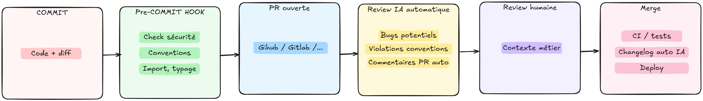
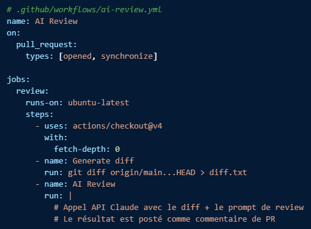
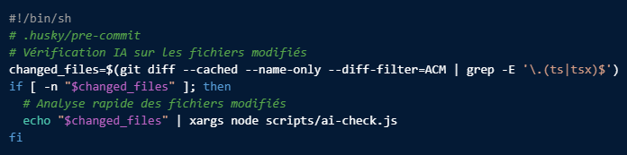

# Chapitre 6 — Développement en équipe augmentée

---

## 6.1 Du usage individuel à la pratique d'équipe

L'usage individuel de l'IA est facile à démarrer : un développeur installe Copilot, commence à utiliser Claude Code, et voit des gains immédiats sur ses tâches quotidiennes. Le passage à une pratique d'équipe cohérente est une étape différente, qui demande une coordination intentionnelle.

Sans coordination, plusieurs problèmes émergent : chaque développeur a ses propres conventions de prompt, les fichiers de contexte sont absents ou incohérents, les nouveaux arrivants ne bénéficient pas des apprentissages de l'équipe, et les risques (sécurité du code, shadow IT) ne sont pas adressés collectivement.

L'objectif de ce chapitre est de couvrir les pratiques qui permettent de capitaliser sur l'usage individuel et de le transformer en avantage collectif.

---

## 6.2 Les fichiers de contexte d'équipe

Un fichier de contexte projet bien maintenu est le premier investissement collectif à faire. Il bénéficie immédiatement à tous les membres de l'équipe et aux nouveaux arrivants, sans qu'ils aient besoin de le configurer eux-mêmes.

Ce fichier vit aujourd'hui dans `AGENTS.md` à la racine du projet (Chapitre 3) — pas besoin de le dupliquer par outil.

### Contenu recommandé pour un fichier d'équipe

```markdown
# Contexte projet — [Nom du projet]

## Stack technique

- Node.js 20, TypeScript 5.x strict mode
- Framework : NestJS 10
- ORM : Prisma 5 (PostgreSQL en prod, SQLite en dev)
- Tests : Vitest + Supertest pour les tests d'intégration
- Linting : ESLint + Prettier (config dans .eslintrc.json)

## Architecture

- Structure : modules NestJS (feature-based, pas technique)
- Un module = un domaine métier (orders, users, payments…)
- Les DTOs sont validés avec class-validator
- Les erreurs applicatives héritent de AppException (src/common/exceptions)

## Conventions

- Nommage : camelCase variables/fonctions, PascalCase classes/interfaces, UPPER_SNAKE_CASE constantes
- Les services ne doivent pas importer d'autres services directement — passer par les modules NestJS
- Pas de console.log: logger.log() / logger.error() de NestJS
- Les transactions Prisma sont obligatoires dès qu'on touche à plusieurs tables
- Imports de types : import type { … }

## Ne pas faire

- Ne pas modifier les migrations Prisma existantes, créer une nouvelle migration
- Ne pas ajouter de dépendances sans validation de l'équipe
- Ne pas générer de clés secrètes ou de credentials dans le code
```

### Ce qui rend ce fichier utile

Sa valeur augmente avec sa précision. Un fichier qui dit "utilise TypeScript strict" apporte peu. Un fichier qui dit "les transactions Prisma sont obligatoires dès qu'on touche à plusieurs tables" évite une classe entière de bugs.

Les sections les plus utiles en pratique :

- Les contraintes non évidentes ("ne pas importer de services directement")
- Les patterns propres au projet ("les erreurs héritent de AppException")
- Ce qu'il ne faut explicitement pas faire

### Maintenance

Le fichier de contexte doit être versionné dans le repository et maintenu comme n'importe quel autre fichier de configuration. Il se dégrade rapidement si personne n'est responsable de le mettre à jour quand l'architecture évolue.

Une bonne pratique : l'inclure dans la checklist de revue des PRs qui modifient l'architecture ou les conventions.

---

## 6.3 Les prompts partagés

Certains prompts reviennent régulièrement dans une équipe : génération de tests selon les conventions du projet, review de PR, documentation d'un service, migration de patterns. Les factoriser économise du temps et homogénéise les résultats.

### Formats de partage

**Fichier de prompts dans le repository :**

```
.prompts/
  review-pr.md
  generate-tests.md
  document-service.md
  migrate-callbacks-to-async.md
```

Chaque fichier contient le prompt complet avec les variables à substituer marquées entre accolades.

**Exemple — `generate-tests.md` :**

```markdown
Génère les tests Vitest pour {NOM_FONCTION} dans {NOM_FICHIER}.

Contexte :

- Tests d'intégration avec Supertest si c'est un controller
- Tests unitaires avec vi.mock() si c'est un service
- Utiliser les factories de test disponibles dans test/factories/

Cas à couvrir obligatoirement :

- Cas nominal
- Entrées invalides (validation class-validator)
- Entité non trouvée → NotFoundException
- Erreur de permission → ForbiddenException

Après génération, liste les cas que tu n'as pas couverts.
```

### Prompts de review

Un prompt de review standardisé produit des reviews plus cohérentes et permet à l'IA de connaître les patterns propres au projet :

```markdown
Review ce diff en tant que reviewer senior NestJS/Prisma.

Contexte projet :

- Les transactions Prisma sont obligatoires dès qu'on touche plusieurs tables
- Les erreurs applicatives doivent hériter de AppException
- Les services ne s'importent pas directement — tout passe par les modules

Identifie :

1. Les violations des conventions projet listées ci-dessus
2. Les bugs potentiels et cas limites non gérés
3. Les problèmes de sécurité évidents
4. Ce que tu ne peux pas évaluer sans plus de contexte

Ne commente pas le style ou le formatage (géré par ESLint/Prettier).
```

### Vers un plugin d'équipe

Ce même besoin — factoriser les prompts récurrents, les partager, les maintenir à jour — se package aujourd'hui différemment : plutôt qu'un dossier `.prompts/` à copier-coller entre postes, un **plugin d'équipe** (Chapitre 4) distribué depuis un dépôt Git interne.

La correspondance est directe :

- `generate-tests.md` devient `skills/generate-tests/SKILL.md`
- `review-pr.md` devient `skills/review-pr/SKILL.md`, ou une slash command si l'équipe préfère l'invoquer explicitement
- Un hook peut compléter le tout : relancer automatiquement la suite de tests après une session d'édition, sans dépendre du fait que le développeur (ou l'agent) y pense

L'intérêt par rapport au dossier de prompts : versioning, installation en une commande pour chaque nouvel arrivant, et cohérence garantie — impossible d'utiliser une version périmée d'un prompt qu'on a oublié de re-copier.

---

## 6.4 Onboarding accéléré

L'onboarding sur un projet existant est l'une des tâches les plus consommatrices de temps. Un nouveau développeur sur une mission passe typiquement une à deux semaines à comprendre l'architecture, les conventions, et les patterns spécifiques du projet avant d'être pleinement productif.

L'IA réduit ce temps de façon significative sur plusieurs dimensions.

### Exploration de l'architecture

```
"Lis les fichiers src/modules/orders/ et explique :
1. La responsabilité de chaque fichier
2. Le flux d'une requête de création de commande de bout en bout
3. Les dépendances externes de ce module
4. Ce qui te semble être de la dette technique ou des patterns inhabituels"
```

Ce prompt sur un module de 15 fichiers produit en quelques secondes une carte de navigation qui aurait demandé plusieurs heures de lecture.

### Questions sur le codebase

Un nouveau développeur peut interroger la codebase en langage naturel :

```
"Dans ce projet, comment est gérée l'authentification ?
Quels fichiers sont concernés ?"

"Pourquoi y a-t-il deux services de paiement (PaymentService et LegacyPaymentService) ?
Lequel utiliser pour une nouvelle feature ?"

"Comment lancer les tests d'intégration en local ?"
```

Ces questions, sans l'IA, requièrent de trouver la bonne personne disponible ou de fouiller la documentation, si elle existe.

### CLAUDE.md comme guide d'onboarding

Un fichier de contexte bien rédigé sert également de documentation d'onboarding. Un nouveau développeur qui lit le `instructions.md` lors de sa première journée comprend immédiatement la stack, les conventions, et les patterns du projet. La maintenance est mutualisée : un seul fichier sert à la fois à l'IA et aux humains.

---

## 6.5 Intégration CI/CD

L'IA peut intervenir à plusieurs étapes d'un pipeline CI/CD pour automatiser des tâches de qualité qui sont aujourd'hui souvent sautées par manque de temps.



Ces mécanismes rejoignent la notion de hook vue au Chapitre 1 : plutôt que d'espérer qu'un développeur — ou un agent — pense à lancer une vérification, l'automatiser au niveau du cycle de vie (commit, session d'édition) la rend systématique plutôt que probabiliste.

### Review automatisée sur les PRs

Un script de review automatique en pre-PR qui analyse le diff et poste un commentaire synthétique avant la review humaine :



### Génération de changelog

À chaque merge sur main, analyser les commits et générer une entrée de changelog structurée :

```
Analyse ces commits et génère une entrée de changelog en markdown.
Format : une ligne par changement, catégorisé en Added / Changed / Fixed / Removed.
Audience : développeurs qui consomment cette API.

Commits : {LISTE_DES_COMMITS}
```

### Pre-commit hooks

Des hooks pre-commit qui lancent une vérification rapide sur les fichiers modifiés :



---

## 6.6 Risques collectifs

### Propriété intellectuelle du code généré

La question de la propriété intellectuelle du code généré par l'IA n'est pas encore complètement stabilisée juridiquement. Les points à connaître :

- La plupart des outils (Copilot, Claude Code) spécifient dans leurs CGU que le code généré appartient à l'utilisateur
- Certains contrats clients incluent des clauses sur l'utilisation d'outils IA, les lire avant de déployer sur un projet
- Copilot a un filtre de détection de code similaire aux données d'entraînement (option activable sur Copilot Business/Enterprise)

### Dépendance aux outils

Une équipe qui a entièrement externalisé sa compréhension du code vers l'IA crée une dépendance fragile. Si l'outil change de pricing, de politique, ou devient indisponible, la capacité à travailler sans assistance dégradée est un indicateur de santé de l'équipe.

La pratique de l'agentic coding (comprendre ce qu'on intègre) est la meilleure protection contre cette dépendance.

### Homogénéisation des pratiques

L'IA tend à produire du code dans les patterns les plus courants de ses données d'entraînement. Sur un projet qui a des conventions spécifiques ou qui utilise des patterns moins répandus, le modèle va régulièrement produire du code "standard" qui ne respecte pas les conventions du projet.

La solution est le fichier de contexte d'équipe, mais il doit être maintenu activement. Un fichier de contexte obsolète est pire que pas de fichier : il donne au modèle des informations incorrectes sur l'architecture.

### Plugins et marketplaces : un nouveau vecteur à évaluer

Un plugin partagé peut embarquer des hooks (donc des scripts exécutés automatiquement) et des serveurs MCP. L'installer depuis un marketplace public sans le relire, c'est accepter d'exécuter du code tiers avec les permissions du développeur — le même risque déjà signalé pour MCP (Chapitre 4), mais étendu à toute la configuration de l'agent. Règle pratique : pour une équipe, ne référencer que des marketplaces internes ou des plugins explicitement revus, jamais un plugin installé au hasard depuis un lien trouvé en ligne.

### Sécurité du code en équipe

Les risques de sécurité s'additionnent à l'échelle d'une équipe :

- Plusieurs développeurs qui utilisent des outils non validés simultanément
- Des tokens d'API qui se retrouvent dans des prompts
- Des patterns de sécurité incorrects propagés à travers plusieurs PRs avant d'être détectés

Une politique d'équipe claire sur les outils autorisés et un processus de review qui inclut une attention particulière aux sections de sécurité sont les réponses pratiques.

---

## 6.7 Ce que ça change pour les missions

### Ce que vous allez observer en arrivant sur un projet

En mission, la situation la plus fréquente n'est pas un client qui a tout structuré, c'est un projet où certains développeurs utilisent des outils IA de façon informelle, sans fichier de contexte, sans conventions partagées, et où personne n'a encore défini ce qui est autorisé ou non.

Les situations concrètes à anticiper :

- L'équipe n'a pas de fichier de contexte projet : le mettre en place est une contribution immédiate à forte valeur, pas une demande de la hiérarchie
- Les conventions IA ne sont pas documentées : les clarifier avec le tech lead avant de commencer à générer du code
- Certains membres de l'équipe font du vibe coding sans s'en rendre compte : l'agentic coding que vous pratiquez sera visible dans la qualité de vos PRs
- La politique sur les outils IA autorisés n'est pas définie côté client : poser la question explicitement, ne pas supposer que l'absence de politique vaut autorisation

### Intégrer une pratique sans l'imposer

Arriver avec des outils et des pratiques que les autres membres de l'équipe n'ont pas n'est pas une position facile. L'approche qui fonctionne : montrer plutôt qu'expliquer.

Un fichier de contexte bien rédigé que vous proposez d'ajouter au repo, un prompt de review que vous partagez après avoir trouvé un bug qu'il aurait détecté, une explication claire sur pourquoi vous avez modifié le plan de l'agent avant d'exécuter : ce sont des démonstrations concrètes qui créent de l'intérêt sans créer de friction.

---

## ✅ Quiz — Chapitre 6

---

**Question 1.** Quel est le premier investissement collectif recommandé quand une équipe veut structurer son usage de l'IA ?

- A) Choisir et standardiser un seul outil IA pour toute l'équipe
- B) Mettre en place un fichier de contexte projet versionné dans le repository
- C) Former tous les membres de l'équipe au prompt engineering
- D) Intégrer une review IA dans le pipeline CI/CD

> ✅ **Réponse : B** — Le fichier de contexte projet est le premier investissement car il bénéficie immédiatement à tous les membres sans configuration individuelle, améliore la qualité des générations pour toute l'équipe, et sert également de documentation d'onboarding.

---

**Question 2.** Dans un fichier de contexte d'équipe, quel type d'information apporte le plus de valeur ?

- A) Les descriptions fonctionnelles des features du projet
- B) Les informations génériques sur le langage (TypeScript strict, ESLint…)
- C) Les contraintes non évidentes et les patterns propres au projet ("les transactions Prisma sont obligatoires dès qu'on touche plusieurs tables")
- D) La liste des membres de l'équipe et leurs spécialités

> ✅ **Réponse : C** — Les contraintes non évidentes sont celles que le modèle ne peut pas deviner et qui préviennent des classes entières de bugs ou de violations de conventions. Les informations génériques (TypeScript strict) sont peu différenciantes, le modèle les connaît déjà.

---

**Question 3.** Pourquoi un fichier de contexte obsolète est-il potentiellement pire que pas de fichier du tout ?

- A) Parce qu'il ralentit le modèle qui doit traiter plus de tokens
- B) Parce qu'il donne au modèle des informations incorrectes sur l'architecture, ce qui produit du code cohérent avec une réalité qui n'existe plus
- C) Parce que les développeurs ne le lisent plus et cessent de le maintenir
- D) Parce qu'il peut entrer en conflit avec les instructions du système prompt de l'outil

> ✅ **Réponse : B** — Un fichier de contexte obsolète oriente activement le modèle dans la mauvaise direction : il va générer du code cohérent avec une architecture ou des conventions qui ont évolué, ce qui crée des incohérences difficiles à identifier.

---

**Question 4.** Un nouveau développeur arrive sur une mission. Il utilise l'IA pour explorer l'architecture du module de paiement en une heure. Sans l'IA, cette exploration lui aurait pris une demi-journée. Qu'est-ce que cela illustre ?

- A) L'IA remplace la documentation du projet
- B) L'IA réduit le temps de montée en charge sur une codebase inconnue, libérant du temps pour des tâches à plus forte valeur ajoutée
- C) L'IA est plus efficace que les développeurs seniors pour expliquer l'architecture
- D) La documentation du projet est devenue inutile si on a l'IA

> ✅ **Réponse : B** — L'IA accélère la compréhension d'une codebase existante, ce qui est une des tâches les plus consommatrices de temps en début de mission. B est correct — cela libère du temps. A et D sont faux : l'IA ne remplace pas la documentation, elle s'appuie dessus.

---

**Question 5.** Une équipe a un dossier `.prompts/` avec des prompts de tests et de review. Un plugin d'équipe propose exactement le même contenu, packagé en skills. Quel avantage concret le plugin apporte-t-il que le dossier ne peut pas offrir ?

- A) Les skills produisent des réponses de meilleure qualité que n'importe quel prompt
- B) Le plugin s'installe en une commande, est versionné, et garantit qu'aucun développeur n'utilise une version périmée d'un prompt
- C) Un plugin ne peut contenir que des skills, jamais de prompts de review
- D) Le dossier `.prompts/` n'est lisible par aucun outil IA

> ✅ **Réponse : B** — La différence n'est pas la qualité des réponses générées (A est faux, c'est le même contenu), mais la distribution : installation en une commande, versioning, cohérence garantie entre les postes de l'équipe. C et D sont des affirmations fausses sur les plugins et les dossiers de prompts.

---

**Question 6.** Un développeur ESN arrive sur une mission et constate que l'équipe n'a pas de fichier de contexte projet et que les conventions IA ne sont pas documentées. Quelle est la bonne approche ?

- A) Attendre que le tech lead prenne l'initiative avant d'agir
- B) Configurer son propre fichier de contexte en local sans le partager pour ne pas créer de friction
- C) Clarifier avec le tech lead ce qui est autorisé, puis proposer de mettre en place un fichier de contexte partagé dans le repo
- D) Utiliser les outils IA sans fichier de contexte — c'est optionnel et ça fonctionne sans

> ✅ **Réponse : C** — Clarifier les autorisations d'abord, puis proposer concrètement plutôt qu'attendre. Un fichier de contexte partagé dans le repo est une contribution immédiate à forte valeur. Le garder en local (B) prive l'équipe du bénéfice et crée une asymétrie sans raison.

---

**Question 7.** Concernant la propriété intellectuelle du code généré, quelle affirmation est correcte ?

- A) Le code généré par l'IA appartient systématiquement à l'éditeur de l'outil
- B) La question est entièrement résolue juridiquement depuis 2024
- C) La plupart des outils spécifient dans leurs CGU que le code généré appartient à l'utilisateur, mais certains contrats clients peuvent inclure des clauses spécifiques sur l'usage de l'IA
- D) Le code généré par l'IA est dans le domaine public et n'appartient à personne

> ✅ **Réponse : C** — La situation standard est que les CGU des outils attribuent le code à l'utilisateur, mais la question n'est pas entièrement stabilisée juridiquement. Et surtout, les contrats clients peuvent inclure des clauses spécifiques qui doivent être vérifiées avant d'utiliser l'IA sur un projet.

---

**Question 8.** Quel est le meilleur indicateur qu'une équipe a une pratique d'agentic coding saine par rapport à la dépendance aux outils IA ?

- A) L'équipe utilise au moins trois outils IA différents
- B) Les développeurs peuvent expliquer et déboguer le code qu'ils ont intégré, même s'il a été généré par l'IA
- C) L'équipe n'utilise l'IA que pour les tâches répétitives
- D) Le taux de couverture de tests est supérieur à 80%

> ✅ **Réponse : B** — La capacité à expliquer et déboguer le code intégré est l'indicateur clé. Si un développeur ne peut pas déboguer un bloc qu'il a commité parce qu'il ne comprend pas ce qu'il fait, l'équipe a une dépendance problématique, indépendamment du taux de couverture ou du nombre d'outils utilisés.
